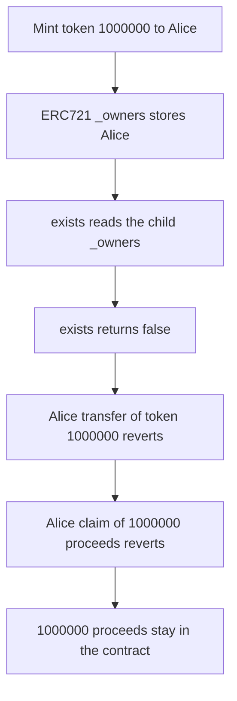

# Fantium: shadowed `_owners` locks the real owner of token 1000000

> **Vulnerability classes:** vuln/access-control/proxy-storage-collision · vuln/access-control/missing-owner-check

<!-- non-defihacklabs -->
<!-- source-auditvault: https://github.com/Auditware/AuditVault/blob/main/findings/28052-fantiumnftv1-owners-shadows-erc721upgradeable-owners-mixbyte.md -->
<!-- date: 2023-01 -->

## Key info

| | |
|---|---|
| **Protocol** | Fantium |
| **Finding** | MixBytes Fantium, AuditVault 28052 |
| **Vulnerable code** | `FantiumNFTV1.exists` |
| **Harm** | Token 1000000 stays with Alice and 1000000 proceeds stay in the contract. `exists` is false, so her transfer and her claim both revert |
| **Chain** | local synthetic |

## TL;DR

`FantiumNFTV1` declares `mapping(uint256 => address) internal _owners`, which hides `ERC721Upgradeable`'s private `_owners`. Mint writes the parent mapping. `exists` reads the child mapping and returns false for token 1000000. Alice is the ERC721 owner and cannot transfer the token or claim 1000000 proceeds. A control with one owner mapping lets Alice claim the 1000000 and transfer token 1000000. A non-owner still cannot.

## The vulnerable code

The function MixBytes quotes, with the child mapping that causes it:

```solidity
mapping(uint256 => address) internal _owners;

function exists(uint256 _tokenId) public view returns (bool) {
    // @> VULN: reads FantiumNFTV1._owners, which mint never writes
    return _owners[_tokenId] != address(0);
}
```

`mint` calls ERC721 `_mint`, which assigns the parent `_owners[tokenId] = to`. That write is a different storage slot. After minting token 1000000 to Alice, `ownerOf` is Alice and `exists` is false. `transferFrom` and `claim` both `require(exists(tokenId))`, so both revert.

The control deletes the second mapping. `exists` reads the same slot mint writes. Alice's claim pays 1000000 and her transfer moves token 1000000 to Bob. The same transfer attempted by another caller reverts.

## Root cause

Solidity name shadowing. The child state variable does not replace the parent's slot. Every Fantium read of `_owners` misses the ERC721 owner that `_mint` stored.

## Preconditions

Token 1000000 has been minted through ERC721 `_mint` to Alice. 1000000 proceeds sit on the NFT contract. No second owner mapping is written. No timestamp change.

## Attack walkthrough

1. Mint 1000000 proceeds onto the NFT contract. See [output.txt](output.txt).
2. Mint token 1000000 to Alice. ERC721 `ownerOf` is Alice.
3. `exists(1000000)` reads the shadowed mapping and returns false.
4. Alice's `transferFrom` reverts on `require(exists(1000000))`. `ownerOf` is still Alice.
5. Alice's `claim` reverts on the same check. The contract balance stays 1000000.
6. The control uses one mapping. `exists` is true, Alice receives 1000000, token 1000000 moves to Bob, and a non-owner transfer returns false.

## Diagrams



## Impact

Alice owns token 1000000 according to ERC721 and cannot move it. The 1000000 sale proceeds accounted to that token stay in the contract because `claim` uses `exists`. The control pays Alice 1000000 and lets her transfer token 1000000. A caller who is not that owner cannot take it.

## Remediation

Delete `FantiumNFTV1._owners`. Implement `exists` with `ownerOf(tokenId) != address(0)`, which is the single ERC721 owner mapping.

## How to reproduce

```bash
cd 28052-fantiumnftv1-owners-shadows-erc721upgradeable-owners-mixbyte_exp
forge test -vv
```

## Sources

- AuditVault finding: https://github.com/Auditware/AuditVault/blob/main/findings/28052-fantiumnftv1-owners-shadows-erc721upgradeable-owners-mixbyte.md
- MixBytes report: https://github.com/mixbytes/audits_public/blob/master/Fantium/Fantium/README.md#4-fantiumnftv1_owners-shadows-erc721upgradeable_owners
- Vulnerable exists: https://github.com/metaxu-art/fantium-smart-contracts/blob/cb2d97bc30c40321991fe5ab8fc798babba1610f/contracts/FantiumNFTV1.sol#L245-L248
- Repo: metaxu-art/fantium-smart-contracts@cb2d97bc30c40321991fe5ab8fc798babba1610f
- Synthetic: [test/28052-fantiumnftv1-owners-shadows-erc721upgradeable-owners-mixbyte.sol](test/28052-fantiumnftv1-owners-shadows-erc721upgradeable-owners-mixbyte.sol)
