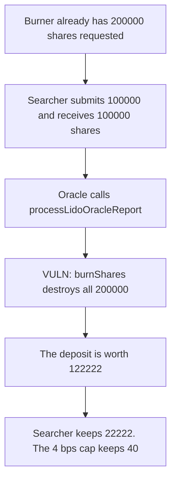

# Lido — an uncapped share burn can be taken by a fresh deposit

> **Vulnerability classes:** vuln/defi/sandwich-attack · vuln/logic/price-calculation

<!-- non-defihacklabs -->
<!-- source-auditvault: https://github.com/Auditware/AuditVault/blob/main/findings/28161-possibility-of-taking-burned-shares-mixbytes-none-lido-markd.md -->
<!-- date: 2022-01 -->

## Key info

| | |
|---|---|
| **Protocol** | Lido |
| **Finding** | MixBytes, AuditVault 28161 |
| **Vulnerable code** | `processLidoOracleReport` calls `burnShares` for the full request |
| **Harm** | A 100000 deposit becomes worth 122222. The depositor keeps 22222. The 4 bps cap leaves an excess of 40. |
| **Chain** | local synthetic (audited Ethereum contracts) |

## TL;DR

`SelfOwnedStETHBurner.processLidoOracleReport` burns every requested share in one report. Burning shares does not reduce pooled ether, so the stETH rate jumps. A searcher who holds nothing beforehand can submit in front of that report and keep the jump. Here 200000 shares are burned, a 100000 deposit is worth 122222, and 22222 stays after principal is returned. LIP-6 caps one run at 4 basis points. That cap burns 440 shares and the excess is 40.

## The vulnerable code

`SelfOwnedStETHBurner.sol` L252. The counters are zeroed and then the whole sum is burned. There is no `maxBurnAmountPerRunBasisPoints`.

```solidity
if (memNonCoverSharesBurnRequested > 0) {
    totalNonCoverSharesBurnt += memNonCoverSharesBurnRequested;
    nonCoverSharesBurnRequested = 0;
}

// @> VULN: the whole requested amount is burned in this report. No per-run cap.
ILido(LIDO).burnShares(address(this), burnAmount);
```

## Root cause

`burnShares` decreases `totalShares` and leaves `totalPooledEther` unchanged. Every share outstanding at that moment is worth more stETH. The report does not limit how large that rebase is, so arriving in the same transaction as the report is enough. The searcher does not need a position from before the report.

## Preconditions

The burner already holds 200000 shares and `coverSharesBurnRequested` is 200000. The pool starts at 1000000 shares and 1000000 pooled ether. The caller of the report is the oracle. The searcher submits 100000 in the same call, before the burn.

## Attack walkthrough

1. The searcher's stETH balance is 0. The burn is already requested.
2. `submit` of 100000 mints 100000 shares at a rate of 1. Total shares are 1100000. Pooled ether is 1100000.
3. The oracle calls `processLidoOracleReport`.
4. `burnShares` destroys 200000 shares. Total shares are 900000. Pooled ether stays 1100000.
5. The 100000 shares are worth `100000 * 1100000 / 900000 = 122222`.
6. The excess over the 100000 principal is 22222.
7. Shares worth the principal are transferred out. 22222 stETH remains.

Control uses the LIP-6 quota, 4 basis points of total shares: `1100000 * 4 / 10000 = 440`. The same deposit is then worth 100040. The excess is 40, not 22222.

## Diagrams



## Impact

A depositor who was not in the pool takes 22222 of the positive rebase caused by burning 200000 shares. Existing holders share a smaller rate increase. With the 4 bps cap the same deposit extracts 40.

## Remediation

Cap the shares burned in one `processLidoOracleReport`, as LIP-6 does with `maxBurnAmountPerRunBasisPoints`. The initial value discussed there is 4 basis points, so one report cannot move the rate enough to pay for a sandwich.

## How to reproduce

```bash
cd 28161-possibility-of-taking-burned-shares-mixbytes-none-lido-markd_exp
forge test -vv
```

## Sources

- AuditVault finding: https://github.com/Auditware/AuditVault/blob/main/findings/28161-possibility-of-taking-burned-shares-mixbytes-none-lido-markd.md
- MixBytes report: https://github.com/mixbytes/audits_public/blob/master/Lido/In-protocol%20Coverage/README.md
- Audited file: `contracts/0.8.9/SelfOwnedStETHBurner.sol` at `ee1991b3bbea2a24b042b0a4433be04301992656` L252
- Cap: https://github.com/lidofinance/lido-improvement-proposals/blob/develop/LIPS/lip-6.md
