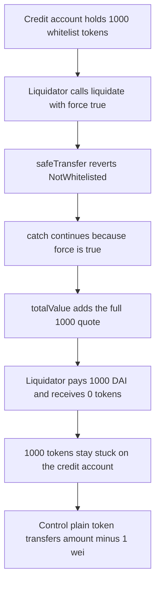

# Gearbox V1 — a failed whitelist transfer is still added to `totalValue`

> **Vulnerability classes:** vuln/logic/liquidation-logic · vuln/logic/missing-check · vuln/dos/frozen-funds

<!-- non-defihacklabs -->
<!-- source-auditvault: https://github.com/Auditware/AuditVault/blob/main/findings/28208-using-tokens-with-whitelist-function-mixbytes-none-gearbox-p.md -->
<!-- date: 2021-12 -->

> **Reproduction:** Cheatcode-free synthetic of `CreditManager._transferAssetsTo` / `_safeTokenTransfer`. A whitelist token reverts, `force` swallows it, and `totalValue += tv` still runs. 1,000 tokens stay stuck. A plain token on the same path is delivered.

## Key info

| | |
|---|---|
| **Loss** | 1,000 WUSD stuck on the credit account (`output.txt:10`) while the liquidator is charged 1,000 DAI (`output.txt:11`) and receives 0 WUSD. The plain-token control delivers `1000000000000000000000 - 1` wei (`output.txt:6`, `output.txt:12`). |
| **Vulnerable contract** | `CreditManager._transferAssetsTo` (Gearbox V1) |
| **Attacker** | A liquidator using `force = true` against a blocked whitelist collateral token |
| **Attack contract** | `Exploit.run` |
| **Attack tx** | Local synthetic, one transaction |
| **Chain · date** | MixBytes Gearbox Protocol v.1, December 2021 |
| **Compiler** | solc 0.8.27, cancun, via_ir (audited source is 0.7.4; the blamed lines are unchanged) |
| **Bug class** | Liquidation value counted after a reverted transfer |

## TL;DR

Gearbox liquidations move every enabled collateral token off the credit account and sum their values into `totalValue`. The sum is what the liquidator pays. `_safeTokenTransfer` catches a reverting `safeTransfer` and continues when `force` is true, which is the documented way to liquidate a blocked token. `_transferAssetsTo` then adds `tv` anyway. The tokens never leave the account, and the liquidator still pays for them.

## The vulnerable code

From `contracts/credit/CreditManager.sol` at `0ac33ba` (lines 584–593 in the report). The synthetic keeps the add and the catch:

```solidity
_safeTokenTransfer(creditAccount, token, to, amount - 1, force);
// @> VULN: totalValue grows even when the whitelist transfer reverted and the tokens did not move
// FIX: add tv only after a successful transfer; on a caught failure leave totalValue unchanged
totalValue += tv;
```

```solidity
try CreditAccount(creditAccount).safeTransfer(token, to, amount) {} catch {
    require(force, "CM_TRANSFER_FAILED");
}
```

`amount - 1` is the audited `amount.sub(1)` dust trick. It is not the bug. The bug is counting `tv` when that transfer did not happen.

## Root cause

Success of the transfer and inclusion in `totalValue` are not the same condition. `force` only decides whether a revert aborts the transaction. It does not decide whether `tv` is real. A whitelist token (USDT-style) reverts when the sender or the recipient is not allowed, so the whole balance stays put while the quote still increases.

## Preconditions

- The credit account holds 1,000 units of a token whose `transfer` reverts unless both sides are whitelisted. Neither the account nor the liquidator is whitelisted.
- `tv` for that balance is 1,000 (1:1 with the payment token).
- Liquidation is called with `force = true`.
- A second account holds 1,000 of a normal token, same manager, same `force`.

## Attack walkthrough

1. Mint 1,000 WUSD to the whitelist credit account and 1,000 plain tokens to the control account.
2. `liquidate(..., force=true)` on the whitelist account calls `safeTransfer`.
3. `transfer` reverts `NotWhitelisted`. The catch sees `force` and does not revert.
4. `totalValue += tv` stores 1,000 (`output.txt:11`).
5. The manager pulls 1,000 DAI from the liquidator. The liquidator's WUSD balance is 0. The credit account still has 1,000 WUSD (`output.txt:10`).
6. The same call on the plain token transfers `1_000 ether - 1` to the liquidator and leaves 1 wei of dust (`output.txt:12`). That payment matches tokens that actually moved.

## Diagrams



## Impact

The liquidator pays 1,000 DAI and receives none of the collateral those DAI were supposed to buy. The 1,000 whitelist tokens remain on the credit account, so they are stuck rather than delivered. With `force = false` the same transfer reverts the whole liquidation (`CM_TRANSFER_FAILED`), which locks the account instead of mis-pricing it. The plain-token control shows the transfer itself works when the token does not revert.

## Remediation

Add `tv` only when `safeTransfer` returns. On a caught failure, leave `totalValue` unchanged (the report's fix) and do not pull payment for that token. Do not treat `force` as proof that the balance moved.

## How to reproduce

```bash
cd 28208-using-tokens-with-whitelist-function-mixbytes-none-gearbox-p_exp
forge test -vv
```

`test_whitelist_tokens_stay_stuck_and_liquidator_is_charged` is the attack plus the in-transaction plain-token control. `test_control_plain_token_transfer_succeeds` runs only the plain token.

## Sources

- AuditVault finding: https://github.com/Auditware/AuditVault/blob/main/findings/28208-using-tokens-with-whitelist-function-mixbytes-none-gearbox-p.md
- MixBytes report: https://github.com/mixbytes/audits_public/blob/master/GearBox%20Protocol/README.md#15-using-tokens-with-whitelist-function
- Report date: Gearbox Protocol v.1, 2021-12-23, listed in the MixBytes public index
- Vulnerable source: https://github.com/Gearbox-protocol/gearbox-contracts/blob/0ac33ba87212ce056ac6b6357ad74161d417158a/contracts/credit/CreditManager.sol#L584-L593
