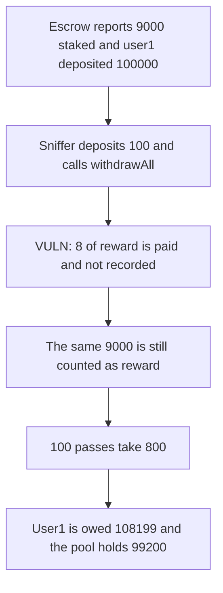

# NuCypher — deposit and withdrawAll sniff the same staked reward

> **Vulnerability classes:** vuln/logic/reward-calculation

<!-- non-defihacklabs -->
<!-- source-auditvault: https://github.com/Auditware/AuditVault/blob/main/findings/28529-reward-sniffing-mixbytes-none-nucypher-markdown.md -->
<!-- date: 2021-04 -->

## Key info

| | |
|---|---|
| **Protocol** | NuCypher |
| **Finding** | MixBytes, AuditVault 28529 |
| **Vulnerable code** | `PoolingStakingContractV2.withdrawAll` while deposits are enabled |
| **Harm** | 100 passes take 800 tokens from user1. User1 is owed 108199 against a free balance of 99200. Unstaked, the loop takes 0. |
| **Chain** | local synthetic (audited Ethereum contracts) |

## TL;DR

`withdrawAll` does not require deposits to be disabled. Reward includes `escrow.getAllTokens`, here 9000, even though those tokens are not free. A 100-token deposit is paid its slice of that 9000, 8 tokens, out of other users' free balance, and `totalWithdrawnReward` is not increased by the payment. The audited loop does this 100 times. The sniffer nets 800. User1 deposited 100000 and is then owed 108199, which is more than the 99200 left in the pool, so `withdrawAll` cannot pay them.

## The vulnerable code

Pre-fix `withdrawAll` from `7d47d3bc` (the parent of `7dfe82fb`, which added the deposit and withdraw rules). Worker fraction is 1 and `BASIS_FRACTION` is 10000, matching the report's `workerFraction = 1`.

```solidity
uint256 availableReward = getAvailableDelegatorReward(msg.sender);
uint256 value = availableReward.add(delegator.depositedTokens);
// totalWithdrawnReward is reduced, not increased by availableReward
// @> VULN: the reward inside `value` is paid and is not added to totalWithdrawnReward.
token.safeTransfer(msg.sender, value);
```

`getAvailableDelegatorReward()` with no argument is `staked + free - totalDeposited`, capped by the free balance. The 9000 staked tokens stay in that sum after every pass.

## Root cause

Staked tokens are treated as withdrawable reward, and the reward actually transferred is not recorded in `totalWithdrawnReward`. The next depositor sees almost the same 9000 and is paid again from the free deposits. Deposits stay enabled, so the deposit and the withdraw happen in one transaction.

## Preconditions

`escrow.getAllTokens(pool)` is 9000. User1 has deposited 100000. Deposits are enabled. The sniffer has 10000 tokens to recycle through 100 deposits of 100. No time change.

## Attack walkthrough

1. User1 deposits 100000. The escrow still reports 9000.
2. The sniffer deposits 100. Total deposited is 100100.
3. `withdrawAll` runs. Reward for that 100 is `9000 * 100 * 9999 / (100100 * 10000) = 8`.
4. The 100 deposit and the 8 reward are transferred. `totalWithdrawnReward` does not grow by 8.
5. After 100 passes the sniffer's balance is 800 above the 10000 they started with.
6. The pool's free balance is 99200.
7. User1 is owed `8199 + 100000 = 108199`. That is greater than 99200, so their `withdrawAll` cannot be paid.

Control sets `getAllTokens` to 0 before the same loop, which is the state the later `isWithdrawAllAllowed` check requires. Each pass pays 0 reward. The sniffer nets 0. The pool still holds user1's 100000.

## Diagrams



## Impact

The sniffer extracts 800 tokens from user1's deposit. The pool free balance falls from 100000 to 99200. User1 is owed 108199 and cannot withdraw. When the stake is zero, the same 100 passes extract 0 and the 100000 stays.

## Remediation

Do not pay `withdrawAll` while deposits are enabled, which is the check the report suggests. Also stop counting escrow stake as free reward, and add the paid reward to `totalWithdrawnReward` before the next depositor is measured.

## How to reproduce

```bash
cd 28529-reward-sniffing-mixbytes-none-nucypher-markdown_exp
forge test -vv
```

## Sources

- AuditVault finding: https://github.com/Auditware/AuditVault/blob/main/findings/28529-reward-sniffing-mixbytes-none-nucypher-markdown.md
- MixBytes report: https://github.com/mixbytes/audits_public/blob/master/NuCypher/README.md
- Vulnerable file: `PoolingStakingContractV2.sol` at `7d47d3bc769ceb5a7de84c9e39f58a18d7c9de1f`
- Lifecycle fix: `7dfe82fb6efbead00854198206f05545193d4009`
