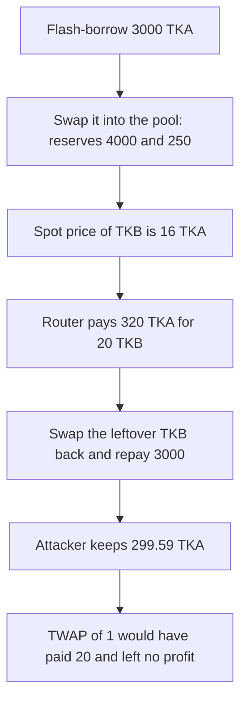

# Cover peripheral — a flash loan moves a pool and the router pays the spot price

> **Vulnerability classes:** vuln/oracle/spot-price · vuln/oracle/price-manipulation · vuln/governance/flash-loan-attack

<!-- non-defihacklabs -->
<!-- source-auditvault: https://github.com/Auditware/AuditVault/blob/main/findings/28662-it-is-possible-to-carry-out-attacks-to-manipulate-pools-with.md -->
<!-- date: 2021-01 -->

> **Reproduction:** Cheatcode-free, one transaction. CoverRouter and Rollover let any caller swap and add or remove liquidity with no same-transaction guard. This reduction is a constant-product pool plus a router that pays `reserveA / reserveB`. A 3,000 token-A flash loan moves the price from 1 to 16. The router pays 320 instead of the TWAP of 20. Repaying the loan still leaves 299.59 token A. The TWAP path loses money.

## Key info

| | |
|---|---|
| **Loss** | Router overpays 300 TKA (320 spot vs 20 TWAP). Attacker keeps `299591836734693877552` wei after repayment (`output.txt:13`). Spot paid is 320 TKA (`output.txt:12`). |
| **Vulnerable contract** | CoverRouter / Rollover spot use (reduced as `Router.buyAtSpot`) |
| **Attacker** | Any caller who can take a flash loan and trade the pool in the same transaction |
| **Attack contract** | `Exploit.run` → `Lender.flash` → `onFlash` |
| **Attack tx** | One transaction. The loan is borrowed and repaid inside `run()`. |
| **Chain · date** | MixBytes Cover Protocol Peripheral, 2021-01-11 |
| **Compiler** | solc 0.8.27, cancun, via_ir |
| **Bug class** | Spot price read inside a flash-loan transaction |

## TL;DR

The peripheral contracts exchange tokens and move liquidity with no check that the caller already did it earlier in the same transaction. A flash loan can skew a pool, trade against the skewed spot price, and repay the loan before the transaction ends. Here that skew turns a fair payment of 20 token A into a payment of 320. A stored TWAP of 1, or the post-loan price, does not leave a profit.

## The vulnerable code

The report does not quote a single existing line. It says any user can swap and add or remove liquidity in CoverRouter and Rollover, and it gives the missing guard. The synthetic's payment is the spot read:

```solidity
uint256 reserveA = pool.reserveA();
uint256 reserveB = pool.reserveB();
// @> VULN: pays the spot reserve ratio inside the same tx as a flash-loan swap; no TWAP and no same-tx origin guard
// FIX: require(block.number > _lastSwapBlock[tx.origin]) or pay twapPrice / the post-loan price
uint256 price = reserveA * 1 ether / reserveB;
paid = bAmount * price / 1 ether;
```

The report's fix:

```solidity
function _preventSameTxOrigin() private {
    require(block.number > _lastSwapBlock[tx.origin], "SAME_TX_ORIGIN");
    _lastSwapBlock[tx.origin] = block.number;
}
```

## Root cause

The price is the pool's current reserves. A flash loan can change those reserves and trade against them before anyone else sees a new block. Nothing records `tx.origin` or a TWAP, so the manipulated ratio is what the router pays out of its own token A.

## Preconditions

- Pool reserves are 1,000 TKA and 1,000 TKB. Constant product, zero fee, so a round trip without the router is lossless aside from integer division.
- TWAP stored on the router is 1 TKA per TKB and is not updated inside the loan.
- Router treasury holds 1,000 TKA.
- Lender can flash 3,000 TKA and must be repaid in the same call.

## Attack walkthrough

1. `lender.flash` sends 3,000 TKA and calls `onFlash`.
2. `swapAforB(3000 ether)` sets reserves to 4,000 TKA and 250 TKB. Spot price of B is 16.
3. `buyAtSpot(20 ether)` pays `20 * 16 = 320` TKA (`output.txt:12`). The TWAP quote for the same 20 TKB is 20 TKA.
4. The leftover 730 TKB is swapped back. The lender pulls its 3,000 TKA.
5. Attacker TKA balance increased by `299591836734693877552` wei (`output.txt:13`). That is the 300 TKA overpayment minus `408163265306122448` wei of integer-division slippage.
6. `profit - (spotPaid - twapPaid)` is negative, so paying the TWAP instead of the spot would not profit. `runControl` does that path and finishes at `591836734693877552` wei, below the 1 TKA of dust it needed to repay (`output.txt:8`).

## Diagrams



## Impact

The router's treasury pays 320 TKA for 20 TKB. The fair TWAP payment is 20 TKA. After the loan is repaid the attacker still has 299.59 TKA that came out of the treasury. The same sequence priced at the TWAP loses the AMM rounding and does not profit.

## Remediation

Do not pay a spot reserve ratio that a flash loan can set in the same transaction. Use a TWAP or the post-loan price, or the report's `_preventSameTxOrigin` guard so one origin cannot manipulate and trade in one transaction.

## How to reproduce

```bash
cd 28662-it-is-possible-to-carry-out-attacks-to-manipulate-pools-with_exp
forge test -vv
```

`test_flash_loan_spot_price_pays_attacker` is the attack. `test_control_twap_profit_disappears` pays `twapPrice` instead of the spot and asserts the profit is gone.

## Sources

- AuditVault finding: https://github.com/Auditware/AuditVault/blob/main/findings/28662-it-is-possible-to-carry-out-attacks-to-manipulate-pools-with.md
- MixBytes report: https://github.com/mixbytes/audits_public/blob/master/Cover%20Protocol/Cover%20Protocol%20Peripheral/README.md#1-it-is-possible-to-carry-out-attacks-to-manipulate-pools-within-one-transaction-using-a-flash-loan
- Report date: 2021-01-11, Cover Protocol Peripheral, listed by MixBytes
- Audited tree: https://github.com/CoverProtocol/cover-peripheral/tree/d5b37e34d47abec3252cdabd46e55e34a72421d4/contracts/CoverRouter.sol
