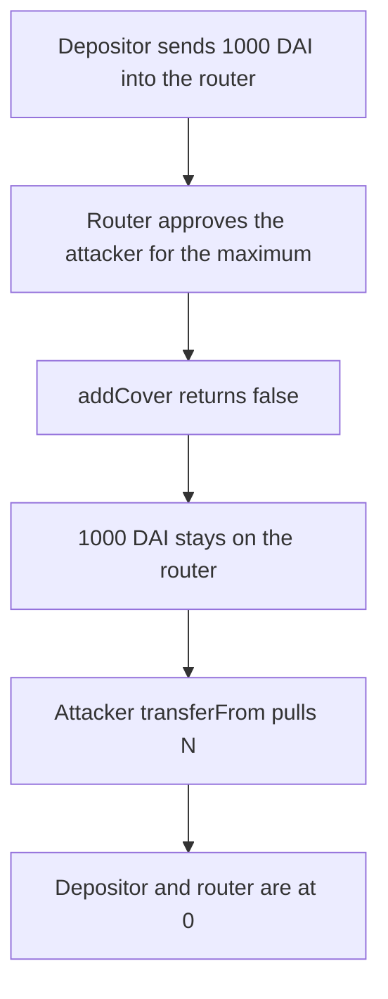

# Cover Protocol — unlimited approve lets an attacker take 1000 DAI off the router

> **Vulnerability classes:** vuln/access-control/missing-auth · vuln/logic/missing-validation

> **Reproduction:** a self-contained Foundry PoC that compiles and runs offline
> with only `forge-std` — no fork and no RPC. Trace: [output.txt](output.txt).
> PoC: [test/28663-possibility-to-steal-tokens-from-the-contract-balance-mixbyt_exp.sol](test/28663-possibility-to-steal-tokens-from-the-contract-balance-mixbyt_exp.sol).

<!-- non-defihacklabs -->
<!-- source-auditvault: https://github.com/Auditware/AuditVault/blob/main/findings/28663-possibility-to-steal-tokens-from-the-contract-balance-mixbyt.md -->
<!-- date: 2021-01 -->

---

## Key info

| | |
|---|---|
| **Impact** | **HIGH** — the attacker receives **N = 1,000 DAI** from the router |
| **Protocol** | Cover Protocol `CoverRouter` |
| **Vulnerable code** | `approve(_spender, uint256(-1))` with no protocol check |
| **Bug class** | Unlimited allowance plus a failed `addCover` that still succeeds |
| **Finding** | MixBytes — Cover Protocol Peripheral, 11 January 2021 · id 28663 |
| **Report** | [Cover Protocol Peripheral](https://github.com/mixbytes/audits_public/blob/master/Cover%20Protocol/Cover%20Protocol%20Peripheral/README.md#2-possibility-to-steal-tokens-from-the-contract-balance) |
| **Source** | [AuditVault finding](https://github.com/Auditware/AuditVault/blob/main/findings/28663-possibility-to-steal-tokens-from-the-contract-balance-mixbyt.md) |
| **Status** | Reproduced. `uint256(-1)` is written as `type(uint256).max` so solc 0.8 accepts it. |
| **Compiler** | solc 0.8.27, cancun, via IR |

---

## TL;DR

`addCoverAndCreatePools` pulls the depositor's collateral onto the router and approves `_protocol` for the maximum uint256. `_protocol` is not checked. The attacker's `addCover` returns false, so the **1,000 DAI** stays on the router, and the attacker `transferFrom`s it.

The depositor ends at 0. The router ends at 0. The attacker holds **1,000 DAI**.

## The vulnerable code

```solidity
if (_token.allowance(address(this), _spender) < _amount) {
    // @> VULN: audited approve(_spender, uint256(-1))
    _token.approve(_spender, type(uint256).max);
}
```

The audited source is Solidity 0.7 and writes `uint256(-1)`. That literal does not compile on 0.8. The value is the same maximum.

## Root cause

Two missing checks stack. The spender of the unlimited allowance is whatever address the caller passed as `_protocol`. And a false return from `addCover` does not revert or refund, so the tokens the router just pulled are left sitting under that allowance.

## Preconditions

- A depositor holds 1,000 DAI and calls the router with the attacker's address as the protocol.
- `addCover` on that address returns false and does not move the tokens itself.

## Attack walkthrough

1. Mint 1,000 DAI to the depositor.
2. The depositor approves the router and calls `addCoverAndCreatePools(attacker, DAI, 1000)`.
3. The router pulls 1,000 DAI.
4. The allowance is below the amount, so the router approves `type(uint256).max` to the attacker.
5. `addCover` returns false. The DAI is still on the router.
6. The attacker `transferFrom`s 1,000 DAI to themselves.

Control: the router accepts only one protocol address and reverts before the pull when the caller names anyone else. The depositor still holds 1,000 DAI.

## Diagrams



## Impact

The depositor loses **1,000 DAI**. The attacker holds it. Any later balance left on the router is exposed to the same allowance.

## Remediation

Approve only the amount this call needs, and only to a known protocol. If `addCover` returns false, revert and send the collateral back.

## Sources

- [AuditVault finding 28663](https://github.com/Auditware/AuditVault/blob/main/findings/28663-possibility-to-steal-tokens-from-the-contract-balance-mixbyt.md)
- [MixBytes Cover Protocol Peripheral, 11 January 2021](https://github.com/mixbytes/audits_public/blob/master/Cover%20Protocol/Cover%20Protocol%20Peripheral/README.md#2-possibility-to-steal-tokens-from-the-contract-balance)
- [CoverRouter.sol at d5b37e34](https://github.com/CoverProtocol/cover-peripheral/blob/d5b37e34d47abec3252cdabd46e55e34a72421d4/contracts/CoverRouter.sol)

### Taxonomy

- `vuln/access-control/missing-check` · `vuln/logic/missing-validation`
