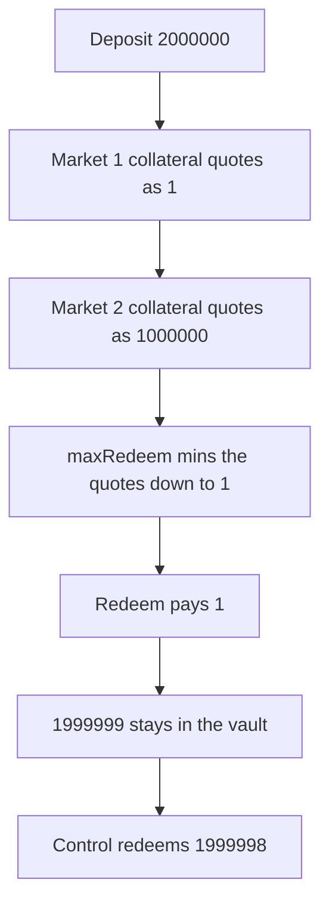

# Perennial: maxRedeem pays 1 of a 2000000 deposit

> **Vulnerability classes:** vuln/logic/price-calculation · vuln/logic/wrong-condition

<!-- non-defihacklabs -->
<!-- source-auditvault: https://github.com/Auditware/AuditVault/blob/main/findings/28950-h-3-vault-max-redeem-calculations-limit-redeem-amount-to-the.md -->
<!-- date: 2023-10 -->

## Key info

| | |
|---|---|
| **Protocol** | Perennial |
| **Finding** | Sherlock 2023-10-perennial H-3, AuditVault 28950 |
| **Vulnerable code** | `StrategyLib` maxRedeem collateral cap |
| **Harm** | A depositor of 2000000 can redeem 1. 1999999 stays in the vault. The control redeems 1999998 |
| **Chain** | local synthetic |

## TL;DR

`maxRedeem` mins the vault's assets by each market's current maker position. Market 1's maker is near its limit, so the quoted collateral is 1 even though the target for that market on a 2000000 vault is 1000000. Redeeming does not need to shrink market 1. It needs to grow it. The cap is still 1, and the depositor receives 1. The control ignores a market whose current collateral is below its target and redeems 1999998.

## The vulnerable code

The audited expression, with the cap that uses it:

```solidity
UFixed6 collateral = marketContext.currentPosition.maker
    .sub(marketContext.currentPosition.net().min(marketContext.currentPosition.maker))
    .min(marketContext.closable.mul(StrategyLib.LEVERAGE_BUFFER))
    .muldiv(marketContext.latestPrice.abs(), registration.leverage)
    .muldiv(totalWeight, registration.weight);
// @> VULN: caps redeem by the smallest current position, here $1
stepCap = UFixed6.unwrap(redemptionAssets.min(collateral));
```

Market 1: maker 0.5, price 1, leverage 1, weight 1, totalWeight 2. Collateral is 1.
Market 2: maker 500000, same scale. Collateral is 1000000.
`redemptionAssets` starts at 2000000 and becomes min(2000000, 1, 1000000) = 1.

The control computes how much can be redeemed before an under-target market would have to shrink. Market 1's current collateral is 1 and its target is 1000000, so that room is 1999998. Market 2 is exactly at its target and does not tighten the under-target room. `redeemFair` pays 1999998.

## Root cause

The cap uses only the current position. It does not compare that position with the target the vault would hold after the redeem. A market that is already far below its target still sets the vault-wide maximum.

## Preconditions

The vault holds two markets, weights 1 and 1, totalWeight 2. Market 1's current collateral is 1 against a 1000000 target. Market 2's current collateral is 1000000, equal to its target. One depositor has 2000000 in the vault. No time change.

## Attack walkthrough

1. Deposit 2000000. See [output.txt](output.txt).
2. `maxRedeem` quotes market 1 at 1 and market 2 at 1000000.
3. The min stores 1.
4. `redeem(2000000)` transfers 1. The vault balance is 1999999.
5. The control on a fresh vault deposits 2000000 and `redeemFair` transfers 1999998. The vault keeps 2, which is the collateral market 1 still has to sit above.

## Diagrams



## Impact

The depositor of 2000000 receives 1. 1999999 of the deposit cannot be redeemed in this call. Repeating the call does not help: the same position still quotes 1. The fair redeem is 1999998.

## Remediation

Do not cap by a market whose current collateral is below the target that market would have after the redeem. Cap only by the room that keeps every under-target market from being forced down. That room is 1999998 here.

## How to reproduce

```bash
cd 28950-h-3-vault-max-redeem-calculations-limit-redeem-amount-to-the_exp
forge test -vv
```

## Sources

- AuditVault finding: https://github.com/Auditware/AuditVault/blob/main/findings/28950-h-3-vault-max-redeem-calculations-limit-redeem-amount-to-the.md
- Sherlock issue: https://github.com/sherlock-audit/2023-10-perennial-judging/issues/29
- Formula: https://github.com/sherlock-audit/2023-10-perennial/blob/main/perennial-v2/packages/perennial-vault/contracts/lib/StrategyLib.sol#L94-L98
- Repo: sherlock-audit/2023-10-perennial (perennial-v2 StrategyLib)
- Synthetic: [test/28950-h-3-vault-max-redeem-calculations-limit-redeem-amount-to-the.sol](test/28950-h-3-vault-max-redeem-calculations-limit-redeem-amount-to-the.sol)
