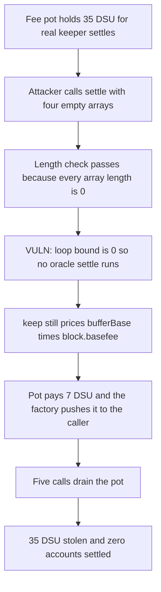

# Perennial KeeperFactory — empty settle arrays still pay the keeper

> **Vulnerability classes:** vuln/logic/missing-check · vuln/defi/fee-manipulation · vuln/logic/fee-calculation

<!-- non-defihacklabs -->
<!-- source-auditvault: https://github.com/Auditware/AuditVault/blob/main/findings/28951-h-4-attacker-can-call-keeperfactorysettle-with-empty-arrays.md -->
<!-- date: 2023-10 -->

## Key info

| | |
|---|---|
| **Protocol** | Perennial |
| **Finding** | Sherlock 2023-10 H-4, AuditVault 28951 |
| **Vulnerable code** | `KeeperFactory.settle` |
| **Harm** | 35 DSU of keeper fees stolen. Each empty `settle` pays 7 DSU. Five calls drain the pot. Zero accounts are settled. |
| **Chain** | local synthetic |

## TL;DR

`KeeperFactory.settle` is permissionless and wrapped in the `keep` modifier. The modifier pays the caller from the oracle fee pot after the body returns. The body rejects mismatched arrays and stuffed calldata, but not four empty arrays. The settlement loop then runs zero times, so no oracle callback runs, and the keeper is still paid `bufferBase * block.basefee`. Repeating the call drains the pot that was meant to pay keepers who actually commit and settle oracle versions.

## The vulnerable code

Audited `KeeperFactory.settle` (the length check does not include `ids.length == 0`):

```solidity
function settle(bytes32[] memory ids, IMarket[] memory markets, uint256[] memory versions, uint256[] memory maxCounts)
    external
    keep(settleKeepConfig(), msg.data, 0, "")
{
    if (
        ids.length != markets.length ||
        ids.length != versions.length ||
        ids.length != maxCounts.length ||
        // Prevent calldata stuffing
        abi.encodeCall(KeeperFactory.settle, (ids, markets, versions, maxCounts)).length != msg.data.length
    ) revert KeeperFactoryInvalidSettleError();

    for (uint256 i; i < ids.length; i++)
        IKeeperOracle(address(oracles[ids[i]])).settle(markets[i], versions[i], maxCounts[i]);
}
```

The fee is `Kept.keep`. After the body, it prices gas and the configured buffer by `block.basefee` and the ETH/keeper-token oracle, pulls that amount from the oracle factory, and pushes the keeper token to `msg.sender`. On L1, `_calldataFee` returns 0. This reduction sets `multiplierBase` to 0 and `bufferBase` to `1e18`, so the paid amount does not depend on gas left and is exactly `bufferBase * block.basefee` times an ETH price of 1. At basefee 7 that is 7 DSU per call. A non-zero gas multiplier would add `gasUsed * basefee` on top of the same unearned buffer.

```solidity
uint256 baseFee = _baseFee(applicableGas, config.multiplierBase, config.bufferBase);
uint256 keeperFee = (applicableValue + baseFee + calldataFee) * _etherPrice() / 1e18;
_raiseKeeperFee(keeperFee, data);
_push(msg.sender, keeperFee);
```

The recommended fix reverts when `ids.length == 0` inside the body. A revert skips the modifier's payment.

## Root cause

`settle` treats "the arrays agree with each other" as "there is work to pay for". Four empty arrays agree, and `abi.encodeCall` of those arrays matches `msg.data`, so the stuffing check passes. The loop condition `i < ids.length` is false immediately. `IKeeperOracle.settle` is never called, which is the path that would have reverted if a market's callback list was empty. The `keep` modifier does not look at how many callbacks ran. It pays anyway.

## Preconditions

The oracle factory's keeper-token pot has a balance. `settleKeepConfig` has a non-zero buffer or a non-zero gas multiplier, and `block.basefee` and the ETH price are non-zero, so the computed fee is non-zero. Anyone can call `settle`. No oracle id, market, or pending account is required.

## Attack walkthrough

1. The fee pot holds 35 DSU, five times the empty-settle fee.
2. The attacker builds four empty arrays and calls `KeeperFactory.settle`.
3. The length check passes. The calldata length matches `abi.encodeCall` of those empty arrays.
4. The loop body does not run. `accountsSettled` stays 0.
5. `keep` computes the fee as `1e18 * 7 = 7 DSU` and `FeePot.claim` pulls it.
6. The factory pushes 7 DSU to the attacker contract.
7. The same call is repeated while the pot can cover another fee. Five calls leave the pot at 0.
8. The attacker contract forwards 35 DSU to its caller. No oracle callback ran.

The control adds `ids.length == 0` to the revert condition. The same empty call reverts, the pot stays at 35 DSU, and the attacker balance stays 0. A one-id settle on that fixed factory runs the oracle callback, pays the honest caller 7 DSU, and leaves 28 DSU in the pot.

## Diagrams



## Impact

The attacker receives 35 DSU that was reserved for keepers, in one transaction, without committing a price or settling an account. Each empty call pays 7 DSU. The loop stops only when the pot cannot cover another fee, so a larger pot is drained the same way. Keepers are no longer paid to commit requested oracle versions, and markets that depend on those versions stop updating. The attacker is not a keeper who did the work.

## Remediation

Revert when `ids.length == 0` before the loop, as in the Sherlock recommendation. The revert happens inside the `keep` body, so the modifier does not pay. A non-empty settle still pays the caller who actually ran the callbacks.

## How to reproduce

```bash
cd 28951-h-4-attacker-can-call-keeperfactorysettle-with-empty-arrays_exp
forge test -vv
```

## Sources

- AuditVault finding: https://github.com/Auditware/AuditVault/blob/main/findings/28951-h-4-attacker-can-call-keeperfactorysettle-with-empty-arrays.md
- Sherlock judging issue: https://github.com/sherlock-audit/2023-10-perennial-judging/issues/50
- Audited factory: https://github.com/sherlock-audit/2023-10-perennial/blob/f8d3cec21011/perennial-v2/packages/perennial-oracle/contracts/keeper/KeeperFactory.sol
- Keeper incentive: `@equilibria/root@2.1.0-rc0` `attribute/Kept/Kept.sol` (`keep`, `_baseFee`, `_calldataFee`)
- Contest tree: https://github.com/sherlock-audit/2023-10-perennial/tree/f8d3cec21011
