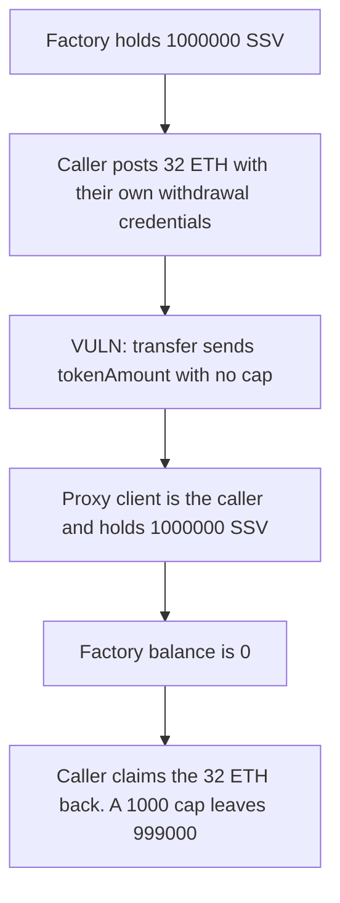

# P2P — depositEthAndRegisterValidators transfers an uncapped SSV amount

> **Vulnerability classes:** vuln/access-control/missing-auth

<!-- non-defihacklabs -->
<!-- source-auditvault: https://github.com/Auditware/AuditVault/blob/main/findings/29417-depositethandregistervalidators-allows-unauthorized-users-to.md -->
<!-- date: 2023-10 -->

## Key info

| | |
|---|---|
| **Protocol** | P2P.org SSV proxy |
| **Finding** | MixBytes, AuditVault 29417 |
| **Vulnerable code** | `i_ssvToken.transfer(p2pSsvProxy, _ssvPayload.tokenAmount)` |
| **Harm** | The caller moves 1000000 SSV into their proxy. The factory is left at 0. They then take the 32 ETH back. A 1000 cap leaves 999000. |
| **Chain** | local synthetic (audited Ethereum contracts) |

## TL;DR

`depositEthAndRegisterValidators` is callable by anyone who posts 32 ETH per validator and names an allowed operator. It does not run the ETH-for-SSV check that `registerValidators` uses. `SsvPayload.tokenAmount` is transferred from the factory to the new proxy with no maximum. The caller sets it to the whole reserve, 1000000 SSV. The proxy's client is the caller. The 32 ETH is a beacon deposit under the caller's own withdrawal credentials, and they claim it back. The factory SSV balance is 0 until the owner recovers it.

## The vulnerable code

`P2pSsvProxyFactory.sol` around the audited transfer. `registerValidators` calls `_checkEthValue(tokenAmount)`. This function does not.

```solidity
function depositEthAndRegisterValidators(...) external payable returns (address p2pSsvProxy) {
    _makeBeaconDeposits(_withdrawalCredentialsAddress);
    p2pSsvProxy = _registerValidators(_ssvPayload);
}

p2pSsvProxy = address(new P2pSsvProxy(msg.sender));
// @> VULN: tokenAmount is chosen by the caller and is not capped.
i_ssvToken.transfer(p2pSsvProxy, _ssvPayload.tokenAmount);
```

`_makeBeaconDeposits` requires `msg.value == 32 ETH` and packs the caller's address into the `0x01` withdrawal credentials.

## Root cause

The SSV reserve is spent on a caller-supplied amount. The operator allow-list checks the operators in the payload, not that the caller is the operator. One 32 ETH deposit is enough to name the whole reserve.

## Preconditions

The factory holds 1000000 SSV. At least one operator id is on the allow-list, and the caller includes that operator. The caller can post 32 ETH. They set withdrawal credentials to themselves.

## Attack walkthrough

1. The factory balance is 1000000 SSV. The caller is not the operator owner.
2. They call `depositEthAndRegisterValidators` with 32 ETH, their own withdrawal address, and `tokenAmount` 1000000.
3. The 32 ETH is deposited with credentials that pack the caller's address.
4. `transfer` sends `tokenAmount` to the new proxy. There is no cap.
5. The proxy's SSV balance is 1000000 and `client()` is the caller.
6. The factory balance is 0. A later registration cannot be funded.
7. The caller claims the beacon deposit. 32 ETH comes back.

Control rejects `tokenAmount` above 1000. The 1000000 payload reverts. A deposit of 1000 SSV leaves 999000 in the factory.

## Diagrams



## Impact

1000000 SSV leaves the factory and sits in a proxy the caller controls. The factory cannot fund the next client until the owner withdraws it back. The caller does not lose the 32 ETH: the withdrawal credentials are theirs, and the claim returns 32 ETH. With a 1000 SSV maximum, the same payload reverts and a capped registration leaves 999000 in the factory.

## Remediation

Cap `SsvPayload.tokenAmount` on `depositEthAndRegisterValidators` the way a later revision checks a per-validator maximum, or require the same ETH coverage `_checkEthValue` already applies to `registerValidators`.

## How to reproduce

```bash
cd 29417-depositethandregistervalidators-allows-unauthorized-users-to_exp
forge test -vv
```

## Sources

- AuditVault finding: https://github.com/Auditware/AuditVault/blob/main/findings/29417-depositethandregistervalidators-allows-unauthorized-users-to.md
- MixBytes report: https://github.com/mixbytes/audits_public/blob/master/P2P.org/SSV%20Integration/README.md
- Audited file: `src/p2pSsvProxyFactory/P2pSsvProxyFactory.sol` at `9dd4728002d9c275e29e8ba38bcf7d90efc7531b`
