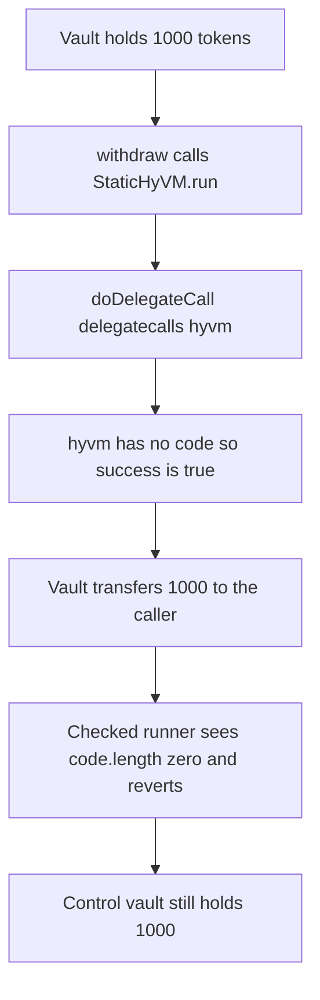

# StaticHyVM — delegatecall to an account with no code returns success

> **Vulnerability classes:** vuln/logic/missing-check · vuln/dependency/unsafe-external-call

<!-- non-defihacklabs -->
<!-- source-auditvault: https://github.com/Auditware/AuditVault/blob/main/findings/29658-lack-of-contract-existence-check-on-statichyvm-trailofbits-n.md -->
<!-- date: 2023-06 -->

> **Reproduction:** Cheatcode-free. `doDelegateCall` is the audited function. `hyvm` is an address with no code. The delegatecall returns success, the guard payload never runs, and a vault that treats success as permission transfers 1,000 tokens. The same call with a `code.length` check reverts and the control vault keeps its 1,000.

## Key info

| | |
|---|---|
| **Loss** | 1,000 vault tokens released (`output.txt:8`). The control vault still holds 1,000 (`output.txt:9`). |
| **Vulnerable contract** | `StaticHyVM.doDelegateCall` |
| **Attacker** | Any caller of a consumer that treats a successful HyVM call as authorization |
| **Attack contract** | `Exploit.run` |
| **Attack tx** | Local synthetic, one transaction |
| **Chain · date** | Trail of Bits Nested / Tetris HyVM review, June 2023 |
| **Compiler** | solc 0.8.27, cancun, via_ir |
| **Bug class** | Missing contract-existence check on delegatecall |

## TL;DR

`doDelegateCall` delegatecalls `hyvm` and reverts only when the call returns `success == false`. The EVM reports success for an account that has no code and runs nothing. If `hyvm` was destroyed, or was never deployed, every call still "succeeds". A vault that releases funds on that success sends 1,000 tokens. Checking `hyvm.code.length` first reverts, and those tokens stay.

## The vulnerable code

From the review, `StaticHyVM.sol` lines 30–36:

```solidity
function doDelegateCall(bytes calldata payload) public returns (bytes memory) {
    if (msg.sender != address(this)) revert OnlySelf();
    // @> VULN: hyvm has no code; delegatecall still returns success and the guard payload never executes
    // FIX: if (hyvm.code.length == 0) revert EmptyCode();
    (bool success, bytes memory data) = hyvm.delegatecall(payload);
    if (!success) revert DelegateFailed();
    return data;
}
```

`OnlySelf` is unchanged. The call is reached through `run`, which does `this.doDelegateCall(payload)`.

## Root cause

`delegatecall` to an empty account is defined to return success and empty return data. The function checks `success` and does not check that `hyvm` has code. A payload that was supposed to revert, or to set a flag, is skipped, and the caller continues.

## Preconditions

- `hyvm` is `0x000000000000000000000000000000000000bEEF`. It has no runtime code.
- The payload is `0x01`, a guard a real hyvm would have to execute.
- Two vaults each hold 1,000 tokens. Both release their balance only after `run` returns.
- The control runner is the same function plus `if (hyvm.code.length == 0) revert EmptyCode()`.

## Attack walkthrough

1. Mint 1,000 tokens into each vault.
2. The open vault calls `StaticHyVM.run`.
3. `doDelegateCall` delegatecalls the empty address. `success` is true. `DelegateFailed` is not thrown.
4. The vault transfers 1,000 tokens to the caller (`output.txt:8`). Its balance is 0.
5. The control vault calls the checked runner. `code.length == 0` reverts `EmptyCode` before the delegatecall.
6. The control vault still holds 1,000 (`output.txt:9`).

## Diagrams



## Impact

The caller receives 1,000 tokens that the missing guard was supposed to keep in the vault. The call did not execute the payload. The codesize check stops the same withdrawal.

## Remediation

Before `delegatecall`, require `hyvm.code.length != 0`. Do not treat a successful low-level call to an empty account as an executed payload.

## How to reproduce

```bash
cd 29658-lack-of-contract-existence-check-on-statichyvm-trailofbits-n_exp
forge test -vv
```

## Sources

- AuditVault finding: https://github.com/Auditware/AuditVault/blob/main/findings/29658-lack-of-contract-existence-check-on-statichyvm-trailofbits-n.md
- Trail of Bits review: https://github.com/trailofbits/publications/blob/master/reviews/2023-06-nestedfinance-tetrishyvm-securityreview.pdf
- Report date: June 2023, from the review filename
