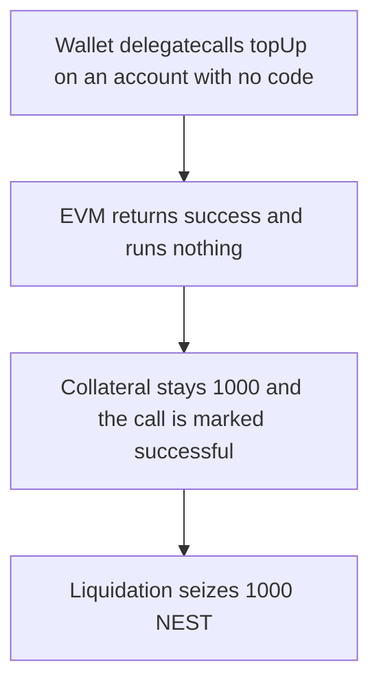

# Nested Finance: a delegatecall to an empty account reports success and the position is liquidated

> **Vulnerability classes:** `vuln/dependency/unsafe-external-call`

<!-- non-defihacklabs -->
<!-- source-auditvault: https://github.com/Auditware/AuditVault/blob/main/findings/29664-lack-of-contract-existence-checks-on-low-level-calls-trailof.md -->
<!-- date: 2023-02 -->

## Key info

| Field | Value |
|---|---|
| **Loss** | 1000 NEST seized. The top-up that would have saved the position did not run |
| **Vulnerable contract** | `NestedWallet.functionDelegateCallUnverified` |
| **Attacker EOA** | `0x1111111111111111111111111111111111111111` |
| **Attack contract** | `Exploit` (liquidator) |
| **Attack tx** | `Exploit.run()` |
| **Chain / block / date** | Local synthetic · 2023-02 |
| **Compiler** | solc 0.8.27, cancun, via IR |
| **Bug class** | Low-level delegatecall succeeds when the target has no code |

## TL;DR

`functionDelegateCallUnverified` delegatecalls a target and treats a `true` success flag as "the payload ran". The EVM returns success for an account with no code. Bob's `topUp(500)` against a codeless HyVM address reports success, collateral stays 1000, the position needed 1500, and liquidation transfers the 1000 NEST to the caller. The report reaches the empty account by destroying the HyVM. This reduction starts from that end state: `address(0xBEEF)` has no code, which is exactly the condition the missing `extcodesize` check fails to reject. Cancun `SELFDESTRUCT` no longer clears code across transactions, so the synthetic does not pretend a later selfdestruct deleted the runtime code.

## The vulnerable code

```solidity
(bool success, bytes memory returndata) = target.delegatecall(data); // @> VULN
if (success) {
    return returndata;
}
```

`executeChecked` adds `require(target.code.length > 0)` before the same delegatecall. Against a live HyVM, `topUp(500)` raises collateral from 1000 to 1500 and liquidation reverts. Against `address(0xBEEF)` the checked path reverts and the 1000 NEST stays in the wallet.

## Root cause

`CALL`, `DELEGATECALL`, and `STATICCALL` return success when the destination has no code. Nested's helper documents that it skips the existence check to save gas, on the assumption the target is always a contract. Trail of Bits notes that assumption is already broken by a separate issue that can destroy the HyVM.

## Preconditions

- The wallet holds a position token balance (1000 NEST) and collateral of 1000 against a required 1500.
- The execution target is an account with empty code.
- Liquidation is permissionless once collateral is short.

## Attack walkthrough

1. The wallet is told to delegatecall `topUp(500)` to `address(0xBEEF)`.
2. The delegatecall returns success and empty returndata. `credit` is never called. Collateral stays 1000.
3. `lastSuccess` is stored as true.
4. `liquidate` sees collateral under 1500 and transfers 1000 NEST to the caller.

## Diagrams



## Impact

The user believes the save transaction worked. The position is liquidated and the 1000 NEST moves to the liquidator. With the codesize check, the same top-up either reverts (empty target) or actually credits collateral (live HyVM) and cannot be liquidated.

## How to reproduce

```bash
cd 29664-lack-of-contract-existence-checks-on-low-level-calls-trailof_exp
forge test -vv
```

## Sources

- AuditVault finding: https://github.com/Auditware/AuditVault/blob/main/findings/29664-lack-of-contract-existence-checks-on-low-level-calls-trailof.md
- Report: https://github.com/trailofbits/publications/blob/master/reviews/2023-02-nestedfinance-smartcontracts-securityreview.pdf
- Blamed helper: `CallHelper.functionDelegateCallUnverified`, quoted in that review (figure 2.3)
