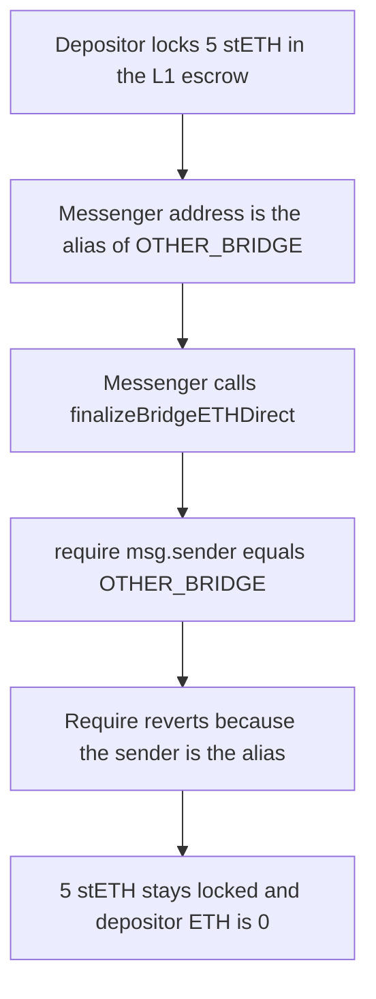

# Blast — `finalizeBridgeETHDirect` compares `msg.sender` to the un-aliased L1 bridge and locks the deposit

> **Vulnerability classes:** vuln/bridge/missing-validation · vuln/logic/wrong-condition · vuln/dos/frozen-funds

> **Reproduction:** a self-contained Foundry PoC that compiles and runs with only `forge-std` — no fork, no RPC. Full trace: [output.txt](output.txt). PoC: [test/29873-msgsender-has-to-be-un-aliased-in-l2blastbridgefinalizebridg_exp.sol](test/29873-msgsender-has-to-be-un-aliased-in-l2blastbridgefinalizebridg_exp.sol).

<!-- non-defihacklabs -->
<!-- source-auditvault: https://github.com/Auditware/AuditVault/blob/main/findings/29873-msgsender-has-to-be-un-aliased-in-l2blastbridgefinalizebridg.md -->
<!-- date: 2024-01 -->

**AuditVault taxonomy:** `lang/solidity` · `platform/spearbit` · `has/github` · `severity/high` · `sector/bridge` · `sector/liquid-staking` · genome: `wrong-condition` · `permanent` · `bridge-sender-auth`

---

## Key info

| | |
|---|---|
| **Impact** | **HIGH** — a direct L1-to-L2 deposit of **5 stETH** (`5000000000000000000`) never credits ETH. The finalize reverts and the 5 stETH stays in the escrow. Credited ETH is **0** |
| **Protocol** | Blast — `L2BlastBridge.finalizeBridgeETHDirect` |
| **Vulnerable code** | `require(msg.sender == address(OTHER_BRIDGE), "StandardBridge: function can only be called from the other bridge")` |
| **Bug class** | The direct L1-to-L2 path checks the raw `msg.sender` instead of `undoL1ToL2Alias(msg.sender)` |
| **Finding** | Spearbit — Blast contracts review, Milo Truck · #29873 |
| **Report** | [report-blast-contracts-review-draft.pdf](https://github.com/spearbit/portfolio/blob/master/pdfs/report-blast-contracts-review-draft.pdf) |
| **Source** | [AuditVault](https://github.com/Auditware/AuditVault/blob/main/findings/29873-msgsender-has-to-be-un-aliased-in-l2blastbridgefinalizebridg.md) |
| **Status** | Audit finding, reproduced as a local L2 synthetic |
| **Compiler** | solc 0.8.27, cancun, via_ir |

`OTHER_BRIDGE` is the L1BlastBridge address. A contract-initiated L1-to-L2 transaction is delivered with `msg.sender = alias(L1BlastBridge)`. The alias is the OP-stack offset `0x1111000000000000000000000000000000001111` added to the L1 address. The check compares against the un-aliased address, so the legitimate caller never passes.

---

## TL;DR

1. The depositor locks **5 stETH** in the L1 escrow. That balance is what a successful finalize is supposed to release as ETH on L2.
2. The caller is a local messenger whose address is exactly `alias(OTHER_BRIDGE)`. It is not `OTHER_BRIDGE`.
3. `finalizeBridgeETHDirect` hits `require(msg.sender == address(OTHER_BRIDGE))` and reverts. The error string is the one in the report.
4. After the revert the escrow still holds `5000000000000000000` stETH, `released` is 0, and the depositor's ETH balance is 0.
5. **Control:** the same messenger calling the fixed bridge, which checks `undoL1ToL2Alias(msg.sender) == OTHER_BRIDGE`, credits the depositor **5 ETH**.

This is the L2 side only. The messenger is a local contract at the aliased address. No second chain is required.

---

## The vulnerable code

The require is the line the report quotes. The surrounding checks are the ones the deployed `finalizeBridgeETHDirect` uses after the sender check.

```solidity
function finalizeBridgeETHDirect(address _from, address _to, uint256 _amount, bytes calldata _extraData)
    public
    payable
{
    // @> VULN: msg.sender is alias(L1BlastBridge), not OTHER_BRIDGE, so this always reverts
    require(msg.sender == address(OTHER_BRIDGE), "StandardBridge: function can only be called from the other bridge");
    require(msg.value == _amount, "StandardBridge: amount sent does not match amount required");
    require(_to != address(this), "StandardBridge: cannot send to self");
    require(_to != address(messenger), "StandardBridge: cannot send to messenger");
    (bool success,) = _to.call{value: _amount}("");
    require(success, "L2BlastBridge: ETH transfer failed");
    released += _amount;
}
```

```diff
- require(msg.sender == address(OTHER_BRIDGE), "StandardBridge: function can only be called from the other bridge");
+ require(undoL1ToL2Alias(msg.sender) == address(OTHER_BRIDGE), "StandardBridge: function can only be called from the other bridge");
```

---

## Root cause

`finalizeBridgeETHDirect` is the direct L1-to-L2 entry, not a messenger relay. On the OP stack a deposit transaction sent by a contract has `msg.sender` equal to `address(uint160(l1Sender) + 0x1111000000000000000000000000000000001111)`. `OTHER_BRIDGE` is stored as the plain L1 address, and other L2BlastBridge functions compare against that plain address after the cross-domain messenger has already un-aliased the sender. This function skips that step, so the equality is false for every real deposit.

## Preconditions

- `OTHER_BRIDGE` is the un-aliased L1BlastBridge.
- The finalize is invoked as a direct L1-to-L2 transaction, so `msg.sender` is the alias.
- The depositor has already locked stETH on L1. There is no other function that returns it.

## Attack walkthrough

Numbers from [output.txt](output.txt):

| Quantity | After the buggy finalize | Control, un-aliased check |
|---|---|---|
| stETH in the escrow | `5000000000000000000` | `5000000000000000000` still held as the L1 deposit |
| ETH credited to the depositor | `0` | `5000000000000000000` |
| `released` on the bridge | `0` | `5000000000000000000` |

The buggy call reverts inside the sender require. The fixed call is made by the same aliased messenger, with `msg.value == 5 ether`, and the depositor's `receive` is credited 5 ETH.

## Diagrams



## Impact

A user who deposits stETH through `L1BlastBridge` never receives the ETH on L2. The 5 stETH remains in the escrow, `released` stays 0, and the depositor's ETH balance stays 0. Repeating the finalize does not help: every direct call has the same aliased sender. The control shows the one-line un-alias pays the same depositor 5 ETH.

## Remediation

Compare `undoL1ToL2Alias(msg.sender)` to `OTHER_BRIDGE`, which is the check the report recommends and the check the deployed `L2BlastBridge` now uses.

## Sources

- AuditVault finding: https://github.com/Auditware/AuditVault/blob/main/findings/29873-msgsender-has-to-be-un-aliased-in-l2blastbridgefinalizebridg.md
- Spearbit report: https://github.com/spearbit/portfolio/blob/master/pdfs/report-blast-contracts-review-draft.pdf
- The Cantina Blast contest opened 2024-01-30 and listed this review's finding 5.1.1 as already published: https://cantina.xyz/competitions/c90131b4-5c7c-4ebc-a1f3-8002d219bfe0
- Alias offset: OP-stack `AddressAliasHelper`, `uint160(0x1111000000000000000000000000000000001111)`
- The blamed `require(msg.sender == address(OTHER_BRIDGE), ...)` line is the snippet in the finding. The audited Blast repo commit is not named in the finding. The deployed L2BlastBridge at `0x4300000000000000000000000000000000000005` is the fixed form and checks `undoL1ToL2Alias(msg.sender)`.
