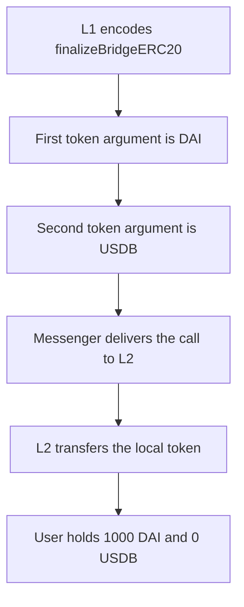

# Blast — `_initiateBridgeERC20` encodes DAI as the local token, so the user receives DAI instead of USDB

> **Vulnerability classes:** vuln/logic/wrong-order · vuln/bridge/missing-validation · vuln/data/wrong-encoding

> **Reproduction:** a self-contained Foundry PoC that compiles and runs with only `forge-std` — no fork, no RPC. Full trace: [output.txt](output.txt). PoC: [test/29874-l1blastbridge-uses-wrong-token-order-when-bridging-usd-yield_exp.sol](test/29874-l1blastbridge-uses-wrong-token-order-when-bridging-usd-yield_exp.sol).

<!-- non-defihacklabs -->
<!-- source-auditvault: https://github.com/Auditware/AuditVault/blob/main/findings/29874-l1blastbridge-uses-wrong-token-order-when-bridging-usd-yield.md -->
<!-- date: 2024-01 -->

**AuditVault taxonomy:** `lang/solidity` · `sector/bridge` · `sector/stable` · `platform/spearbit` · `has/github` · `severity/high` · genome: `wrong-condition` · `cross-chain-message` · `direct-drain`

---

## Key info

| | |
|---|---|
| **Impact** | **HIGH** — a 1000-token USD bridge pays the user **1000 DAI** (`1000000000000000000000`) and **0 USDB**. The 1000 USDB stays on the L2 bridge |
| **Protocol** | Blast — `L1BlastBridge._initiateBridgeERC20` |
| **Vulnerable code** | `abi.encodeWithSelector(finalizeBridgeERC20.selector, DAI, USDB, ...)` |
| **Bug class** | Local and remote token arguments are swapped |
| **Finding** | Spearbit — Blast contracts review, Milo Truck · #29874 |
| **Report** | [report-blast-contracts-review-draft.pdf](https://github.com/spearbit/portfolio/blob/master/pdfs/report-blast-contracts-review-draft.pdf) |
| **Source** | [AuditVault](https://github.com/Auditware/AuditVault/blob/main/findings/29874-l1blastbridge-uses-wrong-token-order-when-bridging-usd-yield.md) |
| **Status** | Audit finding, reproduced as a local synthetic |
| **Compiler** | solc 0.8.27, cancun, via_ir |

`finalizeBridgeERC20(_localToken, _remoteToken, ...)` transfers `_localToken`. On L2 the local token is USDB and the remote token is DAI. The encoder passes them in the other order.

The same report also describes a `DelegateCalls` calldata bug. That is a different root cause and is not this reproduction.

---

## TL;DR

1. The L2 bridge holds 1000 DAI and 1000 USDB.
2. `initiateBridgeERC20` encodes `finalizeBridgeERC20(DAI, USDB, from, to, 1000 ether, extraData)`.
3. L2 transfers `_localToken`. That address is DAI, so the user receives `1000000000000000000000` DAI.
4. The user's USDB balance is 0. The L2 bridge still holds `1000000000000000000000` USDB.
5. **Control:** the fixed encoder passes `USDB` then `DAI`. The same user receives 1000 USDB and 0 DAI.

---

## The vulnerable code

The argument order is the order in the report. DAI is `USDConversions.DAI`. USDB is `Predeploys.USDB`.

```solidity
// @> VULN: DAI is encoded as _localToken and USDB as _remoteToken, so L2 transfers DAI
bytes memory message = abi.encodeWithSelector(
    L2BlastBridge.finalizeBridgeERC20.selector,
    address(dai),
    address(usdb),
    _from,
    _to,
    amountToMintWad,
    _extraData
);
```

L2 then does `MockToken(_localToken).transfer(_to, _amount)`.

```diff
- address(dai),
- address(usdb),
+ address(usdb),
+ address(dai),
```

---

## Root cause

`finalizeBridgeERC20` takes the local token first and the remote token second. For an L2 finalize, local is the L2 token (USDB) and remote is the L1 token (DAI). `_initiateBridgeERC20` passes DAI first. L2 decodes `_localToken = DAI` and transfers that token. The report's failure mode, when no DAI contract exists on L2, is a revert. With both tokens present, which is this reduction, the transfer succeeds and the user is paid the wrong asset.

## Preconditions

- The message is delivered to `finalizeBridgeERC20`.
- The L2 bridge holds a balance of whichever address was encoded as `_localToken`.
- `_amount` is 1000 ether of that token.

## Attack walkthrough

Numbers from [output.txt](output.txt):

| | Buggy order `DAI, USDB` | Control order `USDB, DAI` |
|---|---|---|
| User DAI | `1000000000000000000000` | `0` |
| User USDB | `0` | `1000000000000000000000` |
| `paidLocal` | DAI | USDB |
| `paidRemote` | USDB | DAI |
| USDB left on L2 | `1000000000000000000000` | `0` |

## Diagrams



## Impact

The user who bridged 1000 of the USD yield token receives 1000 DAI. They receive 0 USDB. The 1000 USDB that should have been paid stays on the L2 bridge. The control, with the two addresses swapped back, pays that same 1000 as USDB and pays no DAI.

## Remediation

Pass USDB as `_localToken` and DAI as `_remoteToken` in `_initiateBridgeERC20`, which is the swap the report recommends.

## Sources

- AuditVault finding: https://github.com/Auditware/AuditVault/blob/main/findings/29874-l1blastbridge-uses-wrong-token-order-when-bridging-usd-yield.md
- Spearbit report: https://github.com/spearbit/portfolio/blob/master/pdfs/report-blast-contracts-review-draft.pdf
- The Cantina Blast contest opened 2024-01-30 and listed this review's finding 5.1.2 as already published: https://cantina.xyz/competitions/c90131b4-5c7c-4ebc-a1f3-8002d219bfe0
- The blamed `encodeWithSelector` argument order is the snippet in the finding (`L1BlastBridge.sol` around the lines the report cites as L196-L197). The audited Blast repo commit is not named in the finding.
