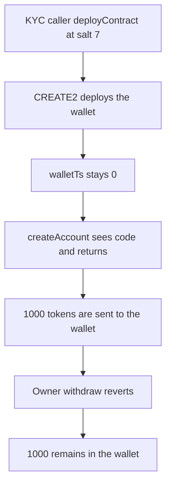

# Kinto: a front-run leaves 1000 stuck in a wallet with no timestamp

> **Vulnerability classes:** vuln/dos/griefing · vuln/data/uninitialized

<!-- non-defihacklabs -->
<!-- source-auditvault: https://github.com/Auditware/AuditVault/blob/main/findings/30496-dos-of-an-account-using-frontrun-mixbytes-none-kinto-markdow.md -->
<!-- date: 2024-02 -->

## Key info

| | |
|---|---|
| **Protocol** | Kinto |
| **Finding** | MixBytes Kinto, AuditVault 30496 |
| **Vulnerable code** | `KintoWalletFactory.deployContract` |
| **Harm** | The owner's withdraw reverts. 1000 tokens stay in the wallet. walletTs is 0. The control sets walletTs and the same withdraw pays 1000 |
| **Chain** | local synthetic |

## TL;DR

`deployContract` is a KYC-gated CREATE2 of arbitrary bytecode. It does not set `walletTs`. A caller deploys the owner's wallet init code at salt 7. `createAccount` sees `code.length > 0` and returns that address without writing `walletTs`. 1000 tokens minted to the wallet cannot be withdrawn: the later call reverts on `walletTs == 0`. Creating the account first sets `walletTs` to the block timestamp, and the same withdraw pays the owner 1000.

## The vulnerable code

```solidity
function deployContract(uint256 amount, bytes memory bytecode, bytes32 salt) external returns (address deployed) {
    require(isKYC(msg.sender), "KYC required");
    require(amount == 0, "amount");
    // @> VULN: CREATE2 may be a KintoWallet and walletTs is never written
    deployed = _create2(salt, bytecode);
}

function createAccount(address owner_, uint256 salt) external returns (address ret) {
    require(isKYC(owner_), "KYC required");
    ret = getAddress(owner_, salt);
    if (ret.code.length > 0) {
        return ret;
    }
    ret = _create2(bytes32(salt), walletInitCode(owner_));
    walletTs[ret] = block.timestamp;
}
```

`withdraw` then requires `factory.getWalletTimestamp(address(this)) != 0`. After the front-run that value is 0, so the call reverts and the balance stays 1000.

## Root cause

Wallet deployment and wallet registration are different paths. CREATE2 of the wallet bytecode occupies the salt, and the path that would have stored `walletTs` is skipped because the code is already there.

## Preconditions

The caller and the owner both pass the KYC check. The init code is the wallet constructor for this owner, token, and factory. Salt is 7. No timestamp change is required. Both calls happen in one transaction; the front-run is just the earlier call.

## Attack walkthrough

1. `deployContract` CREATE2s the wallet. See [output.txt](output.txt). `walletTs` stays 0.
2. `createAccount` hits the existing code and returns.
3. 1000 tokens are minted to the wallet.
4. The owner's `withdraw(1000)` reverts.
5. The wallet balance is 1000.
6. The control calls `createAccount` on a fresh factory. `walletTs` is non-zero. `withdraw` returns true and the owner holds 1000.

## Diagrams



## Impact

The owner cannot withdraw. 1000 tokens are stuck. Recovery that depends on a registered wallet does not run, because `walletTs` is 0. The control withdraw succeeds and the owner receives 1000.

## Remediation

Reject wallet init code inside `deployContract`, or set `walletTs` when `createAccount` finds the wallet already deployed.

## How to reproduce

```bash
cd 30496-dos-of-an-account-using-frontrun-mixbytes-none-kinto-markdow_exp
forge test -vv
```

## Sources

- AuditVault finding: https://github.com/Auditware/AuditVault/blob/main/findings/30496-dos-of-an-account-using-frontrun-mixbytes-none-kinto-markdow.md
- MixBytes report: https://github.com/mixbytes/audits_public/blob/master/Kinto/README.md#3-dos-of-an-account-using-frontrun
- Factory: https://github.com/KintoXYZ/kinto-core/blob/f7dd98f66b9dfba1f73758703b808051196e740b/src/wallet/KintoWalletFactory.sol
- Repo: KintoXYZ/kinto-core@f7dd98f66b9dfba1f73758703b808051196e740b
- Synthetic: [test/30496-dos-of-an-account-using-frontrun-mixbytes-none-kinto-markdow.sol](test/30496-dos-of-an-account-using-frontrun-mixbytes-none-kinto-markdow.sol)
