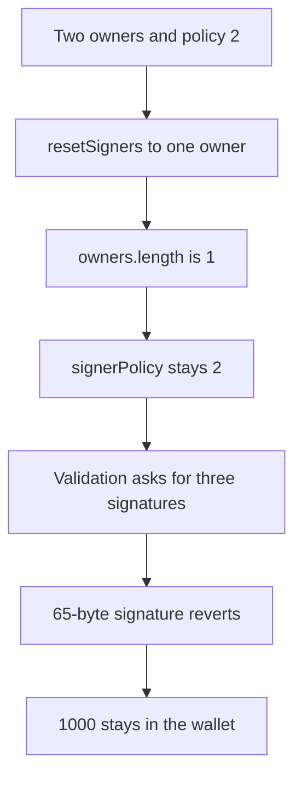

# Kinto: resetting to one signer leaves policy 2 and sticks 1000

> **Vulnerability classes:** vuln/auth/signature-validation · vuln/logic/state-update

<!-- non-defihacklabs -->
<!-- source-auditvault: https://github.com/Auditware/AuditVault/blob/main/findings/30497-dos-kintowallet-contract-mixbytes-none-kinto-markdown.md -->
<!-- date: 2024-02 -->

## Key info

| | |
|---|---|
| **Protocol** | Kinto |
| **Finding** | MixBytes Kinto, AuditVault 30497 |
| **Vulnerable code** | `KintoWallet._resetSigners` |
| **Harm** | Policy stays 2 with one owner. The execute of 1000 reverts. The control sets policy to 1 and pays 1000 |
| **Chain** | local synthetic |

## TL;DR

This is not the `deployContract` front-run. `_resetSigners` replaces `owners` and does not touch `signerPolicy`. A wallet on policy 2 (n-1 of two signers) is reset to one owner. Policy stays 2. `_validateSignature` skips the single-signer branch, sees `owners.length != 2`, and calls the three-signature extract, which reverts on a 65-byte signature. 1000 minted to the wallet stays there. The control writes `signerPolicy = 1` when the new array has one owner. The same signature then pays 1000.

## The vulnerable code

```solidity
function _resetSigners(address[] calldata newSigners) internal {
    require(newSigners.length > 0 && newSigners.length <= 3, "len");
    require(newSigners[0] == owner0, "first");
    // @> VULN: signerPolicy is left unchanged when the owner set shrinks
    owners = newSigners;
}
```

With one owner and policy 2 the validator does not take `signerPolicy == 1`. It takes the `else` of `owners.length == 2` and requires a 195-byte signature. The owner's 65-byte signature reverts. `execute` never transfers.

## Root cause

Signer count and signer policy are updated by different functions. `resetSigners` changes the count only. Policy 2 with one owner is a state `setSignerPolicy` itself would reject (`policy == 1 || owners.length > 1`), but the reset bypasses that check.

## Preconditions

The wallet has two owners and `signerPolicy == 2`, then `resetSigners` is called with one address. The wallet holds 1000. No timestamp change. The 7-day recovery path is not required to show the stuck balance: normal execution already reverts.

## Attack walkthrough

1. Arm two owners and set policy to 2. See [output.txt](output.txt).
2. `resetSigners` stores one owner. Policy is still 2.
3. Mint 1000 to the wallet.
4. `execute` with the remaining owner's 65-byte signature reverts inside the three-signature check.
5. The wallet balance is 1000.
6. The control uses `resetSignersFixed`, which sets policy to 1. The same signature pays the owner 1000 and the wallet balance is 0.

## Diagrams



## Impact

The owner cannot execute. 1000 is stuck until some other path changes the policy. The fixed reset pays the 1000 in the same transaction shape.

## Remediation

When `newSigners.length == 1`, set `signerPolicy` to the single-signer policy inside `_resetSigners`.

## How to reproduce

```bash
cd 30497-dos-kintowallet-contract-mixbytes-none-kinto-markdown_exp
forge test -vv
```

## Sources

- AuditVault finding: https://github.com/Auditware/AuditVault/blob/main/findings/30497-dos-kintowallet-contract-mixbytes-none-kinto-markdown.md
- MixBytes report: https://github.com/mixbytes/audits_public/blob/master/Kinto/README.md#4-dos-kintowallet-contract
- Wallet: https://github.com/KintoXYZ/kinto-core/blob/f7dd98f66b9dfba1f73758703b808051196e740b/src/wallet/KintoWallet.sol
- Repo: KintoXYZ/kinto-core@f7dd98f66b9dfba1f73758703b808051196e740b
- Synthetic: [test/30497-dos-kintowallet-contract-mixbytes-none-kinto-markdown.sol](test/30497-dos-kintowallet-contract-mixbytes-none-kinto-markdown.sol)
