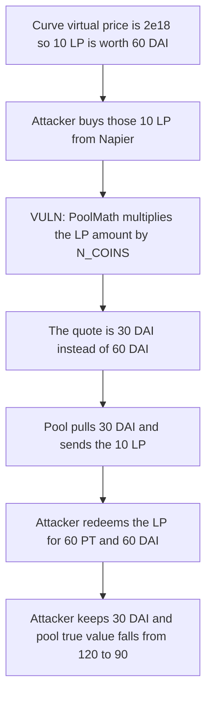

# Napier — base LP tokens are always valued at 3 PT

> **Vulnerability classes:** vuln/logic/price-calculation

<!-- non-defihacklabs -->
<!-- source-auditvault: https://github.com/Auditware/AuditVault/blob/main/findings/30577-h-3-lp-tokens-always-valued-at-3-pts-sherlock-napier-git.md -->
<!-- date: 2024-01 -->

## Key info

| | |
|---|---|
| **Protocol** | Napier |
| **Finding** | Sherlock 2024-01 H-3, AuditVault 30577 |
| **Vulnerable code** | `PoolMath.swapUnderlyingForExactBaseLpToken` |
| **Harm** | 10 base LP worth 60 DAI are sold for 30 DAI. The buyer keeps 30 DAI. Pool true value falls from 120 DAI to 90 DAI while the books stay at 60 DAI. |
| **Chain** | local synthetic (audited Ethereum contracts) |

**AuditVault taxonomy:** `lang/solidity` · `platform/sherlock` · `has/github` · `severity/high` · `sector/dex` · `sector/liquid-staking` · `sector/stable` · genome: `precision-loss` · `frontrun` · `fot-slippage` · `frontrun-exposure`

## TL;DR

Napier's AMM stores Curve tricrypto LP, not the three principal tokens themselves. The swap math multiplies every LP amount by `N_COINS` (3), because the pool was seeded 1:1:1:1. That is the right price only while Curve's virtual price is `1e18`. Fees raise the virtual price. Here it is `2e18`, so 1 LP claims 2 of each PT: 6 PT, which is 6 DAI at par. The pool still charges 3 DAI. Buying 10 LP costs 30 DAI and redeems for 60 DAI.

## The vulnerable code

The multiply is the audited line. `N_COINS` is 3.

```solidity
// @> VULN: frozen at 3 PT. Curve virtual price has grown, so 1 LP is worth more than 3 PT.
int256 internal constant N_COINS = 3;

netBaseLptToAccount = exactBaseLptOut.toInt256() * N_COINS;
```

`NapierPool._loadState` scales the reserve with the same constant: `totalBaseLptTimesN: totalBaseLpt * N_COINS`.

Fair form, which the control uses. It is the live PT basket, and it equals `N_COINS * get_virtual_price / 1e18`:

```solidity
underlyingIn = baseLptOut * tricrypto.basket() / tricrypto.totalSupply();
```

## Root cause

At the initial Curve deposit, one LP token is one PT of each of the three coins, so one LP is three PT. Curve's `get_virtual_price` starts at `1e18` and grows as trading fees increase the basket relative to LP supply. Napier never reads that price. Every later swap still pretends the LP is worth exactly three PT.

This reduction keeps the audited multiply and prices the PT-units at par (the zero-fee case of `calculateSwap` when the exchange rate is `1e18`). The logit curve is not the bug. The only wrong input is the frozen scale.

## Preconditions

The tricrypto holds three same-underlying principal tokens and its virtual price has moved off `1e18`. Here each coin balance is `200e18` and LP supply is `100e18`, so the virtual price is `2e18`. The Napier pool holds 20 of those LP and no DAI. The buyer has the 30 DAI the frozen quote asks for. PTs redeem 1:1 for DAI, which is the par assumption the `* 3` scale is there to express.

## Attack walkthrough

1. Curve's basket is 600 PT against 100 LP. `get_virtual_price` returns `2e18`. Ten LP claim 20 of each PT, which is 60 PT and 60 DAI. `10 * 3 * 2e18 / 1e18` is the same 60 DAI.
2. The attacker approves exactly 30 DAI. That is `fair - 30`.
3. `NapierPool` loads `totalBaseLptTimesN = 20 * 3 = 60` PT-units and asks `PoolMath` for the quote.
4. The vulnerable line sets `netBaseLptToAccount = 10e18 * 3 = 30e18`. At par that is a 30 DAI pull. The reserve cap of 60 PT-units lets it through.
5. The pool transfers 10 LP. The attacker burns them and receives 20 of each PT, 60 PT in total, then redeems those PTs for 60 DAI.
6. The attacker started with 30 DAI and ends with 60. Profit is 30 DAI. The pool now holds 10 LP plus 30 DAI. Books, which still mark LP at 3 DAI, stay at 60 DAI. True value falls from 120 DAI to 90 DAI.

## Diagrams



## Impact

Anyone who buys base LP from the pool pays the stale 3 PT price and redeems the LP on Curve for more. In this state the gap is one extra PT of each coin per LP, so 10 LP yields 30 DAI. The pool's internal books do not move: 20 LP marked at 3 is 60 DAI, and 10 LP marked at 3 plus the 30 DAI received is still 60 DAI. Marked to the basket, the same reserves fall from 120 DAI to 90 DAI. LPs of the Napier pool eat that loss. The other direction of the same bug underpays a seller who deposits LP the pool still marks at 3.

## Remediation

Scale LP into PT-units with the live virtual price, `amount * N_COINS * get_virtual_price / 1e18`, which is the current sum of the three PT balances per LP. The control charges 60 DAI for the same 10 LP. Redeeming them returns 60 DAI, profit is 0, and the pool's true value stays 120 DAI.

## How to reproduce

```bash
cd 30577-h-3-lp-tokens-always-valued-at-3-pts-sherlock-napier-git_exp
forge test -vv
```

## Sources

- AuditVault finding: https://github.com/Auditware/AuditVault/blob/main/findings/30577-h-3-lp-tokens-always-valued-at-3-pts-sherlock-napier-git.md
- Sherlock issue: https://github.com/sherlock-audit/2024-01-napier-judging/issues/90
- Contest repo: https://github.com/sherlock-audit/2024-01-napier
- `PoolMath.swapUnderlyingForExactBaseLpToken`: https://github.com/sherlock-audit/2024-01-napier/blob/main/v1-pool/src/libs/PoolMath.sol
- `NapierPool._loadState`: https://github.com/sherlock-audit/2024-01-napier/blob/main/v1-pool/src/NapierPool.sol
- Protocol fix noted in the finding: https://github.com/napierfi/v1-pool/pull/159
