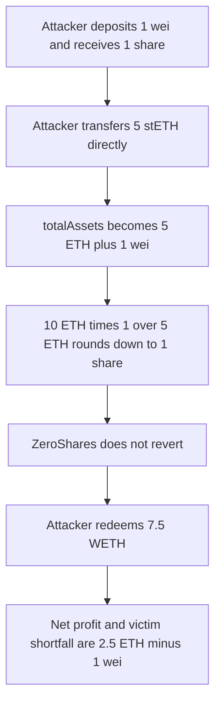

# Napier — a 1-wei share and a 5 stETH donation round a 10 WETH deposit down to 1 share

> **Vulnerability classes:** vuln/arithmetic/rounding · vuln/arithmetic/rounding-direction · vuln/logic/price-calculation

> **Reproduction:** a self-contained Foundry PoC that compiles and runs with only `forge-std` — no fork, no RPC. Full trace: [output.txt](output.txt). PoC: [test/30578-h-4-victims-fund-can-be-stolen-due-to-rounding-error-and-exc_exp.sol](test/30578-h-4-victims-fund-can-be-stolen-due-to-rounding-error-and-exc_exp.sol).

<!-- non-defihacklabs -->
<!-- source-auditvault: https://github.com/Auditware/AuditVault/blob/main/findings/30578-h-4-victims-fund-can-be-stolen-due-to-rounding-error-and-exc.md -->
<!-- date: 2024-01 -->

**AuditVault taxonomy:** `lang/solidity` · `sector/vault` · `sector/liquid-staking` · `platform/sherlock` · `has/github` · `severity/high` · genome: `rounding-direction` · `direct-drain` · `integer-bounds`

---

## Key info

| | |
|---|---|
| **Impact** | **HIGH** — attacker net profit **2499999999999999999** wei (2.5 ETH minus 1 wei). Victim deposited 10 WETH and is short the same amount |
| **Protocol** | Napier — `BaseLSTAdapter.prefundedDeposit` / `previewDeposit` |
| **Vulnerable code** | `return assets * supply / totalAssets()` after `totalAssets()` reads `stETH.balanceOf` |
| **Bug class** | Donation-inflated exchange rate, round down, and a zero-share revert that does not catch a 1-share mint |
| **Finding** | Sherlock — 2024-01-napier, jennifer37 · #30578 (H-4) |
| **Report** | [issue 94](https://github.com/sherlock-audit/2024-01-napier-judging/issues/94) |
| **Source** | [AuditVault](https://github.com/Auditware/AuditVault/blob/main/findings/30578-h-4-victims-fund-can-be-stolen-due-to-rounding-error-and-exc.md) |
| **Status** | Audit finding, reproduced as a local synthetic |
| **Compiler** | solc 0.8.27, cancun, via_ir |

The report's numbers are used as-is. Fees are ignored, as the report says.

---

## TL;DR

1. The attacker deposits **1 wei** of WETH and receives **1 share**. `if (shares == 0) revert ZeroShares()` does not fire.
2. The attacker transfers **5 ether** of stETH straight to the adapter. `totalAssets()` is `bufferEth + stETH.balanceOf`, so the rate is now 1 share per 5 ETH + 1 wei.
3. The victim deposits **10 ether** of WETH. Shares minted are `10 ether * 1 / (5 ether + 1) = 1`.
4. The attacker redeems that 1 share for **7500000000000000000** WETH. WETH gain versus the starting 1 wei is **7499999999999999999**. Subtracting the 5 ether donation, net profit is **2499999999999999999**.
5. The victim's remaining share pays **7500000000000000001** of combined WETH and stETH. Shortfall versus 10 ether is **2499999999999999999**.
6. **Control:** `previewDeposit` uses `assets * (supply + 1) / (totalAssets + 1)`. The victim receives 3 shares. The attacker is paid **3750000000000000000** WETH, which is less than the 5 ether donation, and the victim's value is **11250000000000000001**, above the 10 ether deposit.

---

## The vulnerable code

The four lines are the report's `BaseLSTAdapter.prefundedDeposit` body. `totalAssets` is the `StEtherAdapter` formula: queue plus buffer plus `stETH.balanceOf`.

```solidity
uint256 bufferEthCache = bufferEth; // cache storage reads
uint256 queueEthCache = withdrawalQueueEth; // cache storage reads
uint256 assets = weth.balanceOf(address(this)) - bufferEthCache; // amount of WETH deposited at this time
uint256 shares = previewDeposit(assets);

if (assets == 0) return (0, 0);
if (shares == 0) revert ZeroShares();
```

```solidity
function previewDeposit(uint256 assets) public view returns (uint256) {
    uint256 supply = totalSupply;
    if (supply == 0) return assets;
    // @> VULN: rounds down against donation-inflated totalAssets(), so 10 ETH mints 1 share
    return assets * supply / totalAssets();
}

function totalAssets() public view returns (uint256) {
    return uint256(withdrawalQueueEth) + uint256(bufferEth) + steth.balanceOf(address(this));
}
```

```diff
- return assets * supply / totalAssets();
+ return assets * (supply + 1) / (totalAssets() + 1);
```

The control uses that virtual-share rounding. It is the OpenZeppelin form the protocol's own discussion cites (`decimalsOffset` of 0). It is not a full dead-share seed, and the same 5 ETH donation still moves value, but the attacker no longer profits.

---

## Root cause

Two things compose. `totalAssets()` trusts `stETH.balanceOf`, so a transfer that is not a deposit raises the exchange rate. `previewDeposit` then rounds down. The only guard is `shares == 0`. A 10 ETH deposit against a 1-wei supply and a 5 ETH donation rounds to 1, not 0, so the guard does not revert and the victim is minted the same number of shares as the attacker.

## Preconditions

- The adapter has no other supply. The attacker's 1 wei is the first deposit.
- The attacker can transfer stETH directly to the adapter.
- The victim's 10 WETH is prefunded and then `prefundedDeposit` is called, which is the adapter's deposit path.

## Attack walkthrough

Numbers from [output.txt](output.txt):

| | Buggy `assets * supply / totalAssets` | Control `(supply + 1) / (totalAssets + 1)` |
|---|---|---|
| Victim shares | `1` | `3` |
| Attacker WETH out | `7500000000000000000` | `3750000000000000000` |
| Attacker WETH gain vs 1 wei | `7499999999999999999` | n/a, the 1 wei was already sent |
| Attacker net after 5 stETH | `2499999999999999999` | negative, 3.75 WETH against 5 stETH |
| Victim value out | `7500000000000000001` | `11250000000000000001` |
| Victim shortfall vs 10 WETH | `2499999999999999999` | none |

## Diagrams



## Impact

The attacker spends 5 ether of stETH plus 1 wei of WETH and receives 7.5 ether of WETH. Net profit is 2499999999999999999 wei. The victim deposits 10 ether of WETH, is minted 1 share, and withdraws 7500000000000000001 wei of value. That is a shortfall of 2499999999999999999 wei, a quarter of the deposit, which is the figure in the report.

## Remediation

Do not let a direct token transfer change the exchange rate. Track assets in storage. And mint a virtual supply, `assets * (supply + 1) / (totalAssets + 1)`, so a 1-wei supply cannot price a 10 ETH deposit as 1 share. The report also recommends minting dead shares at deployment. The control demonstrates the virtual-share rounding on this same sequence.

## Sources

- AuditVault finding: https://github.com/Auditware/AuditVault/blob/main/findings/30578-h-4-victims-fund-can-be-stolen-due-to-rounding-error-and-exc.md
- Sherlock judging issue 94: https://github.com/sherlock-audit/2024-01-napier-judging/issues/94
- `BaseLSTAdapter.prefundedDeposit`: https://github.com/sherlock-audit/2024-01-napier/blob/main/napier-v1/src/adapters/BaseLSTAdapter.sol
- `StEtherAdapter.totalAssets`: https://github.com/sherlock-audit/2024-01-napier/blob/main/napier-v1/src/adapters/lido/StEtherAdapter.sol
