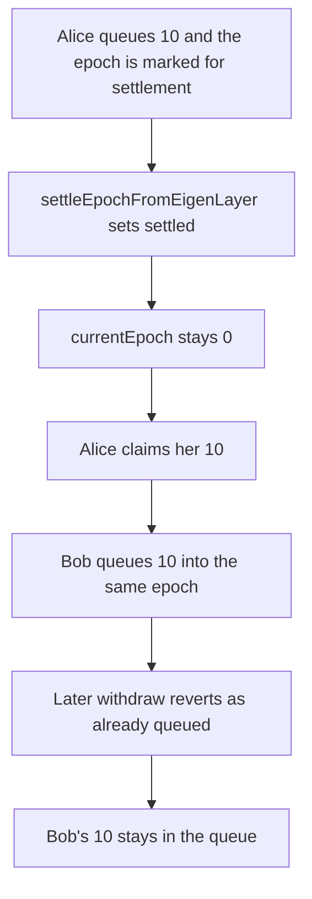

# Rio — settling an EigenLayer epoch does not increment it, so a later withdrawal reverts and 10 tokens stay in the queue

> **Vulnerability classes:** vuln/logic/incorrect-state-transition · vuln/dos/frozen-funds · vuln/logic/missing-check

> **Reproduction:** a self-contained Foundry PoC that compiles and runs with only `forge-std` — no fork, no RPC. Full trace: [output.txt](output.txt). PoC: [test/30896-h-1-creating-new-withdrawal-requests-in-conjunction-with-set_exp.sol](test/30896-h-1-creating-new-withdrawal-requests-in-conjunction-with-set_exp.sol).

<!-- non-defihacklabs -->
<!-- source-auditvault: https://github.com/Auditware/AuditVault/blob/main/findings/30896-h-1-creating-new-withdrawal-requests-in-conjunction-with-set.md -->
<!-- date: 2024-02 -->

**AuditVault taxonomy:** `lang/solidity` · `platform/sherlock` · `has/github` · `severity/high` · `sector/restaking` · `sector/staking` · genome: `missing-modifier` · `locked-funds` · `access-roles`

---

## Key info

| | |
|---|---|
| **Impact** | **HIGH** — Bob's later withdraw reverts and his **10 ether** (`10000000000000000000`) stays in the queue. His balance is 0. Alice was paid her 10 |
| **Protocol** | Rio Network — `RioLRTWithdrawalQueue.settleEpochFromEigenLayer` |
| **Vulnerable code** | `epochWithdrawals.settled = true` then `assetsReceived = sharesOwed`, with no `currentEpoch += 1` |
| **Bug class** | A settled epoch stays current, so a new withdrawal cannot be queued or settled again |
| **Finding** | Sherlock — 2024-02-rio-network, mussucal · #30896 (H-1) |
| **Report** | [issue 4](https://github.com/sherlock-audit/2024-02-rio-network-core-protocol-judging/issues/4) |
| **Source** | [AuditVault](https://github.com/Auditware/AuditVault/blob/main/findings/30896-h-1-creating-new-withdrawal-requests-in-conjunction-with-set.md) |
| **Status** | Audit finding, reproduced as a local synthetic |
| **Compiler** | solc 0.8.27, cancun, via_ir |

No `vm.warp`. The 7-day EigenLayer delay is not what locks the funds. The lock is the missing epoch increment, and that is what this single-block run shows.

---

## TL;DR

1. Alice queues **10 ether**. `queueCurrentEpochSettlement` stores an aggregate root and does **not** increment `currentEpoch`.
2. `settleEpochFromEigenLayer` sets `settled` and freezes `assetsReceived` at 10. `currentEpoch` is still 0.
3. Alice claims her 10. The queue balance returns to 0.
4. Bob queues another **10 ether** into epoch 0. `sharesOwed` becomes 20. `assetsReceived` stays 10. His tokens are now in the queue.
5. Bob's later `withdrawRemaining` reverts `WITHDRAWALS_ALREADY_QUEUED_FOR_EPOCH`. The queue still holds `10000000000000000000`. Bob's balance is 0.
6. **Control:** `queueCurrentEpochSettlement` increments the epoch. Bob's 10 is epoch 1, the later withdraw settles it, and Bob is paid 10. The fixed queue's balance ends at 0.

---

## The vulnerable code

`settleCurrentEpoch` does `currentEpoch[asset] += 1`. `settleEpochFromEigenLayer` does not. `queueCurrentEpochSettlement` does not either. That is the report's gap. The protocol's fix adds the increment inside `queueCurrentEpochSettlement`.

```solidity
if (epochWithdrawals.sharesOwed == 0) revert NO_SHARES_OWED_IN_EPOCH();
if (epochWithdrawals.settled) revert EPOCH_ALREADY_SETTLED();
if (epochWithdrawals.aggregateRoot == bytes32(0)) revert WITHDRAWALS_NOT_QUEUED_FOR_EPOCH();
epochWithdrawals.settled = true;
// @> VULN: assetsReceived is frozen here and currentEpoch is not incremented
epochWithdrawals.assetsReceived = epochWithdrawals.sharesOwed;
```

The later withdraw is the report's rebalance revert:

```solidity
function withdrawRemaining() external {
    address asset = address(token);
    uint256 epoch = currentEpoch[asset];
    if (epochs[asset][epoch].aggregateRoot != bytes32(0)) revert WITHDRAWALS_ALREADY_QUEUED_FOR_EPOCH();
    settleCurrentEpoch();
}
```

```diff
     epochWithdrawals.aggregateRoot = aggregateRoot;
+    currentEpoch[asset] += 1;
```

That is the one-line change the Rio team shipped in `queueCurrentEpochSettlement`.

---

## Root cause

Incoming withdrawals are booked on `currentEpoch`. The only increment in this contract is `settleCurrentEpoch`, and that runs only when the deposit pool can already cover the epoch. The EigenLayer path marks the epoch settled and records what it received, then leaves the counter where it was. Anything queued after that, including during the wait the report describes, increases `sharesOwed` on an epoch that already has an aggregate root and is already settled. `queueCurrentEpochSettlement` cannot run again, and `settleEpochFromEigenLayer` reverts `EPOCH_ALREADY_SETTLED`. There is no epoch left to put the new withdrawal in.

## Preconditions

- Epoch 0 has a queued withdrawal and a non-zero aggregate root.
- `settleEpochFromEigenLayer` has run, so the epoch is settled and `currentEpoch` is still 0.
- A second user calls `queueWithdrawal` for the same asset.

## Attack walkthrough

Numbers from [output.txt](output.txt):

| | Buggy queue | Fixed queue, epoch incremented at queue time |
|---|---|---|
| `currentEpoch` after settle | `0` | `1` before Bob queues |
| Alice paid | `10000000000000000000` | `10000000000000000000` |
| Later withdraw | reverts `WITHDRAWALS_ALREADY_QUEUED_FOR_EPOCH` | settles epoch 1 |
| Bob's balance | `0` | `10000000000000000000` |
| Tokens left in the queue | `10000000000000000000` | `0` |

## Diagrams



## Impact

Bob transfers 10 ether into the queue and cannot withdraw it. `withdrawRemaining` reverts, his token balance stays 0, and the queue balance stays `10000000000000000000`. Alice, who withdrew before the epoch was settled, is paid in full. The fixed queue pays Bob the same 10 and ends empty.

## Remediation

Increment `currentEpoch` when the epoch is queued for EigenLayer settlement, which is what Rio did in `queueCurrentEpochSettlement`. Requests that arrive after that point belong to the next epoch and can be settled on their own.

## Sources

- AuditVault finding: https://github.com/Auditware/AuditVault/blob/main/findings/30896-h-1-creating-new-withdrawal-requests-in-conjunction-with-set.md
- Sherlock judging issue 4: https://github.com/sherlock-audit/2024-02-rio-network-core-protocol-judging/issues/4
- `RioLRTWithdrawalQueue` at contest commit `4f01e065`: https://github.com/sherlock-audit/2024-02-rio-network-core-protocol/blob/4f01e065c1ed346875cf5b05d2b43e0bcdb4c849/rio-sherlock-audit/contracts/restaking/RioLRTWithdrawalQueue.sol
- Fix note in the judging thread: increment inside `queueCurrentEpochSettlement` (rio-org/rio-sherlock-audit pull 1)
