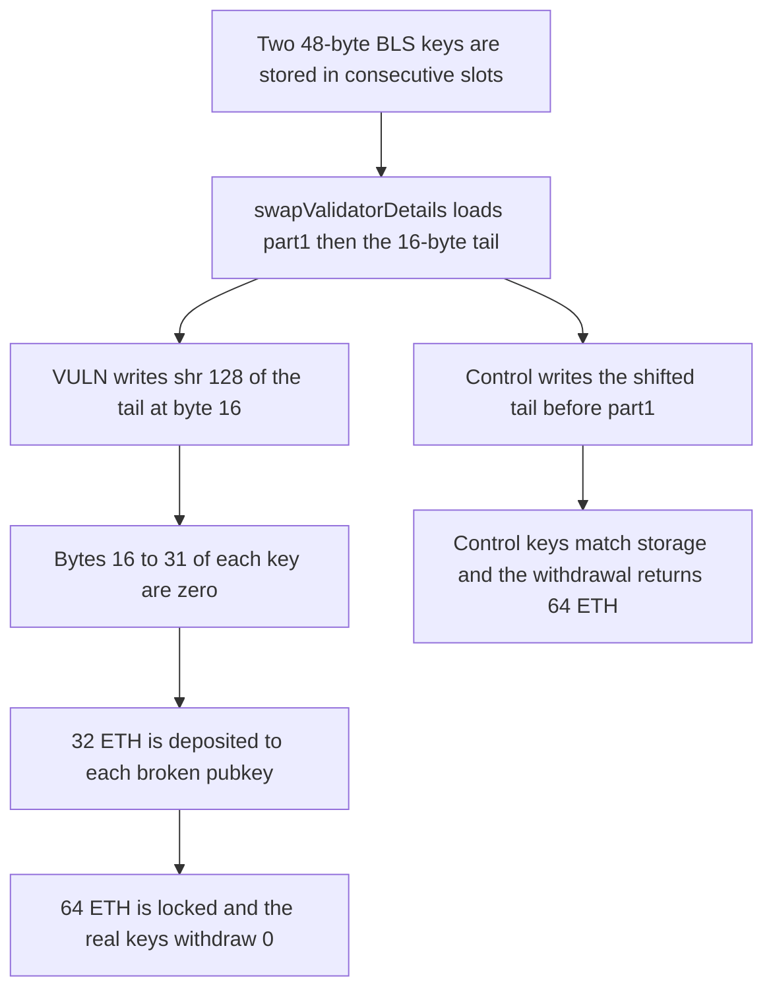

# Rio Network: swapped BLS keys are zeroed in the middle and 64 ETH stays in the beacon deposit

> **Vulnerability classes:** vuln/dos/frozen-funds · vuln/logic/incorrect-order-of-operations

<!-- non-defihacklabs -->
<!-- source-auditvault: https://github.com/Auditware/AuditVault/blob/main/findings/30900-h-5-swapvalidatordetails-incorrectly-writes-keys-to-memory-r.md -->
<!-- date: 2024-02 -->

## Key info

| Field | Value |
|---|---|
| **Loss** | 64 ETH deposited to two corrupted BLS pubkeys. Withdrawal with the real keys returns 0 |
| **Vulnerable contract** | `ValidatorDetails.swapValidatorDetails` |
| **Attacker EOA** | `0x1111111111111111111111111111111111111111` (the operator registry caller) |
| **Attack contract** | `Exploit` |
| **Attack tx** | `Exploit.run()` |
| **Chain / block / date** | Ethereum model · block 0 · 2024-02 |
| **Compiler** | solc 0.8.27, cancun, via IR |
| **Bug class** | 48-byte BLS key load writes the shifted tail over the middle 16 bytes |

## TL;DR

`swapValidatorDetails` loads a 48-byte BLS public key with `mstore(key+0x20, part1)` and then `mstore(key+0x30, shr(128, part2))`. The second write starts 16 bytes into the first word, and the shift fills those 16 bytes with zeros. `reportOutOfOrderValidatorExits` then deposits 32 ETH per validator to a pubkey nobody can sign for. Two validators lock 64 ETH. The real keys withdraw 0. Storing the shifted tail before `part1` keeps the key and withdraws all 64 ETH.

## Background

Sherlock's February 2024 Rio Network Core Protocol contest, issue 84 (H-5), reported by 0xkaden, Stiglitz, and hash. A BLS public key is 48 bytes, stored as 32 bytes plus a left-aligned 16-byte tail. The example key in the report is `0x95cfcb859956953f9834f8b14cdaa939e472a2b5d0471addbe490b97ed99c6eb8af94bc3ba4d4bfa93d087d522e4b78d`. Rio fixed the mstore order in `rio-org/rio-sherlock-audit` pull 2.

## The vulnerable code

```solidity
mstore(add(key1, 0x20), part1a) // Store bytes 0..31
// @> VULN: shr(128, _part2) is written 16 bytes into part1, so bytes 16..31 of the 48-byte BLS key become zero
assembly {
    mstore(add(key1, 0x30), shr(128, part2a)) // Store bytes 16..47
}
```

`part2` holds the last 16 key bytes in the high half of the word. `shr(128, part2)` moves them to the low half and leaves the high half zero. Writing that word at offset `0x30` replaces bytes 16..31, which the first mstore had just set to `e472a2b5d0471addbe490b97ed99c6eb`.

The recommended change, from the judging report, stores the tail first so `part1` covers the padding:

```diff
- mstore(add(key1, 0x20), _part1) // Store bytes 0..31
- mstore(add(key1, 0x30), shr(128, _part2)) // Store bytes 16..47
+ mstore(add(key1, 0x30), shr(128, _part2)) // Store bytes 16..47
+ mstore(add(key1, 0x20), _part1) // Store bytes 0..31
```

The same swap is required for the second key.

## Root cause

The two mstores overlap by 16 bytes, and the later one carries 16 bytes of zeros in its high half. Memory ends up as 16 correct bytes, 16 zero bytes, and the original 16-byte tail. The chisel dump in issue 84 shows that layout at the free-memory pointer. `allocateETHDeposits` reads those bytes and `stakeETH` passes them to the beacon deposit contract.

## Preconditions

- Two validator records hold 48-byte BLS keys. The first is the key quoted in issue 84.
- `reportOutOfOrderValidatorExits` calls `swapValidatorDetails` for those indexes.
- Each allocation deposits `ETH_DEPOSIT_SIZE`, 32 ETH. This run deposits both swapped validators.

## Attack walkthrough

1. Operator 1 stores the report's key at index 0 and a second key at index 1.
2. The swap loads both keys. The first 32 bytes are written, then the shifted tail is written 16 bytes later.
3. Bytes 16..31 of the first key are zero. The second key is packed the same way.
4. 32 ETH is deposited to each broken pubkey. The beacon balance is 64 ETH.
5. Withdrawal with the original 48 bytes finds no deposit and returns 0.
6. The control reverses the mstore order. Both keys match the originals, and the withdrawal returns 64 ETH.

## Diagrams



## Impact

The beacon deposit contract holds 64 ETH after the two allocations. The operator's original public keys withdraw 0 ETH, because the deposited pubkeys have 16 zero bytes in the middle and no one has the matching private keys. The 64 ETH cannot be exited. The control, which stores the tail before `part1`, withdraws the full 64 ETH and leaves the beacon empty.

## Remediation

Write `mstore(key+0x30, shr(128, part2))` before `mstore(key+0x20, part1)` for both keys, which is the change recommended on issue 84 and applied in Rio pull 2.

## How to reproduce

```bash
cd 30900-h-5-swapvalidatordetails-incorrectly-writes-keys-to-memory-r_exp
forge test -vv
```

`test_exploit_corrupted_bls_keys_lock_64_eth` asserts a 64 ETH beacon balance, a zero withdrawal on the real key, and a zeroed middle. `test_control_fixed_mstore_order_withdraws_64_eth` asserts the reversed mstore order preserves a nonzero middle byte and returns all 64 ETH. Captured output is `output.txt`.

## Sources

- AuditVault finding: https://github.com/Auditware/AuditVault/blob/main/findings/30900-h-5-swapvalidatordetails-incorrectly-writes-keys-to-memory-r.md
- Sherlock judging issue 84: https://github.com/sherlock-audit/2024-02-rio-network-core-protocol-judging/issues/84
- Fix: https://github.com/rio-org/rio-sherlock-audit/pull/2
- Blamed lines: https://github.com/sherlock-audit/2024-02-rio-network-core-protocol/blob/main/rio-sherlock-audit/contracts/utils/ValidatorDetails.sol#L151
