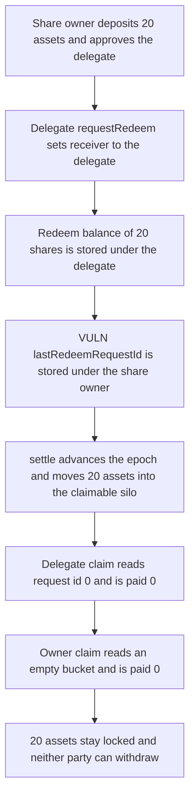

# Amphor AsyncSynthVault — delegated requestRedeem locks the assets

> **Vulnerability classes:** vuln/dos/frozen-funds · vuln/logic/missing-check · vuln/logic/incorrect-state-transition

<!-- non-defihacklabs -->
<!-- source-auditvault: https://github.com/Auditware/AuditVault/blob/main/findings/30917-h-2-calling-requestredeem-with-msgsender-owner-will-lead-to.md -->
<!-- date: 2024-03 -->

## Key info

| | |
|---|---|
| **Protocol** | Amphor |
| **Finding** | Sherlock 2024-03 H-2, AuditVault 30917 |
| **Vulnerable code** | `AsyncSynthVault._createRedeemRequest` |
| **Harm** | 20 assets locked in the claimable silo; owner and delegate each claim 0 |
| **Chain** | local synthetic |

## TL;DR

`requestRedeem` may be called by a delegate who holds share allowance. The vault credits `redeemRequestBalance[receiver]` and then stores the epoch on `lastRedeemRequestId[owner]`. `claimRedeem` always reads `lastRedeemRequestId[msg.sender]` and that caller's bucket. After `settle()` advances the epoch, the delegate's id is still 0 and the owner's bucket is empty. The 20 assets moved into the claimable silo stay there. Neither party can withdraw them.

## The vulnerable code

```solidity
epochs[epochId].redeemRequestBalance[receiver] += shares;
// FIX: lastRedeemRequestId[receiver] = epochId;
// @> VULN: claimRedeem reads lastRedeemRequestId[msg.sender]; this stores the owner
lastRedeemRequestId[owner] = epochId;
```

This is the audited assignment. The balance is indexed by the receiver, the request id by the owner. `claimRedeem` uses one address, `msg.sender`, for both lookups.

## Root cause

Amphor's async vault allows one open redeem request per user and records which epoch it belongs to in `lastRedeemRequestId`. On claim, the caller is treated as the owner of that request:

```solidity
uint256 lastRequestId = lastRedeemRequestId[owner];
uint256 shares = epochs[lastRequestId].redeemRequestBalance[owner];
```

`owner` here is `msg.sender`, not the `owner` argument of `requestRedeem`. A delegated call therefore writes the index in a slot the claim path never reads, and stores the balance in a slot the owner's claim does not read. `settle()` burns the escrowed shares and moves the underlying into the claimable silo. The silo can only be drawn by a claim that finds a non-zero balance, so the assets are stuck.

## Preconditions

The share owner has deposited and approved a delegate for the shares. The vault is closed, which is when `requestRedeem` is allowed. The delegate calls `requestRedeem(shares, delegate, owner)`. The vault owner then calls `settle()`, which advances `epochId` in the same transaction. No block timestamp change is required.

## Attack walkthrough

1. The share owner deposits 20 assets and receives 20 shares, then approves the delegate for those shares.
2. `close()` shuts the vault. `epochId` is 1.
3. The delegate calls `requestRedeem(20 shares, receiver = delegate, owner = share owner)`.
4. The vault moves the 20 shares into the pending silo, adds 20 to `redeemRequestBalance[delegate]`, and sets `lastRedeemRequestId[share owner] = 1`. The delegate's id stays 0.
5. `settle()` burns the pending shares, transfers 20 assets to the claimable silo, and sets `epochId` to 2.
6. The delegate calls `claimRedeem`. The lookup is `lastRedeemRequestId[delegate] == 0`, the bucket is empty, and the transfer amount is 0.
7. The share owner calls `claimRedeem`. The id is epoch 1, but `redeemRequestBalance[share owner]` is 0. The transfer amount is 0.
8. The claimable silo still holds 20 assets. Both asset balances and both share balances are 0. The delegate's epoch-1 bucket still records 20 shares that no claim reads.

The control writes `lastRedeemRequestId[receiver] = epochId` and runs the same deposit, approval, close, request, and settle. The delegate's claim then pays 20 assets and the silo balance falls to 0. The owner's claim still pays 0, which is the intended split: the receiver is the claimant.

## Diagrams



## Impact

The owner's shares are taken into the redeem flow and the matching assets are locked in the vault's claimable silo. There is no later call that pairs the delegate's balance with the owner's request id, so the loss is permanent until the contract is upgraded. The delegate does not receive the assets either.

## Remediation

In `_createRedeemRequest`, store the epoch on the receiver, the same address whose redeem balance was just increased:

```solidity
lastRedeemRequestId[receiver] = epochId;
```

That is the change Amphor shipped. `claimRedeem` can then see the request when the receiver calls.

## How to reproduce

```bash
cd 30917-h-2-calling-requestredeem-with-msgsender-owner-will-lead-to_exp
forge test -vv
```

## Sources

- AuditVault finding: https://github.com/Auditware/AuditVault/blob/main/findings/30917-h-2-calling-requestredeem-with-msgsender-owner-will-lead-to.md
- Sherlock judging: https://github.com/sherlock-audit/2024-03-amphor-judging/issues/85
- Vulnerable function: https://github.com/sherlock-audit/2024-03-amphor/blob/6c797025ffe296e04607abf74400ff2bb36a7de3/asynchronous-vault/src/AsyncSynthVault.sol
- Protocol fix: https://github.com/AmphorProtocol/asynchronous-vault/pull/103
