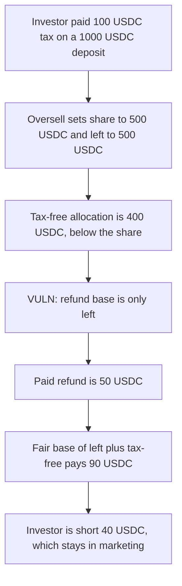

# Zap TokenSale — tax refund uses the wrong base

> **Vulnerability classes:** vuln/logic/fee-calculation

<!-- non-defihacklabs -->
<!-- source-auditvault: https://github.com/Auditware/AuditVault/blob/main/findings/31190-h-1-tax-refund-is-calculated-based-on-the-wrong-amount-sherl.md -->
<!-- date: 2024-03 -->

## Key info

| | |
|---|---|
| **Protocol** | Zap Protocol |
| **Finding** | Sherlock 2024-03 H-1, AuditVault 31190 |
| **Vulnerable code** | `TokenSale.claim` |
| **Harm** | Paid tax refund is 50 USDC. Fair refund is 90 USDC. The investor is short 40 USDC. |
| **Chain** | local synthetic |

## TL;DR

After an oversold private sale, `claim` refunds tax on `left` only. A 1,000 USDC deposit is split into a 500 USDC share and a 500 USDC `left`. The investor's tax-free allocation is 400 USDC, which is below the share, so the full-refund branch does not run. At a 10 percent rate the contract pays `(500 * 100) / 1000 = 50` USDC. The corrected base is `left` plus the tax-free allocation, `(900 * 100) / 1000 = 90` USDC. Marketing keeps 50 USDC of the 100 USDC tax instead of 10.

## The vulnerable code

```solidity
uint256 tax = userTaxRate(s.amount, msg.sender);
uint256 taxFreeAllc = _maxTaxfreeAllocation(msg.sender) * PCT_BASE;
if (taxFreeAllc >= s.share) {
    refundTaxAmount = s.taxAmount;
} else {
    // @> VULN: base is only left, so the 400 USDC tax-free allocation is omitted
    refundTaxAmount = (left * tax) / POINT_BASE;
}
usdc.safeTransferFrom(marketingWallet, msg.sender, refundTaxAmount);
```

`POINT_BASE` is 1000 and `globalTaxRate` is 100. `left` is 500 USDC. `taxFreeAllc` is 400 USDC. The else branch is the one that runs.

## Root cause

The partial-refund formula multiplies only the unused principal. The tax-free allocation was already loaded into `taxFreeAllc` and is used for the `>= s.share` check, then dropped from the base. Sherlock's recommendation adds it back: `refundTaxAmount = ((left + taxFreeAllc) * tax) / POINT_BASE`. The escalation that tried to invalidate the issue was rejected. The finding stayed High.

## Preconditions

The investor deposited 1,000 USDC and paid a 10 percent tax, 100 USDC, into the marketing wallet. The sale oversold: `totalPrivateSold` is twice `totalSupplyInValue`, so the stake becomes a 500 USDC share and a 500 USDC `left`. Staking reports a tax-free allocation of 400, below that share. The epoch is Finished and claims are not blocked.

Deposit needs epoch Private and claim needs epoch Finished. One timestamp cannot be both, so `run()` writes that post-deposit state directly. No `vm.warp`.

## Attack walkthrough

1. The investor is minted the 100 USDC tax and the 500 USDC of unused principal, and approves TokenSale.
2. The finished, oversold stake is seated. Marketing receives 100 USDC. The sale contract receives the 500 USDC it must return.
3. `canClaim` reports share 500 USDC and left 500 USDC. Staking reports a 400 USDC tax-free allocation.
4. `claim` passes the epoch check. `left > 0`, so the sibling "nothing to claim" gate does not fire.
5. `taxFreeAllc` is 400 USDC, which is less than the 500 USDC share. The else branch runs.
6. The refund is `(left * tax) / POINT_BASE` = 50 USDC. Marketing sends 50 USDC and keeps 50.
7. The fair refund on `left + taxFreeAllc` is 90 USDC. The shortfall is 40 USDC.

The control is the same body with the corrected base. It pays 90 USDC of tax on top of the 500 USDC principal. Marketing ends at 10 USDC, the tax on the 100 USDC of share that is not tax-free.

## Diagrams



## Impact

The investor receives a 50 USDC tax refund instead of 90 USDC. 40 USDC that the corrected formula would have returned stays in the marketing wallet. Marketing's balance rises by 50 USDC over the call: the 100 USDC tax comes in and only 50 USDC goes back. On the fixed claim the same stake returns 90 USDC and marketing keeps 10.

## Remediation

In the branch where the tax-free allocation is below `share`, set `refundTaxAmount = ((left + taxFreeAllc) * tax) / POINT_BASE`.

## How to reproduce

```bash
cd 31190-h-1-tax-refund-is-calculated-based-on-the-wrong-amount-sherl_exp
forge test -vv
```

## Sources

- AuditVault finding: https://github.com/Auditware/AuditVault/blob/main/findings/31190-h-1-tax-refund-is-calculated-based-on-the-wrong-amount-sherl.md
- Sherlock report: https://github.com/sherlock-audit/2024-03-zap-protocol-judging
- Sherlock issue: https://github.com/sherlock-audit/2024-03-zap-protocol-judging/issues/57
- Vulnerable function: https://github.com/sherlock-audit/2024-03-zap-protocol/blob/c2ad35aa844899fa24f6ed0cbfcf6c7e611b061a/zap-contracts-labs/contracts/TokenSale.sol#L385
