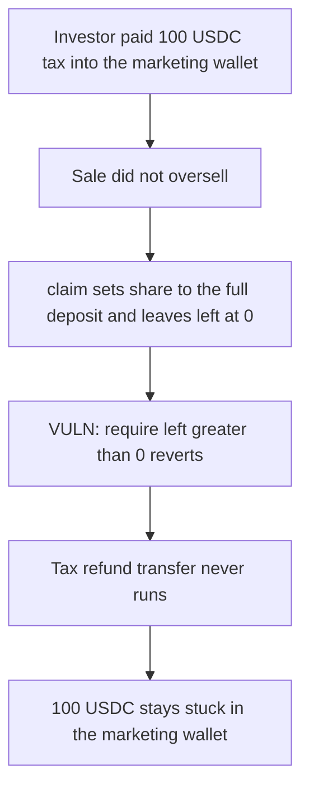

# Zap TokenSale — tax refund stuck when the sale does not oversell

> **Vulnerability classes:** vuln/dos/frozen-funds · vuln/logic/reward-calculation · vuln/logic/wrong-condition

<!-- non-defihacklabs -->
<!-- source-auditvault: https://github.com/Auditware/AuditVault/blob/main/findings/31191-h-2-if-token-does-not-oversell-users-cannot-claim-tax-refund.md -->
<!-- date: 2024-03 -->

## Key info

| | |
|---|---|
| **Protocol** | Zap Protocol |
| **Finding** | Sherlock 2024-03 H-2, AuditVault 31191 |
| **Vulnerable code** | `TokenSale.claim` |
| **Harm** | 100 USDC tax refund stuck in the marketing wallet. The investor receives 0. |
| **Chain** | local synthetic |

## TL;DR

`claim` refunds tax only after `require(left > 0)`. `_claim` sets `left` only when `totalPrivateSold > totalSupplyInValue`. If the sale did not oversell, `left` stays 0, the require reverts with `TokenSale: Nothing to claim`, and the tax-free branch never runs. An investor whose allocation covers the whole stake is owed the full tax back, here 100 USDC, and cannot take it. Removing the require pays that 100 USDC.

## The vulnerable code

```solidity
(s.share, left) = _claim(s);
// @> VULN: left is 0 when the sale did not oversell, so this require blocks the tax refund
require(left > 0, "TokenSale: Nothing to claim");
uint256 refundTaxAmount;
if (s.taxAmount > 0) {
    uint256 tax = userTaxRate(s.amount, msg.sender);
    uint256 taxFreeAllc = _maxTaxfreeAllocation(msg.sender) * PCT_BASE;
    if (taxFreeAllc >= s.share) {
        refundTaxAmount = s.taxAmount;
    } else {
        refundTaxAmount = (left * tax) / POINT_BASE;
    }
    usdc.safeTransferFrom(marketingWallet, msg.sender, refundTaxAmount);
}
```

`_claim` leaves `left` at 0 in the non-oversold branch and sets `share` to the full deposit. The refund that follows would be the whole `s.taxAmount` when the tax-free allocation covers `share`.

## Root cause

The surplus check is applied to the whole claim, including the tax refund. The refund does not need a surplus. Sherlock's escalation kept the finding: a tax-free allocation is still owed when the sale does not oversell.

## Preconditions

The investor deposited 1,000 USDC and paid a 10 percent tax, 100 USDC, into the marketing wallet. Staking reports a tax-free allocation of 1,000, which covers the whole stake. `totalSupplyInValue` is twice `totalPrivateSold`, so the sale did not oversell. The epoch is Finished and claims are not blocked.

Deposit needs epoch Private and claim needs epoch Finished. One timestamp cannot be both, so `run()` writes that post-deposit state directly. No `vm.warp`.

## Attack walkthrough

1. The investor is minted the 100 USDC tax and approves TokenSale.
2. The finished, non-oversold stake is seated. The 100 USDC moves into the marketing wallet.
3. `claim` passes the epoch check. `_claim` returns `left == 0`.
4. `require(left > 0)` reverts with `TokenSale: Nothing to claim`.
5. The investor's balance stays 0. The marketing wallet still holds 100 USDC, and `claimed` stays false.

The control is the same body without that require. `_maxTaxfreeAllocation() * PCT_BASE` equals `share`, so `refundTaxAmount` is the full 100 USDC. The investor receives 100 USDC and the marketing wallet ends at 0.

## Diagrams



## Impact

The investor loses the 100 USDC tax refund. The tokens stay in the marketing wallet. The same stake on the fixed claim is paid 100 USDC.

## Remediation

Delete `require(left > 0, "TokenSale: Nothing to claim")`. A zero surplus must still reach the tax-refund transfer. Keep the `Nothing to claim` revert only for a caller whose surplus and tax refund are both zero.

## How to reproduce

```bash
cd 31191-h-2-if-token-does-not-oversell-users-cannot-claim-tax-refund_exp
forge test -vv
```

## Sources

- AuditVault finding: https://github.com/Auditware/AuditVault/blob/main/findings/31191-h-2-if-token-does-not-oversell-users-cannot-claim-tax-refund.md
- Sherlock report: https://github.com/sherlock-audit/2024-03-zap-protocol-judging
- Sherlock issue: https://github.com/sherlock-audit/2024-03-zap-protocol-judging/issues/58
- Vulnerable function: https://github.com/sherlock-audit/2024-03-zap-protocol/blob/c2ad35aa844899fa24f6ed0cbfcf6c7e611b061a/zap-contracts-labs/contracts/TokenSale.sol#L377
