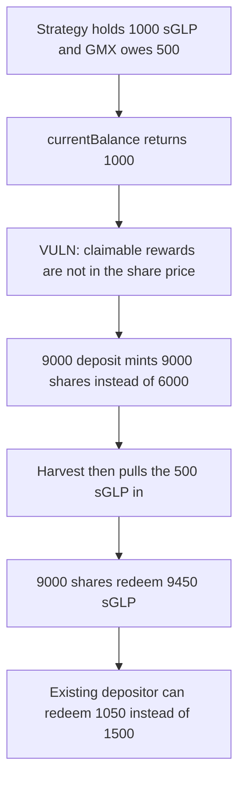

# Tapioca GlpStrategy — deposits mint against a balance that hides GMX rewards

> **Vulnerability classes:** vuln/logic/reward-calculation · vuln/logic/missing-check · vuln/logic/price-calculation

<!-- non-defihacklabs -->
<!-- source-auditvault: https://github.com/Auditware/AuditVault/blob/main/findings/31527-c-02-attackers-can-steal-unclaimed-rewards-from-glpstrategy.md -->
<!-- date: 2024-02 -->

## Key info

| | |
|---|---|
| **Protocol** | Tapioca DAO YieldBox / GlpStrategy |
| **Finding** | Pashov 2024-02 C-02, AuditVault 31527 |
| **Vulnerable code** | `GlpStrategy._currentBalance` |
| **Harm** | 450 sGLP stolen from 500 of unclaimed rewards; the existing depositor can redeem 1,050 instead of 1,500 |
| **Chain** | local synthetic |

## TL;DR

`_currentBalance` is sGLP held by the strategy plus rewards that were already harvested and not yet swapped to GLP. Rewards still claimable on GMX are not included. An existing depositor has 1,000 shares against 1,000 sGLP, and GMX owes the strategy 500 more. A 9,000 sGLP deposit is minted 9,000 shares, as if the pool were only 1,000. The deposit then harvests the 500. Redeeming the 9,000 shares pays 9,450 sGLP. The attacker gains 450. The original depositor is left able to redeem 1,050, not 1,500.

## The vulnerable code

```solidity
function _currentBalance() internal view virtual returns (uint256 amount) {
    // @> VULN: sGLP on hand is the whole share price. GMX claimable is not added.
    amount = sglp.balanceOf(address(this));
    amount += pendingRewards();
}
```

`pendingRewards` is the harvested-but-unswapped bucket. In this state it is 0. `deposit` reads this balance, mints shares, and only then calls `harvest`, which pulls GMX claimable into sGLP.

## Root cause

Share minting and the harvest are ordered so the balance used for the mint does not contain the rewards the harvest is about to realize. Anyone can deposit while claimable rewards are nonzero, receive too many shares, and withdraw a slice of rewards that accrued to the previous supply.

## Preconditions

The strategy holds 1,000 sGLP and the YieldBox supply is 1,000 shares, all owned by the existing depositor. GMX `claimable` for the strategy is 500. Harvested-but-unswapped rewards are 0. The attacker has 9,000 sGLP.

## Attack walkthrough

1. GMX claimable is 500. `_currentBalance` returns 1,000.
2. The attacker deposits 9,000. Shares minted are `9000 * 1000 / 1000 = 9000`. Counting the 500 would have minted `9000 * 1000 / 1500 = 6000`.
3. Harvest runs after the mint. The strategy's sGLP becomes 1,000 + 500 + 9,000 = 10,500. Supply is 10,000 shares.
4. The attacker withdraws 9,000 shares. `9000 * 10500 / 10000 = 9450` sGLP is paid out.
5. 1,050 sGLP and 1,000 shares remain. The existing depositor can redeem 1,050. Fair value of those shares was 1,500. The 450 difference is the attacker's profit.

The control adds `gmx.claimable` to `_currentBalance`. The same 9,000 deposit mints 6,000 shares and withdraws exactly 9,000 sGLP. The existing depositor's preview is 1,500.

## Diagrams



## Impact

The attacker deposits 9,000 sGLP and withdraws 9,450. 450 sGLP of rewards that had accrued to the existing 1,000 shares is transferred to the attacker. The existing depositor's claim falls from 1,500 sGLP to 1,050 sGLP. A larger deposit against a smaller pool takes a larger fraction of whatever is claimable. The report's flash-loan note is the same mint-then-harvest ordering with borrowed sGLP; this reduction uses the attacker's own 9,000.

## Remediation

Include GMX-claimable rewards, valued in GLP, in `_currentBalance` before shares are minted. Harvesting after the mint is safe only if that balance already contained what the harvest will realize.

## How to reproduce

```bash
cd 31527-c-02-attackers-can-steal-unclaimed-rewards-from-glpstrategy_exp
forge test -vv
```

## Sources

- AuditVault finding: https://github.com/Auditware/AuditVault/blob/main/findings/31527-c-02-attackers-can-steal-unclaimed-rewards-from-glpstrategy.md
- Pashov report: https://github.com/solodit/solodit_content/blob/main/reports/Pashov%20Audit%20Group/2024-02-01-TapiocaDAO.md
