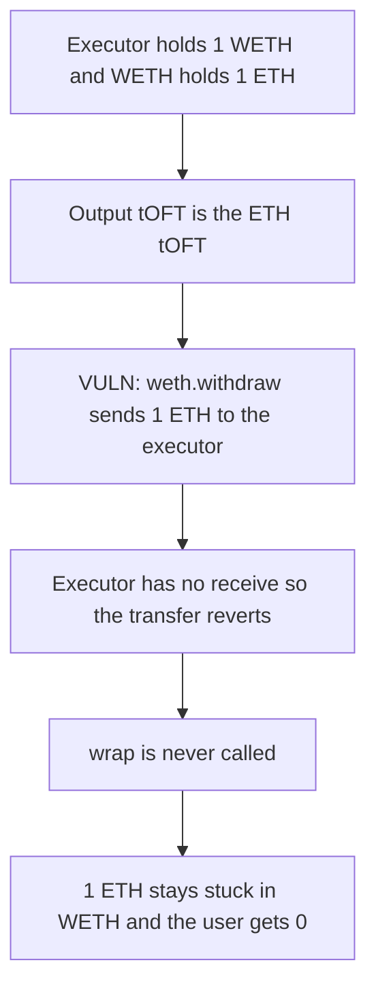

# Tapioca BaseLeverageExecutor — WETH withdraw reverts with no receive()

> **Vulnerability classes:** vuln/dos/frozen-funds · vuln/logic/missing-check

<!-- non-defihacklabs -->
<!-- source-auditvault: https://github.com/Auditware/AuditVault/blob/main/findings/31529-h-02-baseleverageexecutor-doesnt-have-a-receive-method-to-re.md -->
<!-- date: 2024-02 -->

## Key info

| | |
|---|---|
| **Protocol** | Tapioca DAO |
| **Finding** | Pashov 2024-02 H-02, AuditVault 31529 |
| **Vulnerable code** | `BaseLeverageExecutor._handleToftWrapToSender` |
| **Harm** | 1 ETH stuck in WETH. The user receives 0. |
| **Chain** | local synthetic |

## TL;DR

When the leverage output is the ETH tOFT, the executor calls `weth.withdraw` and then wraps the ETH. `WETH9.withdraw` sends ETH back to the caller. `BaseLeverageExecutor` has no `receive()` or `fallback`, so the send reverts, the whole unwrap reverts, and the 1 ETH stays in WETH. Adding `receive()` lets the withdraw complete and pays the user 1 ETH.

## The vulnerable code

```solidity
if (toftErc20 == address(0)) {
    // If the tOFT is for ETH, withdraw from WETH and wrap it.
    // @> VULN: weth.withdraw sends ETH here, and this contract has no receive()
    weth.withdraw(amountOut);
    ITOFT(tokenOut).wrap{value: amountOut}(address(this), wrapsTo, amountOut);
}
```

`erc20()` on the ETH tOFT is `address(0)`, so this is the only arm that runs. `sendBack` is true, so a successful wrap would forward the ETH to the caller.

## Root cause

`withdraw` is an ETH-bearing callback into the executor. The contract can call WETH, but it cannot accept the ETH WETH sends back. The later `wrap{value:}` is never reached.

## Preconditions

The executor holds 1 WETH, the stand-in for swap output. WETH holds the matching 1 ETH. The chosen output token is the ETH tOFT.

## Attack walkthrough

1. The user sends 1 ETH into `fund`. The executor deposits it and holds 1 WETH.
2. `getAsset` reads `erc20() == address(0)` and calls `weth.withdraw(1 ether)`.
3. WETH burns nothing that sticks: `transfer` of 1 ETH to the executor reverts.
4. The user balance stays 0. WETH still holds 1 ETH. The executor still holds 1 WETH.

The control is the same executor with `receive() external payable {}`. `withdraw` succeeds, `wrap` forwards 1 ETH to the user, and WETH ends at 0.

## Diagrams



## Impact

Any leverage call that finishes in the ETH tOFT reverts. The 1 ETH that was wrapped for that call stays in WETH. The user is paid 0. With `receive()`, the same call pays the user 1 ETH.

## Remediation

Add `receive() external payable {}` to `BaseLeverageExecutor`. Child executors that already declare it can drop the duplicate.

## How to reproduce

```bash
cd 31529-h-02-baseleverageexecutor-doesnt-have-a-receive-method-to-re_exp
forge test -vv
```

## Sources

- AuditVault finding: https://github.com/Auditware/AuditVault/blob/main/findings/31529-h-02-baseleverageexecutor-doesnt-have-a-receive-method-to-re.md
- Pashov report: https://github.com/solodit/solodit_content/blob/main/reports/Pashov Audit Group/2024-02-01-TapiocaDAO.md
