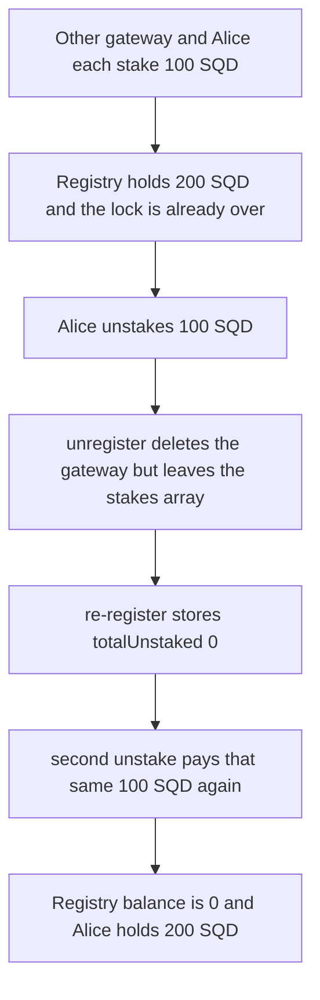

# Subsquid GatewayRegistry — re-register resets totalUnstaked and the same stake pays twice

> **Vulnerability classes:** vuln/logic/state-update · vuln/logic/missing-check · vuln/logic/missing-validation

<!-- non-defihacklabs -->
<!-- source-auditvault: https://github.com/Auditware/AuditVault/blob/main/findings/31545-c-01-gateway-creator-can-steal-all-tokens-from-the-gatewayre.md -->
<!-- date: 2024-01 -->

## Key info

| | |
|---|---|
| **Protocol** | Subsquid |
| **Finding** | Pashov C-01, AuditVault 31545 |
| **Vulnerable code** | `GatewayRegistry.register` (`totalUnstaked: 0`) and `unregister` (stakes array left in place) |
| **Harm** | Registry funded with 200 SQD is drained to 0. The operator is paid 100 SQD twice for one stake row |
| **Chain** | local synthetic, replayed at block 301 |

## TL;DR

`unregister` deletes the gateway and does not delete `stakes[peerId]`. `register` always stores `totalUnstaked: 0`. After a matured stake is withdrawn, unregistering and registering the same `peerId` makes `_unstakeable` sum that surviving row against a zero counter, so `unstake` transfers the same 100 SQD again. A second gateway's 100 SQD is what pays that second transfer. The registry ends at 0 and the operator holds both stakes, 200 SQD.

## The vulnerable code

`register` writes a fresh gateway. The audited assignment sets `totalUnstaked` to 0:

```solidity
// @> VULN: re-register stores totalUnstaked: 0 while stakes[] still holds the withdrawn row, so unstake pays it again
gateways[peerIdHash] = Gateway({
    operator: msg.sender,
    peerId: peerId,
    strategy: defaultStrategy,
    ownAddress: gatewayAddress,
    metadata: metadata,
    totalStaked: 0,
    totalUnstaked: 0
});
```

`unregister` requires `totalStaked == totalUnstaked`, then deletes the gateway only:

```solidity
require(gateway.totalStaked == gateway.totalUnstaked, "Gateway has staked tokens");
delete gatewayByAddress[gateway.ownAddress];
delete gateways[peerIdHash];
// FIX: delete stakes[peerIdHash];
```

`_unstakeable` is the audited sum. It does not know the row was already paid, except through `totalUnstaked`:

```solidity
Stake[] memory _stakes = stakes[keccak256(gateway.peerId)];
uint256 blockNumber = block.number;
uint256 total = 0;
for (uint256 i = 0; i < _stakes.length; i++) {
    Stake memory _stake = _stakes[i];
    if (_stake.lockEnd <= blockNumber) {
        total += _stake.amount;
    }
}
return total - gateway.totalUnstaked;
```

The stake lock is `lockEnd = nextEpoch() + duration`. The finding stakes for 200 blocks and then `vm.roll(+300)`. This replay is already at block 301, so `nextEpoch` is 1, `lockEnd` is 201, and `201 <= 301`. Both unstakes run in that one block.

## Root cause

The stake rows and the withdrawn-amount counter live in different storage. `unregister` clears only the gateway struct. The next `register` of the same `peerId` builds a new struct with `totalUnstaked: 0` and does not touch `stakes[peerId]`. `_unstakeable` then returns the full matured amount, and `unstake` transfers it again. The second transfer is real SQD: it comes out of whatever other stakes are still sitting in the contract.

## Preconditions

The caller is the operator of the peerId, the stake's `lockEnd` is already `<= block.number`, and the registry holds at least one other stake so the second transfer does not run the token balance to zero before it completes. Here that other stake is 100 SQD. No time passes between the two unstakes.

## Attack walkthrough

1. At block 301 another gateway has staked 100 SQD and Alice has staked 100 SQD for 200 blocks. The registry holds 200 SQD. Alice's row has `lockEnd` 201, which is already `<= 301`, so both unstakes below run in this block.
2. Alice unstakes 100 SQD. `totalUnstaked` becomes 100. The registry still holds the other gateway's 100 SQD.
3. Alice unregisters. The check `totalStaked == totalUnstaked` passes. The gateway struct is deleted. `stakeCount` is still 1.
4. Alice registers the same `peerId`. The assignment stores `totalUnstaked: 0`. `unstakeable` is 100 SQD again.
5. Alice unstakes 100 SQD. That is the same row, paid a second time. The registry balance goes from 100 SQD to 0. Alice's balance is 200 SQD.
6. The other gateway still shows 100 SQD staked and 0 unstaked. Its withdrawal reverts, because the contract balance is 0.

The control deletes `stakes[peerId]` inside `unregister`. The same sequence pays the first 100 SQD, then the second `unstake` reverts with `Not enough funds to unstake`. The registry keeps the other 100 SQD.

## Diagrams



## Impact

One matured stake of 100 SQD is paid out twice. The registry was funded with 200 SQD and ends at 0. The operator receives both stakes. The other gateway's 100 SQD is still recorded as staked, and that withdrawal cannot be paid. Deleting the stakes array on unregister removes the row the second unstake spends, and that second call reverts.

## Remediation

Delete `stakes[peerId]` in `unregister`, which is the fix in the report. After that, re-registering the same peerId starts from an empty array, `_unstakeable` returns 0, and the second unstake cannot transfer.

## How to reproduce

```bash
cd 31545-c-01-gateway-creator-can-steal-all-tokens-from-the-gatewayre_exp
forge test -vv
```

## Sources

- AuditVault finding: https://github.com/Auditware/AuditVault/blob/main/findings/31545-c-01-gateway-creator-can-steal-all-tokens-from-the-gatewayre.md
- Pashov report: https://github.com/pashov/audits/blob/master/team/md/Subsquid-security-review.md
- Audited commit: https://github.com/subsquid/subsquid-network-contracts/blob/3545236f5b34076820fe747eb607a16d8b664a08/packages/contracts/src/GatewayRegistry.sol (2024-01)
