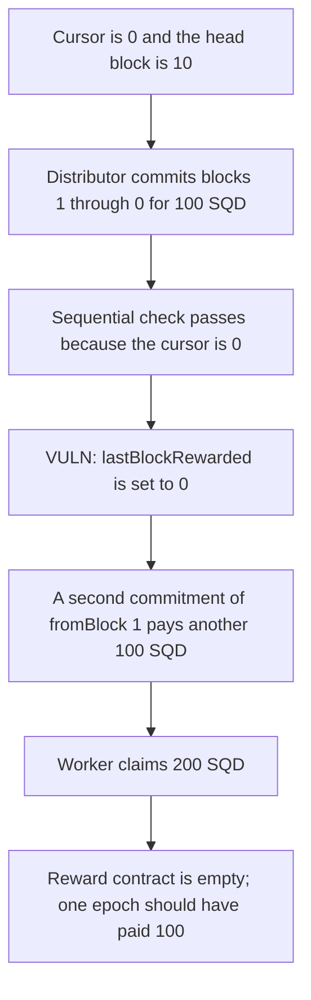

# Subsquid rewards — toBlock 0 lets a distributor pay the same blocks twice

> **Vulnerability classes:** vuln/logic/wrong-condition · vuln/logic/reward-calculation · vuln/logic/missing-check

<!-- non-defihacklabs -->
<!-- source-auditvault: https://github.com/Auditware/AuditVault/blob/main/findings/31546-h-01-missing-check-on-toblock-allows-distributors-to-change.md -->
<!-- date: 2024-01 -->

## Key info

| | |
|---|---|
| **Protocol** | Subsquid DistributedRewardsDistribution |
| **Finding** | Pashov H-01, AuditVault 31546 |
| **Vulnerable code** | `commit` / `distribute` (`lastBlockRewarded = toBlock`) |
| **Harm** | 200 SQD claimed for one epoch of 100 SQD; 100 SQD overpaid from the reward budget |
| **Chain** | local synthetic |

## TL;DR

`commit` checks that `toBlock` is in the past. It does not check that `toBlock` is after `fromBlock`. A distributor commits blocks 1 through 0 and names worker 1 for 100 SQD. `distribute` accepts it because `lastBlockRewarded` is 0, credits the 100 SQD, then stores `lastBlockRewarded = 0`. A second commitment of the same `fromBlock`, with a different hash, is accepted for the same reason and credits another 100 SQD. The worker claims 200 SQD. The reward contract, which was funded with 200 SQD, is emptied. One epoch should have paid 100 SQD and left 100 SQD for the next span.

## The vulnerable code

```solidity
require(currentDistributor() == msg.sender, "Not a distributor");
// @audit missing check on block span: toBlock > fromBlock
require(toBlock < block.number, "Future block");

function distribute(...) internal {
    require(lastBlockRewarded == 0 || fromBlock == lastBlockRewarded + 1, "Not all blocks covered");
    for (uint256 i = 0; i < recipients.length; i++) {
        claimableOf[recipients[i]] += workerRewards[i];
    }
    lastBlockRewarded = toBlock;
    // @> VULN: a backwards span is accepted, and toBlock 0 leaves the cursor open
    if (toBlock < fromBlock) backwardsSpans += 1;
}
```

The recommended check is `require(toBlock > fromBlock, "Invalid block span")` in `commit` or `distribute`.

## Root cause

The sequential rule treats a zero cursor as "no distribution yet" and also lets a distribution write that same zero back. `toBlock < block.number` is true for 0 whenever the chain is past genesis. Nothing rejects a span that runs backwards. A new commitment hash, even one that pays the same worker again, is a fresh approval.

## Preconditions

The caller is the current distributor. One approval is enough, which is the contract's initial `requiredApproves`. The head block is 10, so `toBlock` 0 is not a future block. The reward contract holds 200 SQD. Worker 1's epoch reward is 100 SQD.

## Attack walkthrough

1. `lastBlockRewarded` is 0. The head block is 10.
2. The distributor commits `fromBlock = 1`, `toBlock = 0`, worker 1, 100 SQD. The sequential check passes because the cursor is 0. Worker 1's claimable becomes 100 SQD. `lastBlockRewarded` is set to 0.
3. The distributor commits `fromBlock = 1`, `toBlock = 0` again, with a second zero-reward recipient so the commitment hash is new. The sequential check passes again. Worker 1's claimable becomes 200 SQD.
4. The worker claims 200 SQD. The reward contract balance is 0.

The control requires `toBlock > fromBlock`. The 1-to-0 commit reverts. A commit of blocks 1 through 5 credits 100 SQD and sets the cursor to 5. Another commit that starts at block 1 reverts with `Not all blocks covered`. The worker is paid 100 SQD and 100 SQD stays in the contract.

## Diagrams



## Impact

Worker 1 is paid 200 SQD for a span that does not advance the reward cursor. 100 SQD of that is a second payment of the same blocks. The other 100 SQD that was sitting in the reward contract for a later epoch is gone. Any later honest span has to start at `lastBlockRewarded + 1`, and that value is still 0, so the distributor can repeat the credit until the balance is gone.

## Remediation

Require `toBlock > fromBlock` before a commitment is stored or distributed. Do not write `lastBlockRewarded` unless the new cursor is strictly after the old one.

## How to reproduce

```bash
cd 31546-h-01-missing-check-on-toblock-allows-distributors-to-change_exp
forge test -vv
```

The forge test rolls to block 10 before `run()`. `run()` does not roll or warp. The playground uses the same block number.

## Sources

- AuditVault finding: https://github.com/Auditware/AuditVault/blob/main/findings/31546-h-01-missing-check-on-toblock-allows-distributors-to-change.md
- Pashov report: https://github.com/pashov/audits/blob/master/team/md/Subsquid-security-review.md
- Reviewed tree: https://github.com/subsquid/subsquid-network-contracts/tree/3545236f5b34076820fe747eb607a16d8b664a08
