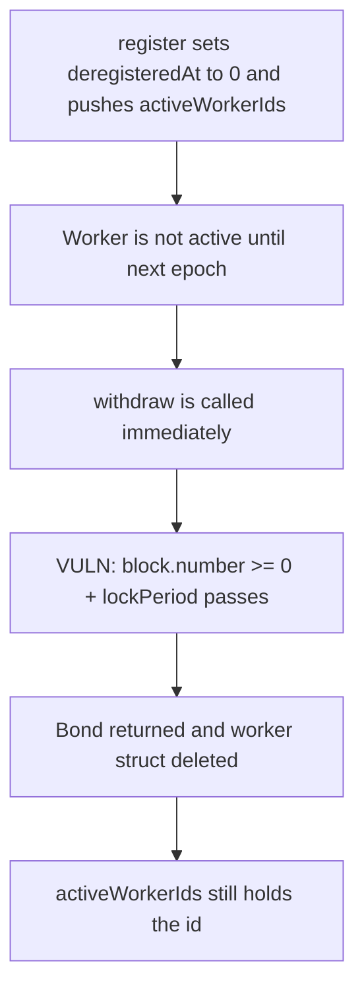

# Subsquid WorkerRegistration — withdraw skips the lock when deregisteredAt is 0

> **Vulnerability classes:** vuln/logic/missing-check · vuln/dos/lockup · vuln/input-validation/missing

<!-- non-defihacklabs -->
<!-- source-auditvault: https://github.com/Auditware/AuditVault/blob/main/findings/31548-h-03-workers-could-withdraw-without-deregister-and-waiting-f.md -->
<!-- date: 2024-01 -->

## Key info

| | |
|---|---|
| **Protocol** | Subsquid |
| **Finding** | Pashov H-03, AuditVault 31548 |
| **Vulnerable code** | `WorkerRegistration.withdraw` |
| **Harm** | 1,000 SQD bond returned immediately; 2 deleted workers left in `activeWorkerIds` |
| **Chain** | local synthetic, replayed at block 176329477 (the finding's own `vm.roll`) |

## TL;DR

A worker is not active until the epoch after registration, and `deregisteredAt` is still 0. `withdraw` only checks `block.number >= deregisteredAt + lockPeriod()`. That is `block.number >= lockPeriod()` when the worker was never deregistered, which is true on a live chain. The bond comes back in the same transaction, the worker struct is deleted, and the id stays in `activeWorkerIds`. Doing it twice leaves two ghost ids and still costs no capital.

## The vulnerable code

`register` sets `registeredAt` to `nextEpoch()` and `deregisteredAt` to 0, then pushes the id. `withdraw` is the audited function:

```solidity
require(!isWorkerActive(worker), "Worker is active");
require(worker.creator == msg.sender, "Not worker creator");
// @> VULN: deregisteredAt == 0, so this is `block.number >= lockPeriod()` and passes.
require(block.number >= worker.deregisteredAt + lockPeriod(), "Worker is locked");
uint256 bond = worker.bond;
delete workers[workerId];
tSQD.transfer(msg.sender, bond);
```

`isWorkerActive` is the audited predicate: active only once `registeredAt <= block.number`. A worker registered for the next epoch is inactive, so the first require passes. `deregister` is the function that pops `activeWorkerIds`. `withdraw` never calls it.

`lockPeriod()` in the audited contract returns one epoch. This reduction uses 1000 blocks. At block 176329477, `176329477 >= 1000`.

## Root cause

The lock is measured from `deregisteredAt`. Zero means "never deregistered", but the comparison treats zero as a timestamp in the distant past. The bond, which is supposed to stay through a lock after deregistration, is withdrawable for the whole window before the worker becomes active. Because the bond returns immediately, the caller can repeat the register/withdraw pair and grow `activeWorkerIds` without leaving capital in the contract. Every later loop over that array, including `getActiveWorkers` and `deregister`, walks the ghost ids.

## Preconditions

The caller has the bond amount (1,000 SQD here) and the chain is past `lockPeriod`, which any deployed network is. The worker must not be active yet, which is the state `register` itself creates.

## Attack walkthrough

1. At block 176329477 the attacker registers `worker-1`. `registeredAt` is 1000 blocks in the future. The id is pushed. The bond moves to the contract.
2. The attacker calls `withdraw` in the same transaction. The worker is not active. The lock check passes because `deregisteredAt` is 0.
3. The struct is deleted and the bond comes back. `activeWorkerIds[0]` is still 1.
4. The same pair for `worker-2` leaves a second ghost id. The attacker's SQD balance is unchanged and the registration contract holds 0.

The control adds `deregisteredAt != 0` to the lock check. The same withdraw reverts and the bond stays in the contract.

## Diagrams



## Impact

The bond lock is bypassed, and each bypass permanently lengthens `activeWorkerIds`. The finding's impact is that unbounded loop: the array is what reward and deregister paths iterate, and growing it no longer requires leaving a bond behind.

## Remediation

Require `deregisteredAt != 0` in addition to the elapsed-lock check, which is the diff in the report. Withdrawing should also remove the id from `activeWorkerIds`, the way `deregister` already does.

## How to reproduce

```bash
cd 31548-h-03-workers-could-withdraw-without-deregister-and-waiting-f_exp
forge test -vv
```

## Sources

- AuditVault finding: https://github.com/Auditware/AuditVault/blob/main/findings/31548-h-03-workers-could-withdraw-without-deregister-and-waiting-f.md
- Pashov report: https://github.com/pashov/audits/blob/master/team/md/Subsquid-security-review.md
- Audited commit: https://github.com/subsquid/subsquid-network-contracts/tree/3545236f5b34076820fe747eb607a16d8b664a08 (`packages/contracts/src/WorkerRegistration.sol`, 2024-01-24)
