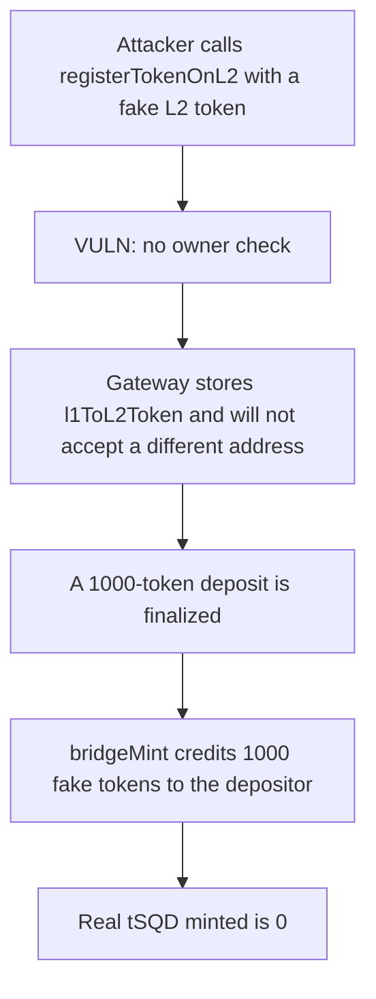

# Subsquid tSQD — anyone pins the L2 token, and the bridge mints it

> **Vulnerability classes:** vuln/access-control/missing-auth · vuln/bridge/missing-validation

<!-- non-defihacklabs -->
<!-- source-auditvault: https://github.com/Auditware/AuditVault/blob/main/findings/31549-h-04-lack-of-access-control-on-tsqds-registertokenonl2-pasho.md -->
<!-- date: 2024-01 -->

## Key info

| | |
|---|---|
| **Protocol** | Subsquid |
| **Finding** | Pashov H-04, AuditVault 31549 |
| **Vulnerable code** | `tSQD.registerTokenOnL2` |
| **Harm** | 1000 fake L2 tokens minted to the depositor. Real tSQD minted: 0. |
| **Chain** | local synthetic |

## TL;DR

`registerTokenOnL2` has no owner check. The first caller chooses `l2CustomTokenAddress`. Arbitrum's custom gateway stores that address in `l1ToL2Token` and reverts if a later call tries a different one. A bridge finalize then `bridgeMint`s the stored token. Here that mint is 1000 units of the attacker's token. The real L2 token stays at 0. Restricting the caller to the owner pins the real token, and the same finalize pays the depositor 1000 real tSQD.

## The vulnerable code

```solidity
require(!shouldRegisterGateway, "ALREADY_REGISTERED");
shouldRegisterGateway = true;

// @> VULN: no onlyOwner. The caller picks the L2 token the bridge will mint.
gateway.registerTokenToL2{value: valueForGateway}(
    l2CustomTokenAddress, maxGasForCustomGateway, gasPriceBid, maxSubmissionCostForCustomGateway, creditBackAddress
);
```

`shouldRegisterGateway` is only a reentrancy flag so `isArbitrumEnabled` can return `0xb1` during the gateway callback. It is not an access check. After the call it is set back to false, but the gateway mapping stays.

## Root cause

The L1 token is the only account the gateway will accept a registration from, because the gateway calls back into `isArbitrumEnabled`. Nothing checks that the account which called `registerTokenOnL2` is the owner. The first successful call wins: `l1ToL2Token` rejects a different address afterwards.

## Preconditions

The gateway's counterpart for tSQD is still unset. The attacker has a token whose `bridgeMint` the gateway is allowed to call. A later inbound bridge message mints the registered L2 token. The cross-chain retryable is collapsed into the same gateway so that mint happens in this block. The registration value is what the gateway stores, not a number invented for the mint.

## Attack walkthrough

1. The attacker calls `registerTokenOnL2` with the fake token.
2. The gateway checks `isArbitrumEnabled() == 0xb1`, sees no existing counterpart, and stores the fake address.
3. The router is pointed at that gateway.
4. `finalizeInboundTransfer` reads `l1ToL2Token[tSQD]` and `bridgeMint`s 1000 of that token to the depositor.
5. The depositor holds 1000 fake tokens. The real L2 token balance is 0.

The control requires `msg.sender == owner`. The attacker's call reverts and nothing is pinned. The owner registers the real token. The same finalize mints 1000 real tSQD to the depositor and the fake balance stays 0.

## Diagrams



## Impact

The depositor who bridged 1000 tokens receives 1000 units of the attacker's token. The real tSQD supply for that deposit is 0. The legitimate register can no longer replace the counterpart.

## Remediation

Restrict `registerTokenOnL2` to the owner, as the Arbitrum bridge-token design does.

## How to reproduce

```bash
cd 31549-h-04-lack-of-access-control-on-tsqds-registertokenonl2-pasho_exp
forge test -vv
```

## Sources

- AuditVault finding: https://github.com/Auditware/AuditVault/blob/main/findings/31549-h-04-lack-of-access-control-on-tsqds-registertokenonl2-pasho.md
- Pashov report: https://github.com/pashov/audits/blob/master/team/md/Subsquid-security-review.md
- Reviewed tree: https://github.com/subsquid/subsquid-network-contracts/blob/3545236f5b34076820fe747eb607a16d8b664a08/packages/contracts/src/tSQD.sol
- Gateway store: https://github.com/OffchainLabs/token-bridge-contracts/blob/master/contracts/tokenbridge/ethereum/gateway/L1CustomGateway.sol
- L2 mint: https://github.com/OffchainLabs/token-bridge-contracts/blob/master/contracts/tokenbridge/arbitrum/gateway/L2CustomGateway.sol
