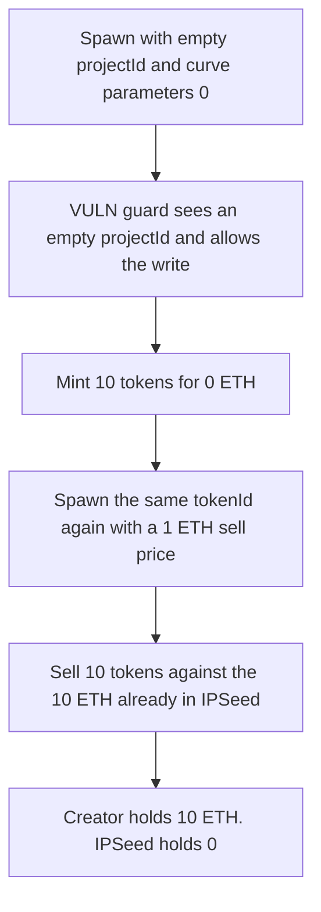

# Catalyst: an empty projectId lets the creator reprice IPSeed and drain its ETH

> **Vulnerability classes:** `vuln/logic/incorrect-state-transition` · `vuln/access-control/missing-auth`

<!-- non-defihacklabs -->
<!-- source-auditvault: https://github.com/Auditware/AuditVault/blob/main/findings/31585-c-01-attacker-can-drain-all-eth-from-ipseed-due-to-re-config.md -->
<!-- date: 2025-06 -->

## Key info

| Field | Value |
|---|---|
| **Loss** | 10 tokens minted at price 0 are sold for the 10 ETH already held by IPSeed. IPSeed ends at 0 |
| **Vulnerable contract** | `IPSeed.spawn` |
| **Attacker EOA** | `0x1111111111111111111111111111111111111111` (the creator) |
| **Attack contract** | `Exploit` |
| **Attack tx** | `Exploit.run()` |
| **Chain / block / date** | Ethereum model · block 0 · 2025-06 |
| **Compiler** | solc 0.8.27, cancun |
| **Bug class** | `TokenAlreadyExists` only trips when `projectId` is non-empty |

## TL;DR

`spawn` rejects a token only after `projectId` is non-empty. The creator spawns with an empty project id and curve parameters of 0, mints 10 tokens for 0 ETH, then spawns the same `tokenId` again with a 1 ETH sell price. Selling those tokens pays out the 10 ETH IPSeed was holding for other buyers. The contract balance is 0.

## The vulnerable code

```solidity
if (bytes(tokenMeta[tokenId].projectId).length > 0) { // @> VULN: an empty projectId never trips TokenAlreadyExists, so tokenId can be spawned again
    revert TokenAlreadyExists();
}
```

```diff
- if (bytes(tokenMeta[tokenId].projectId).length > 0) revert TokenAlreadyExists();
+ require(bytes(projectId).length > 0, "empty project");
+ if (bytes(tokenMeta[tokenId].projectId).length > 0) revert TokenAlreadyExists();
```

## Root cause

The existence check reads the stored `projectId`, and the attack keeps that string empty. Curve parameters are part of the metadata write, so the second spawn changes the price of tokens that were minted for free.

## Preconditions

- `tokenId` is `keccak256(creator, "")`, so both spawns use the same id.
- Curve parameters of 0 make `getBuyPrice` return 0.
- IPSeed already holds 10 ETH from other buyers.
- The second spawn sets curve parameters to 1 ETH per token.

## Attack walkthrough

1. Spawn with an empty project id and zero parameters.
2. `TokenAlreadyExists` does not fire.
3. Mint 10 tokens. The price check is `msg.value == 0`.
4. Spawn the same id again with parameters of 1 ETH.
5. Sell 10 tokens. `getSellPrice` pays 10 ETH.
6. The creator holds 10 ETH. IPSeed holds 0.

## Diagrams



## Impact

Buyers who funded IPSeed lose the 10 ETH. The creator paid nothing for the tokens that were sold. Requiring a non-empty `projectId` on the first spawn makes the second call hit `TokenAlreadyExists`.

## How to reproduce

```bash
cd 31585-c-01-attacker-can-drain-all-eth-from-ipseed-due-to-re-config_exp
forge test -vv
```

## Sources

- AuditVault finding: https://github.com/Auditware/AuditVault/blob/main/findings/31585-c-01-attacker-can-drain-all-eth-from-ipseed-due-to-re-config.md
- Pashov Catalyst review: https://github.com/pashov/audits/blob/master/team/md/Catalyst-security-review.md
- Reviewed tree: https://github.com/moleculeprotocol/desci-ecosystem/tree/e7980268004251020b47ba450c3c684dc0f38247
