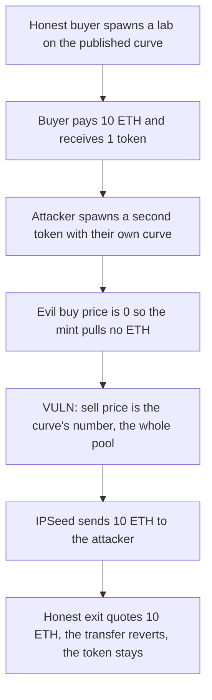

# Catalyst IPSeed — a caller-supplied curve drains the ETH pool

> **Vulnerability classes:** vuln/logic/missing-check · vuln/logic/price-calculation

<!-- non-defihacklabs -->
<!-- source-auditvault: https://github.com/Auditware/AuditVault/blob/main/findings/31586-c-02-attacker-can-drain-all-eth-from-ipseed-due-to-malicious.md -->
<!-- date: 2024-02 -->

## Key info

| | |
|---|---|
| **Protocol** | Catalyst (Molecule IPSeed) |
| **Finding** | Pashov Audit Group C-02, AuditVault 31586 |
| **Vulnerable code** | `IPSeed.spawn`, `IPSeed.getSellPrice` |
| **Harm** | 10 ETH taken from the shared pool; the honest buyer's exit reverts and their token stays stuck |
| **Chain** | local synthetic |

## TL;DR

`spawn` is public. The caller passes any `IIPSeedCurve`, and that address is written into `tokenMeta` with no whitelist. `getBuyPrice` and `getSellPrice` trust whatever that contract returns. An attacker spawns a second token whose curve buys at 0 and sells at the contract's whole ETH balance. They mint one token for free and `burn` pays them the 10 ETH an honest lab just deposited. The lab's later exit still quotes 10 ETH, the transfer reverts, and the lab token is still in the buyer's wallet.

## The vulnerable code

```solidity
function spawn(
    uint256 tokenId,
    string calldata name,
    string calldata symbol,
    string calldata projectId,
    IIPSeedCurve curve,
    bytes32 curveParameters,
    address sourcer
) public {
    if (tokenId != computeTokenId(_msgSender(), projectId)) {
        revert InvalidTokenId();
    }
    if (bytes(tokenMeta[tokenId].projectId).length > 0) {
        revert TokenAlreadyExists();
    }

    // @> VULN: the caller-supplied curve is stored with no whitelist
    Metadata memory newMetadata = Metadata(sourcer, sourcer, name, symbol, projectId, curve, curveParameters);
    tokenMeta[tokenId] = newMetadata;
}

function getSellPrice(uint256 tokenId, uint256 sell)
    public
    view
    returns (uint256 gross, uint256 net, uint256 protocolFee, uint256 sourcerFee)
{
    // @> VULN: the sell quote is taken from the untrusted curve and paid in ETH
    gross = tokenMeta[tokenId].priceCurve.getSellPrice(
        totalSupply(tokenId), sell, tokenMeta[tokenId].curveParameters
    );
    (protocolFee, sourcerFee) = computeFees(gross);
    net = gross - protocolFee - sourcerFee;
}
```

The report's fix is to accept only a whitelisted `IIPSeedCurve`. The control does that. The malicious `spawn` reverts, and the honest buyer can sell the token back for the same 10 ETH.

## Root cause

Price is not computed by IPSeed. It is an external call to an address the token's creator chose. Buy and sell then move ETH against that number, and every token draws on the same contract balance. A curve the protocol did not deploy can report 0 on the way in and the entire balance on the way out. The token-id check only ties the id to `msg.sender`. It does not constrain the curve.

## Preconditions

Anyone can call `spawn` for a token id derived from their own address. The contract already holds ETH from another token. Fees in this reduction are 0, so the quoted sell price is paid in full. A non-zero fee would pay the attacker the balance minus the fee. It would not stop the drain.

## Attack walkthrough

1. An honest buyer holds 10 ETH and spawns a lab token on the published curve, which charges 10 ETH per token.
2. The buyer mints one token. IPSeed's balance is 10 ETH.
3. The attacker spawns a different token id and passes their own curve.
4. That curve's buy price is 0. The attacker mints one token and sends no ETH. The pool is still 10 ETH.
5. The attacker burns the token. `getSellPrice` asks the attacker's curve, which returns `msg.sender.balance`, the full 10 ETH.
6. `burn` sends 10 ETH to the attacker. IPSeed's balance is 0.
7. The buyer calls `exit`. The honest curve still quotes 10 ETH, the transfer reverts, and the buyer still holds the token.

The control whitelists the published curve. The attacker's `spawn` reverts with `UntrustedCurve`. The buyer then sells and receives the 10 ETH back.

## Diagrams



## Impact

The attacker holds the 10 ETH that the honest buyer deposited. The buyer's token balance is still 1, and a later exit cannot pay the quoted 10 ETH because the pool is empty. The same curve can quote any larger balance that other labs have already deposited. The attacker does not need an admin key. `spawn` is public, and the token id only has to match the caller.

## Remediation

Reject curves that are not on a protocol whitelist before writing `tokenMeta`. Also cap a sale at the ETH that token actually brought in, so one curve cannot spend another token's deposits.

## How to reproduce

```bash
cd 31586-c-02-attacker-can-drain-all-eth-from-ipseed-due-to-malicious_exp
forge test -vv
```

## Sources

- AuditVault finding: https://github.com/Auditware/AuditVault/blob/main/findings/31586-c-02-attacker-can-drain-all-eth-from-ipseed-due-to-malicious.md
- Pashov report: https://github.com/pashov/audits/blob/master/team/md/Catalyst-security-review.md
- Reviewed tree: https://github.com/moleculeprotocol/desci-ecosystem/tree/e7980268004251020b47ba450c3c684dc0f38247
