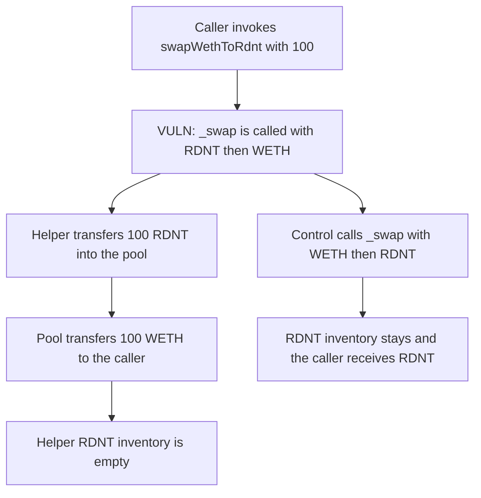

# Radiant swapWethToRdnt sells RDNT and pays the caller in WETH

> **Vulnerability classes:** vuln/logic/wrong-order · vuln/logic/wrong-condition

<!-- non-defihacklabs -->
<!-- source-auditvault: https://github.com/Auditware/AuditVault/blob/main/findings/31661-c-01-incorrect-token-order-passed-for-weth-rdnt-swaps-pashov.md -->
<!-- date: 1970-01 -->

## Key info

| Field | Value |
|---|---|
| **Loss** | 100 WETH paid to a permissionless caller while 100 RDNT of helper inventory is sold |
| **Vulnerable contract** | `BalancerPoolHelper.swapWethToRdnt` |
| **Attacker EOA** | `0x1111111111111111111111111111111111111111` |
| **Attack contract** | `Exploit` |
| **Attack tx** | `Exploit.run()` |
| **Chain / block / date** | Ethereum model · block 0 · 1970-01 |
| **Compiler** | solc 0.8.27, cancun, via IR |
| **Bug class** | Input and output tokens are reversed on the WETH to RDNT swap |

## TL;DR

`swapWethToRdnt` is supposed to swap WETH for RDNT. The quoted call passes `RDNT_ADDRESS` as tokenIn and `REAL_WETH_ADDR` as tokenOut. Any caller can spend the helper's RDNT inventory and receive WETH. In the PoC that is 100 WETH out and 100 RDNT gone. The control passes WETH then RDNT, so the same inventory is untouched and the caller receives RDNT.

## Background

Pashov Audit Group, Radiant. `BalancerPoolHelper.swapWethToRdnt` builds a Balancer swap on the WETH/RDNT pool and sets the recipient to `msg.sender`. The report's diff swaps the first two arguments of `_swap`.

## The vulnerable code

```solidity
amountOut = this._swap(RDNT_ADDRESS, REAL_WETH_ADDR, _wethAmount, _minAmountOut, WETH_RDNT_POOL_ID, msg.sender);
```

`_swap` transfers `tokenIn` from the helper into the pool and asks the pool to pay `tokenOut` to the recipient.

## Root cause

The argument order does not match the function name. WETH is never pulled. RDNT is. The pool then sends WETH to the caller. A zero `minAmountOut` does not stop it.

## Preconditions

- The helper holds RDNT (here, 100).
- The pool can pay the same amount of WETH.
- `swapWethToRdnt` is callable without an admin check.

## Attack walkthrough

1. The helper is seeded with 100 RDNT. The pool holds 1000 of each token.
2. The caller invokes `swapWethToRdnt(100, 0)` and does not send WETH.
3. `_swap` transfers 100 RDNT from the helper into the pool.
4. The pool transfers 100 WETH to the caller.
5. The helper's RDNT balance is 0.

## Diagrams



## Impact

The caller is paid 100 WETH that the swap was not supposed to send, and the protocol's 100 RDNT inventory is sold. The corrected order spends WETH that was deposited for the swap and leaves the RDNT inventory at 100.

## Remediation

Pass WETH as tokenIn and RDNT as tokenOut, matching the report diff:

```solidity
_swap(wethAddr, RDNT_ADDRESS, _wethAmount, _minAmountOut, WETH_RDNT_POOL_ID, msg.sender);
```

## How to reproduce

```bash
cd 31661-c-01-incorrect-token-order-passed-for-weth-rdnt-swaps-pashov_exp
forge test -vv
```

`test_reversed_swap_pays_weth_from_rdnt_inventory` asserts the caller received 100 WETH and the helper's RDNT is 0. `test_control_weth_in_rdnt_out_keeps_inventory` asserts the RDNT inventory is unchanged and the caller received 100 RDNT instead of WETH.

## Sources

- AuditVault finding: https://github.com/Auditware/AuditVault/blob/main/findings/31661-c-01-incorrect-token-order-passed-for-weth-rdnt-swaps-pashov.md
- Report: https://github.com/pashov/audits/blob/master/team/md/Radiant-security-review.md
