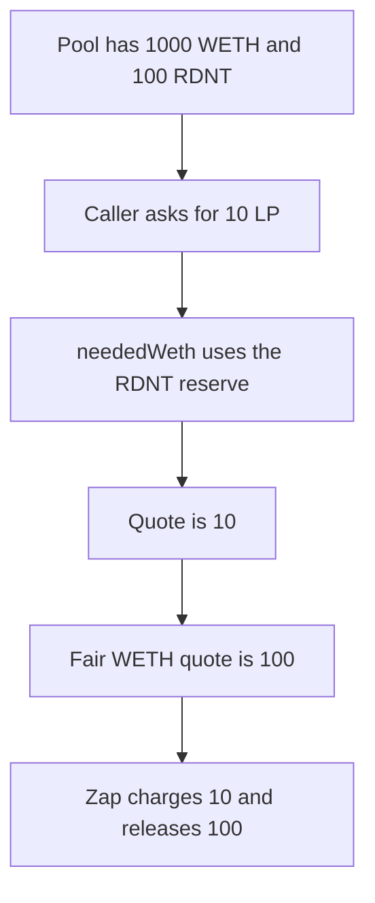

# Radiant: quoteWETH returns 10 where the WETH reserve says 100

> **Vulnerability classes:** vuln/logic/price-calculation

<!-- non-defihacklabs -->
<!-- source-auditvault: https://github.com/Auditware/AuditVault/blob/main/findings/31663-h-01-incorrect-quoteweth-implementation-out-of-scope-pashov.md -->
<!-- date: 2024-03 -->

## Key info

| | |
|---|---|
| **Protocol** | Radiant |
| **Finding** | Pashov Radiant H-01, AuditVault 31663 |
| **Vulnerable code** | `UniswapPoolHelper.quoteWETH` |
| **Harm** | A 10 LP mint is quoted at 10 WETH and settled for 100 WETH. The fair quote is 100. The caller keeps 100 |
| **Chain** | local synthetic |

## TL;DR

`neededWeth` is `(rdnt * lpAmount) / lpTokenSupply`. The pool has 1000 WETH and 100 RDNT, and the LP supply is 100. Quoting 10 LP therefore returns 10. Using the WETH reserve returns 100. The zap charges the quote, 10, and releases the WETH value of that LP, 100. The caller ends holding 100. The control quotes with the WETH reserve and the charge is 100, so nothing is left over.

## The vulnerable code

```solidity
uint256 wethReserve = token0 != rdntAddr ? reserve0 : reserve1;
uint256 rdnt = token0 == rdntAddr ? reserve0 : reserve1;
uint256 lpTokenSupply = totalSupply;
fair = (wethReserve * lpAmount) / lpTokenSupply;
// @> VULN: neededWeth is taken from the RDNT reserve, not the WETH reserve
neededWeth = (rdnt * lpAmount) / lpTokenSupply;
quoted = neededWeth;
```

token0 is WETH, so `wethReserve` is reserve0 = 1000 and `rdnt` is reserve1 = 100. `lpAmount` is 10 and `lpTokenSupply` is 100.

| | WETH |
|---|---|
| Buggy quote | 10 |
| Fair quote | 100 |
| Charged | 10 |
| Released | 100 |

## Root cause

The numerator of `neededWeth` is the RDNT reserve. The comment and the variable name say WETH. The two reserves are not equal, so the quote is off by the reserve ratio, here 10x.

## Preconditions

token0 is the WETH token, so the ternary that selects `rdnt` picks reserve1. Reserves are 1000 and 100. Supply is 100. The caller asks to mint 10 LP. No price oracle and no timestamp.

## Attack walkthrough

1. The pool is funded with 1000 WETH. See [output.txt](output.txt).
2. The caller is funded with 10 WETH.
3. `zap(10)` calls `quoteWETH`. The stored quote is 10 and the fair value is 100.
4. The zap pulls 10 and transfers 100 back.
5. The caller holds 100.
6. The control's `quoteFair` returns 100. Paying that amount leaves the caller with 0.

## Diagrams



## Impact

The mint is sized off 10 WETH instead of 100 WETH. The caller pays 10 and receives the 100 WETH that 10 LP represents against this pool. Existing LPs are short the 90 WETH difference. The control charges the 100.

## Remediation

Set `neededWeth = (wethReserve * lpAmount) / lpTokenSupply`.

## How to reproduce

```bash
cd 31663-h-01-incorrect-quoteweth-implementation-out-of-scope-pashov_exp
forge test -vv
```

## Sources

- AuditVault finding: https://github.com/Auditware/AuditVault/blob/main/findings/31663-h-01-incorrect-quoteweth-implementation-out-of-scope-pashov.md
- Pashov report: https://github.com/pashov/audits/blob/master/team/md/Radiant-security-review.md
- Helper: UniswapPoolHelper.quoteWETH in radiant-capital/v2-core
- Synthetic: [test/31663-h-01-incorrect-quoteweth-implementation-out-of-scope-pashov.sol](test/31663-h-01-incorrect-quoteweth-implementation-out-of-scope-pashov.sol)
