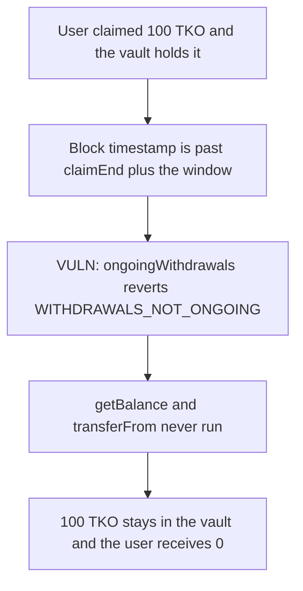

# Taiko ERC20Airdrop2 — the full claim is stuck once the window closes

> **Vulnerability classes:** vuln/dos/frozen-funds · vuln/logic/wrong-condition

<!-- non-defihacklabs -->
<!-- source-auditvault: https://github.com/Auditware/AuditVault/blob/main/findings/31931-h-03-users-will-never-be-able-to-withdraw-their-claimed-aird.md -->
<!-- date: 2024-03 -->

## Key info

| | |
|---|---|
| **Protocol** | Taiko |
| **Finding** | Code4rena 2024-03 H-03, AuditVault 31931 |
| **Vulnerable code** | `ERC20Airdrop2.ongoingWithdrawals` |
| **Harm** | 100 TKO stuck in the vault. The user receives 0. |
| **Chain** | local synthetic |

## TL;DR

Tokens unlock linearly and are fully withdrawable at `claimEnd + withdrawalWindow`. `ongoingWithdrawals` reverts as soon as `block.timestamp` is greater than that instant. A user who is not in the block at that exact timestamp cannot withdraw the remainder. This block is already past the window: the user claimed 100 TKO, `withdraw` reverts with `WITHDRAWALS_NOT_ONGOING`, and the vault still holds 100 TKO. A buffer after full unlock lets the same call pay the user 100 TKO.

## The vulnerable code

```solidity
modifier ongoingWithdrawals() {
    // @> VULN: equality is the full unlock, and the next timestamp is already too late
    if (claimEnd > block.timestamp || claimEnd + withdrawalWindow < block.timestamp) {
        revert WITHDRAWALS_NOT_ONGOING();
    }
    _;
}
```

`getBalance` caps the elapsed time at `claimEnd + withdrawalWindow`, so that timestamp is a 100 percent unlock. One second later the modifier rejects the call, and the unpaid remainder stays in the vault.

## Root cause

The close of the window and the moment of full unlock are the same timestamp, and the comparison is strict. There is no time after a full unlock in which `withdraw` still succeeds.

## Preconditions

`claimEnd` is 1000 and `withdrawalWindow` is 1000, so full unlock was timestamp 2000. The block timestamp is 1000000, set once for the block. `run()` does not warp. The user has `claimedAmount` of 100 TKO and `withdrawnAmount` of 0. The vault holds the 100 TKO and has approved the airdrop.

## Attack walkthrough

1. `windowClosed` is true: 2000 is less than 1000000.
2. The vault is minted 100 TKO and the user is seeded as claimed for 100.
3. `withdraw` hits the modifier. `claimEnd + withdrawalWindow < block.timestamp`, so it reverts `WITHDRAWALS_NOT_ONGOING`.
4. The user balance stays 0. The vault still holds 100 TKO.

The control adds a buffer after `claimEnd + withdrawalWindow`. On this same block the modifier passes. `getBalance` caps at the window end and returns the full 100. The user receives 100 TKO and the vault ends at 0.

## Diagrams



## Impact

The unpaid claim, here the entire 100 TKO, cannot be withdrawn. The tokens remain in the vault.

## Remediation

Keep withdrawals open for a buffer after `claimEnd + withdrawalWindow`, so a user can still take the fully unlocked balance. Do not close the window on the same timestamp that first reaches 100 percent.

## How to reproduce

```bash
cd 31931-h-03-users-will-never-be-able-to-withdraw-their-claimed-aird_exp
forge test -vv
```

## Sources

- AuditVault finding: https://github.com/Auditware/AuditVault/blob/main/findings/31931-h-03-users-will-never-be-able-to-withdraw-their-claimed-aird.md
- Code4rena report: https://code4rena.com/reports/2024-03-taiko
- Vulnerable modifier: https://github.com/code-423n4/2024-03-taiko/blob/f58384f44dbf4c6535264a472322322705133b11/packages/protocol/contracts/team/airdrop/ERC20Airdrop2.sol#L39
