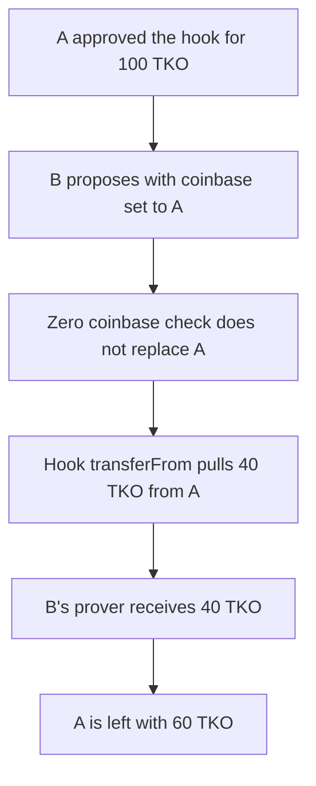

# Taiko L1 — proposer charges another account's prover fee

> **Vulnerability classes:** vuln/access-control/missing-auth · vuln/logic/missing-check

<!-- non-defihacklabs -->
<!-- source-auditvault: https://github.com/Auditware/AuditVault/blob/main/findings/31932-h-04-taiko-l1-proposer-can-maliciously-cause-loss-of-funds-b.md -->
<!-- date: 2024-03 -->

## Key info

| | |
|---|---|
| **Protocol** | Taiko L1 |
| **Finding** | Code4rena 2024-03 Taiko H-04, AuditVault 31932 |
| **Vulnerable code** | `AssignmentHook.onBlockProposed` fee `transferFrom` |
| **Harm** | Proposer A loses 40 TKO. Proposer B's prover receives it |
| **Chain** | local synthetic, one chain |

## TL;DR

`proposeBlock` only replaces `params.coinbase` when the caller passes the zero address. A later assignment hook pays the prover with `transferFrom(meta.coinbase, prover, fee)`. Proposer B sets coinbase to A, who has already approved the hook. A pays 40 TKO of B's prover fee. The control passes coinbase zero, so the proposer pays and A's balance does not move.

## The vulnerable code

```solidity
if (coinbase == address(0)) {
    coinbase = msg.sender;
}
chosenCoinbase = coinbase;
hook.onBlockProposed(prover, coinbase, proverFee);
```

```solidity
// @> VULN: ERC20 prover fee is pulled from meta.coinbase, which the proposer set
feeToken.transferFrom(coinbase, prover, proverFee);
```

The audited lines are `LibProposing`'s coinbase default and `AssignmentHook`'s ERC20 branch. Ether fees are not this bug. This reduction keeps one chain and the ERC20 pull.

## Root cause

Coinbase is caller-supplied metadata, and the hook treats it as the fee payer. Nothing checks that coinbase is `msg.sender`. An approval left on the hook from an earlier proposal is spendable by the next proposer.

## Preconditions

A holds 100 TKO and has approved the hook for 100 TKO. B is any proposer. The fee token is the assignment's `feeToken`, not ether.

## Attack walkthrough

1. A approves the hook for 100 TKO.
2. B calls `proposeBlock(A, B, 40 TKO)`.
3. The zero check does not fire. `chosenCoinbase` is A.
4. The hook `transferFrom`s 40 TKO from A to B.
5. A has 60 TKO left. B's balance rose by 40 TKO.

The control calls `proposeBlock(address(0), ...)`. Coinbase becomes the proposer, A is not charged.

## Diagrams



## Impact

A loses 40 TKO on a block A did not propose. The same allowance can be spent up to its remaining size. The control shows a proposal whose coinbase is the caller does not touch A.

## Remediation

Force `params.coinbase = msg.sender` whenever the supplied coinbase is not the caller. Pay the ERC20 fee from that caller, not from an arbitrary address.

## How to reproduce

```bash
cd 31932-h-04-taiko-l1-proposer-can-maliciously-cause-loss-of-funds-b_exp
forge test -vv
```

## Sources

- AuditVault finding 31932
- https://code4rena.com/reports/2024-03-taiko
- code-423n4/2024-03-taiko `AssignmentHook.sol` and `LibProposing.sol` at `0d081a40`
