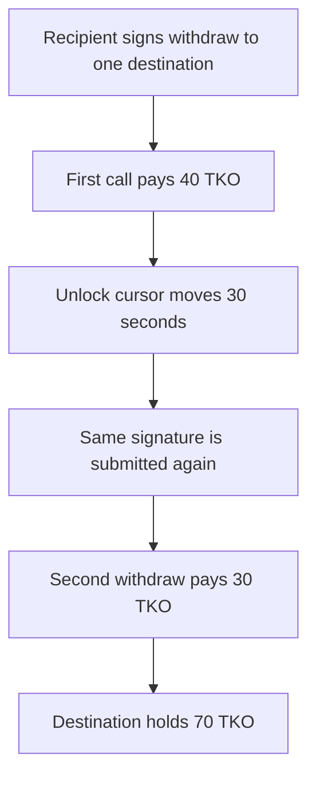

# Taiko — withdraw signature replays for another 30 TKO

> **Vulnerability classes:** vuln/auth/signature-replay · vuln/logic/missing-validation

<!-- non-defihacklabs -->
<!-- source-auditvault: https://github.com/Auditware/AuditVault/blob/main/findings/31933-h-05-signatures-can-be-replayed-in-withdraw-to-withdraw-more.md -->
<!-- date: 2024-03 -->

## Key info

| | |
|---|---|
| **Protocol** | Taiko TimelockTokenPool |
| **Finding** | Code4rena 2024-03 Taiko H-05, AuditVault 31933 |
| **Vulnerable code** | `TimelockTokenPool.withdraw(address,bytes)` |
| **Harm** | One signature withdraws 40 TKO, then a second withdraw of 30 TKO |
| **Chain** | local synthetic |

## TL;DR

`withdraw(address,bytes)` hashes only `"Withdraw unlocked Taiko token to: "` plus the destination. There is no nonce. The grant recipient signs once. The first call pays the 40 TKO unlocked at that moment. After more of the grant unlocks, the same signature pays another 30 TKO. The control calls withdraw twice with no further unlock and the second payment is 0.

The playground keeps one `block.timestamp`. `passTime` moves `unlockStart` backward by 30 seconds, which is the same `_calcAmount` result as mining a block 30 seconds later. The signature bytes were produced offline with `cast wallet sign --no-hash`. There is no `vm.sign` and no warp inside `run()`.

## The vulnerable code

```solidity
bytes32 hash = keccak256(abi.encodePacked("Withdraw unlocked Taiko token to: ", _to));
// @> VULN: no nonce and no amount, so this signature still withdraws after more tokens unlock
address recipient = ECDSA.recover(hash, _sig);
_withdraw(recipient, _to);
```

`_withdraw` pays `amountUnlocked - amountWithdrawn` from the shared vault. A later unlock increases `amountUnlocked`, and the old signature is still valid.

## Root cause

The signed payload does not include a nonce, the grant id, or the amount. Recovery is the only authorization. Anyone who sees the signature can call `withdraw` again whenever the vesting formula unlocks more tokens.

## Preconditions

The signer holds a 100 TKO grant. At the current timestamp, 40 of 100 seconds of the unlock period have elapsed, so 40 TKO is withdrawable. The destination is fixed in the signature. The vault holds the TKO and has approved the pool.

## Attack walkthrough

1. Offline, sign the destination hash. The recovered address is the grant recipient.
2. `withdraw` pays 40 TKO.
3. `passTime(recipient, 30)` makes the unlock formula return 70 TKO. `block.timestamp` does not change.
4. The same signature pays the new remainder, 30 TKO.
5. The destination holds 70 TKO. The second call alone moved 30 TKO.

Without `passTime`, the second call computes `amountToWithdraw = 0`.

## Diagrams



## Impact

The recipient authorized a withdrawal of the tokens that were unlocked when they signed. The replay pulls 30 TKO more to the same destination. Repeating this for the rest of the vest drains the grant without a new signature.

## Remediation

Include a nonce in the hash and increment it inside `withdraw`. Bind the chain id and the pool address as well.

## How to reproduce

```bash
cd 31933-h-05-signatures-can-be-replayed-in-withdraw-to-withdraw-more_exp
forge test -vv
```

## Sources

- AuditVault finding 31933
- https://code4rena.com/reports/2024-03-taiko
- `packages/protocol/contracts/team/TimelockTokenPool.sol` at `f58384f44dbf4c6535264a472322322705133b11`
