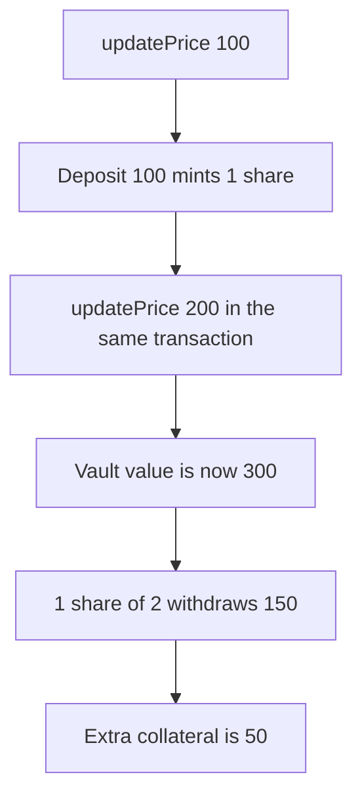

# Perpetual: two Pyth prices pay 150 on a 100 deposit

> **Vulnerability classes:** vuln/oracle/spot-price · vuln/logic/price-calculation

<!-- non-defihacklabs -->
<!-- source-auditvault: https://github.com/Auditware/AuditVault/blob/main/findings/32162-h-1-two-pyth-prices-can-be-used-in-the-same-transaction-to-a.md -->
<!-- date: 2024-02 -->

## Key info

| | |
|---|---|
| **Protocol** | Perpetual |
| **Finding** | Sherlock 2024-02-perpetual H-1, AuditVault 32162 |
| **Vulnerable code** | `OracleMaker.deposit` share mint |
| **Harm** | 100 collateral deposited at price 100 withdraws 150 at price 200. Extra 50. One price returns 100 |
| **Chain** | local synthetic |

## TL;DR

`updatePrice` stores whichever Pyth price it is given, and nothing stops two updates in one transaction. The maker holds 1 base. At price 100 the pool is worth 100, so a 100 deposit mints 1 share against the existing 1 share. The same transaction then stores price 200. The pool is worth 300 and that 1 share of 2 withdraws 150. A control that uses only price 200 mints 0.5 share and withdraws 100.

## The vulnerable code

```solidity
function updatePrice(uint256 newPrice, uint256 publishTime) external {
    require(block.timestamp >= publishTime, "future");
    require(block.timestamp - publishTime <= MAX_AGE, "stale");
    price = newPrice;
}

uint256 priceNow = _getPrice();
uint256 vaultValueXShareDecimals = _getVaultValueSafe(priceNow) - amount;
uint256 amountXShareDecimals = amount;
// @> VULN: share mint uses the price stored in this transaction
shares = (amountXShareDecimals * totalSupply) / vaultValueXShareDecimals;
```

Both updates pass `publishTime == block.timestamp`. `MAX_AGE` is one hour. A block has one timestamp, so the check does not distinguish the two prices.

## Root cause

The share price is the last stored Pyth update, and deposit and withdraw read it independently. Nothing binds a deposit and a withdraw to the same update.

## Preconditions

The maker has 1 base and 1 share outstanding. The attacker has 100 collateral. Two signed prices, 100 and 200, are both fresh for this block. No whitelist is required. The maker is prefunded with 200 collateral so the withdrawal of 150 can be paid. That prefund is the pool reserve, not the attacker's profit.

## Attack walkthrough

1. Store price 100 and deposit 100. Shares minted: 1. See [output.txt](output.txt).
2. Store price 200.
3. Withdraw the 1 share. Payout is 150.
4. Extra collateral is 50.
5. The control stores only 200, deposits 100, mints 0.5 share, and withdraws 100.

## Diagrams



## Impact

The attacker deposits 100 and withdraws 150. Existing LPs lose the 50. Using one price for both calls returns exactly the 100 deposit.

## Remediation

Do not let one transaction store two prices for an LP deposit and a withdrawal. Require deposits and withdrawals to be made by a trusted relayer, which is the fix the report recommends.

## How to reproduce

```bash
cd 32162-h-1-two-pyth-prices-can-be-used-in-the-same-transaction-to-a_exp
forge test -vv
```

## Sources

- AuditVault finding: https://github.com/Auditware/AuditVault/blob/main/findings/32162-h-1-two-pyth-prices-can-be-used-in-the-same-transaction-to-a.md
- Sherlock issue: https://github.com/sherlock-audit/2024-02-perpetual-judging/issues/123
- Deposit: https://github.com/sherlock-audit/2024-02-perpetual/blob/main/perp-contract-v3/src/maker/OracleMaker.sol#L189-L206
- Withdraw: https://github.com/sherlock-audit/2024-02-perpetual/blob/main/perp-contract-v3/src/maker/OracleMaker.sol#L234-L247
- Repo: sherlock-audit/2024-02-perpetual
- Synthetic: [test/32162-h-1-two-pyth-prices-can-be-used-in-the-same-transaction-to-a.sol](test/32162-h-1-two-pyth-prices-can-be-used-in-the-same-transaction-to-a.sol)
