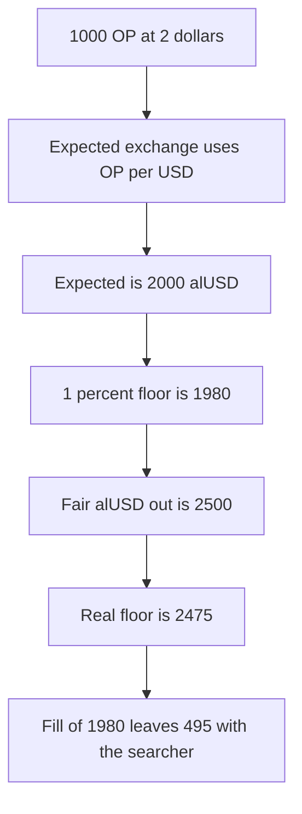

# Alchemix: the swap fills at 1980, below the 2475 alUSD floor

> **Vulnerability classes:** vuln/defi/slippage · vuln/oracle/wrong-feed

<!-- non-defihacklabs -->
<!-- source-auditvault: https://github.com/Auditware/AuditVault/blob/main/findings/32243-h-1-the-calculated-value-for-slippage-protection-in-the-prot.md -->
<!-- date: 2024-04 -->

## Key info

| | |
|---|---|
| **Protocol** | Alchemix |
| **Finding** | Sherlock 2024-04-alchemix H-1, AuditVault 32243 |
| **Vulnerable code** | `OptimismRewardCollector.getExpectedExchange` |
| **Harm** | 1000 OP is swapped with a floor of 1980 alUSD. The real 1% floor is 2475. The fill is 1980, and 495 is kept by the searcher |
| **Chain** | local synthetic |

## TL;DR

The collector prices the OP rewards in USD and treats that number as alUSD. 1000 OP at $2 becomes an expected 2000. alUSD is $0.80, so the fair alUSD out is 2500. With 100 bps of slippage the buggy floor is 1980 and the real floor is 2475. The router fills the floor it is given. 1980 is worse than 2475. The 495 gap is transferred to the caller. The control uses the alUSD price, rejects 1980, and fills 2475.

## The vulnerable code

```solidity
if (debtToken == alUsd) {
    // @> VULN: OP/USD treats alUSD as $1
    expectedExchange = totalToSwap * uint256(opToUsd) / 1e8;
}
minimum = expectedExchange * SLIPPAGE_BPS / BPS;
```

`opToUsd` is 2e8. `totalToSwap` is 1000. `SLIPPAGE_BPS` is 9900 and `BPS` is 10000. `alUsdToUsd` is 0.8e8. The fair line is `totalToSwap * opToUsd / alUsdToUsd`.

| | alUSD |
|---|---|
| Buggy expected | 2000 |
| Buggy minimum | 1980 |
| Fair expected | 2500 |
| Fair minimum | 2475 |
| Fill | 1980 |
| Gap | 495 |

## Root cause

The route sells OP for alUSD, but the minimum is computed from the USD value of OP. alUSD is not USD, so the floor sits below the market.

## Preconditions

debtToken is the alUSD address, so the alUSD branch runs. OP is $2 and alUSD is $0.80. Slippage is 1%. The router will fill at the minimum it is passed. One transaction, no timestamp change.

## Attack walkthrough

1. The router is funded with the fair 2500 alUSD. See [output.txt](output.txt).
2. `minimumOut` stores expected 2000 and minimum 1980.
3. `fairOut` stores 2475.
4. The swap fills 1980 to the collector.
5. 495, the amount under the real floor, is paid to the caller.
6. The control calls `swapProtected` with minOut 1980 and floor 2475. That reverts. The same call with minOut 2475 fills 2475.

## Diagrams



## Impact

The reward swap accepts 1980 alUSD. The protocol's own 1% slippage on the alUSD price would require 2475. 495 alUSD is worse than that minimum. The control will not fill 1980.

## Remediation

Divide by the alUSD/USD price: `expectedExchange = totalToSwap * opToUsd / alUsdToUsd`, then apply `SLIPPAGE_BPS`.

## How to reproduce

```bash
cd 32243-h-1-the-calculated-value-for-slippage-protection-in-the-prot_exp
forge test -vv
```

## Sources

- AuditVault finding: https://github.com/Auditware/AuditVault/blob/main/findings/32243-h-1-the-calculated-value-for-slippage-protection-in-the-prot.md
- Sherlock issue: https://github.com/sherlock-audit/2024-04-alchemix-judging/issues/5
- Collector: https://github.com/sherlock-audit/2024-04-alchemix/blob/main/v2-foundry/src/utils/collectors/OptimismRewardCollector.sol#L120-L126
- Repo: sherlock-audit/2024-04-alchemix
- Synthetic: [test/32243-h-1-the-calculated-value-for-slippage-protection-in-the-prot.sol](test/32243-h-1-the-calculated-value-for-slippage-protection-in-the-prot.sol)
