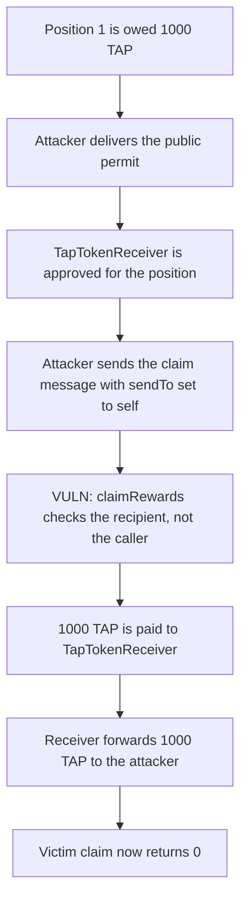

# Tapioca twTAP — anyone can claim an approved position's rewards

> **Vulnerability classes:** vuln/access-control/missing-auth · vuln/access-control/missing-owner-check · vuln/logic/missing-check · vuln/logic/reward-calculation

<!-- non-defihacklabs -->
<!-- source-auditvault: https://github.com/Auditware/AuditVault/blob/main/findings/32314-h-03-absence-of-restrictions-on-the-sender-of-the-twtapclaim.md -->
<!-- date: 2024-02 -->

## Key info

| | |
|---|---|
| **Protocol** | Tapioca DAO |
| **Finding** | Code4rena 2024-02 H-03, AuditVault 32314 |
| **Vulnerable code** | `TwTAP.claimRewards` |
| **Harm** | 1,000 TAP taken by the attacker; the victim's later claim returns 0 |
| **Chain** | local synthetic |

## TL;DR

`twTAP.claimRewards` checks that the recipient `_to` owns the position or is approved for it. It never checks `msg.sender`. A destination-chain permit that anyone can deliver approves `TapTokenReceiver`. The attacker then delivers the claim message, names themselves as `sendTo`, and the receiver forwards the position's TAP. The owner's own claim, run after that, returns 0.

## The vulnerable code

```solidity
function claimRewards(uint256 _tokenId, address _to)
    external
    nonReentrant
    whenNotPaused
    returns (uint256[] memory amounts_)
{
    _requireClaimPermission(_to, _tokenId);
    amounts_ = _claimRewards(_tokenId, _to);
}

function _requireClaimPermission(address _to, uint256 _tokenId) internal view {
    // @> VULN: checks `_to`, not msg.sender. Any caller can claim to an approved receiver.
    if (!_isApprovedOrOwner(_to, _tokenId) && !isERC721Approved(_ownerOf(_tokenId), _to, address(this), _tokenId)) {
        revert NotApproved(_tokenId, msg.sender);
    }
}
```

The warden's patch also requires `_requireClaimPermission(msg.sender, _tokenId)`. Tapioca noted that this still lets the receiver through, because in that call `msg.sender == _to`. Restricting the caller to the position owner closes both the direct call and the receiver path.

## Root cause

The permission helper asks whether `_to` is the owner or an approved operator. The cross-chain claim is built so `_to` is `TapTokenReceiver`, which the user is expected to approve. Nothing asks whether the account that triggered the permit, or the account that sent the claim message, is that owner. The receiver then pays `sendTo` from the message, and that field is attacker-controlled.

## Preconditions

The victim holds a twTAP position with accrued TAP. The destination-chain permit that approves `TapTokenReceiver` can be delivered by anyone, not only by the owner. The claim message is not bound to the source-chain sender.

## Attack walkthrough

1. Position 1 is owed 1,000 TAP, escrowed in twTAP. The owner is the victim.
2. The attacker delivers the permit. `getApproved(1)` becomes `TapTokenReceiver`.
3. The attacker calls the claim message with `sendTo` set to themselves.
4. The receiver calls `claimRewards(1, address(this))`. The permission check sees an approved `_to` and does not look at the caller.
5. twTAP transfers 1,000 TAP to the receiver. The receiver forwards it to the attacker.
6. The victim's later claim message runs the same path and gets 0. The victim's TAP balance stays 0.

The control requires `msg.sender` to be the position owner. The attacker's call reverts. The victim's call still pays the 1,000 TAP to the victim.

## Diagrams



## Impact

The attacker holds the 1,000 TAP that belonged to the victim's position. A later claim, including the owner's own cross-chain claim, returns an empty amount, so nothing is bridged to the victim. The report's front-run variant leaves the same tokens sitting in `TapTokenReceiver` instead of forwarding them; either way the owner is paid 0.

## Remediation

Only the position owner may call `claimRewards`. Checking that the caller is merely approved does not help when the approved address is `TapTokenReceiver` and the attacker is the one who asked it to claim.

## How to reproduce

```bash
cd 32314-h-03-absence-of-restrictions-on-the-sender-of-the-twtapclaim_exp
forge test -vv
```

## Sources

- AuditVault finding: https://github.com/Auditware/AuditVault/blob/main/findings/32314-h-03-absence-of-restrictions-on-the-sender-of-the-twtapclaim.md
- Code4rena report: https://code4rena.com/reports/2024-02-tapioca
- Code4rena issue: https://github.com/code-423n4/2024-02-tapioca-findings/issues/142
- Vulnerable function: https://github.com/Tapioca-DAO/tap-token/blob/20a83b1d2d5577653610a6c3879dff9df4968345/contracts/governance/twTAP.sol#L396-L404
- Receiver call: https://github.com/Tapioca-DAO/tap-token/blob/20a83b1d2d5577653610a6c3879dff9df4968345/contracts/tokens/TapTokenReceiver.sol#L156
