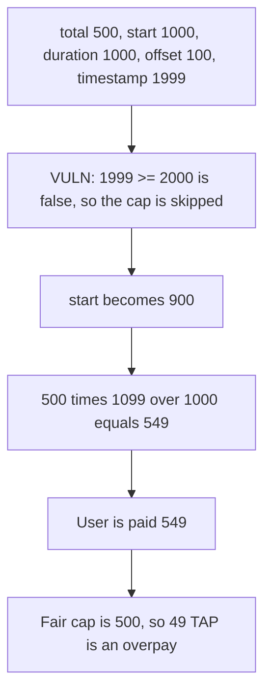

# Tapioca vesting — `_vested` pays 549 where the cap is 500

> **Vulnerability classes:** vuln/logic/reward-calculation · vuln/logic/wrong-condition

<!-- non-defihacklabs -->
<!-- source-auditvault: https://github.com/Auditware/AuditVault/blob/main/findings/32316-h-05-vested-claimable-amount-calculation-error-code4rena-ta.md -->
<!-- date: 2024-02 -->

## Key info

| | |
|---|---|
| **Protocol** | Tapioca DAO |
| **Finding** | Code4rena 2024-02 H-05, AuditVault 32316 |
| **Vulnerable code** | `Vesting._vested` |
| **Harm** | Claimed 549 TAP. Fair cap is 500. The user is paid 49 too much. |
| **Chain** | local synthetic |

## TL;DR

`_vested` treats the schedule as fully vested only when `block.timestamp >= start + duration`. The linear term then subtracts `__initialUnlockTimeOffset` from `start`, so it can exceed `totalAmount` while the full-vest check is still false. With the report's numbers — total 500, duration 1000, offset 100, start 1000, timestamp 1999 — the claim pays 549. The corrected check, `timestamp >= start - offset + duration`, returns 500. The control pays 500 and leaves the extra 49 unclaimed.

## The vulnerable code

```solidity
// @> VULN: fully-vested check ignores __initialUnlockTimeOffset, so the product can exceed _totalAmount
if (block.timestamp >= _start + _duration) return _totalAmount;

_start = _start - __initialUnlockTimeOffset;
return (_totalAmount * (block.timestamp - _start)) / _duration;
```

At timestamp 1999 the comparison is `1999 >= 2000`, which is false. `start` becomes 900. `500 * 1099 / 1000` is 549.

## Root cause

The offset is applied to the numerator and not to the cap. The schedule is therefore allowed to pay more than `totalAmount` for the last `offset` seconds before `start + duration`.

## Preconditions

`cliff` is 0. `totalAmount` is 500, `start` is 1000, `duration` is 1000, and `__initialUnlockTimeOffset` is 100. The block timestamp is 1999, set once for the block. `run()` does not warp. The vesting contract holds 549 TAP so the over-cap transfer can succeed.

## Attack walkthrough

1. The user calls `claim` at timestamp 1999.
2. The full-vest check does not fire.
3. The linear product returns 549, and that amount is transferred.
4. The corrected formula on the same inputs returns 500.
5. Claimed is 549. Fair is 500. The difference is 49.

The control moves the offset into the full-vest comparison. `1999 >= 1900`, so `_vested` returns 500. The user receives 500 and 49 TAP stays in the vesting contract.

## Diagrams



## Impact

The user receives 549 TAP against a fair vested amount of 500. The extra 49 is taken from the vesting balance.

## Remediation

```solidity
if (block.timestamp >= _start - __initialUnlockTimeOffset + _duration) return _totalAmount;
```

## How to reproduce

```bash
cd 32316-h-05-vested-claimable-amount-calculation-error-code4rena-ta_exp
forge test -vv
```

## Sources

- AuditVault finding: https://github.com/Auditware/AuditVault/blob/main/findings/32316-h-05-vested-claimable-amount-calculation-error-code4rena-ta.md
- Code4rena report: https://code4rena.com/reports/2024-02-tapioca
- Fix PR: https://github.com/Tapioca-DAO/tap-token/pull/175
