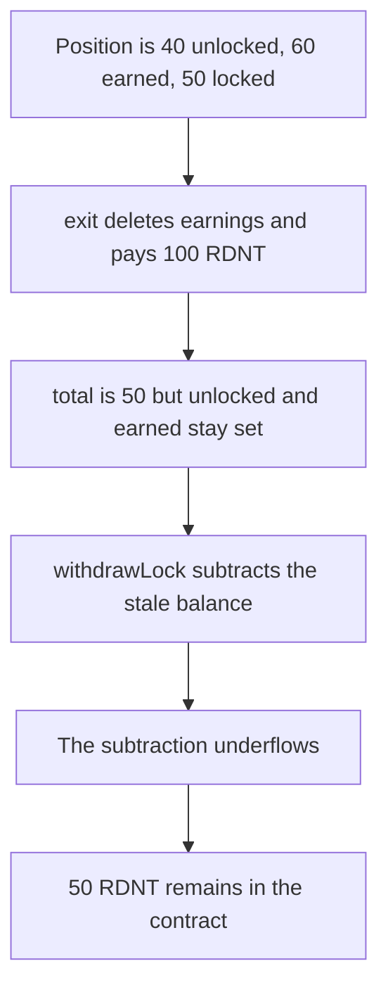

# Radiant — exit leaves earned and unlocked set and freezes 50 RDNT

> **Vulnerability classes:** vuln/logic/state-update · vuln/dos/frozen-funds

<!-- non-defihacklabs -->
<!-- source-auditvault: https://github.com/Auditware/AuditVault/blob/main/findings/32846-incorrect-accounting-of-earned-and-unlocked-tokens-on-exit-m.md -->
<!-- date: 2023-05 -->

## Key info

| | |
|---|---|
| **Protocol** | Radiant MultiFeeDistribution |
| **Finding** | OpenZeppelin Radiant audit, AuditVault 32846 |
| **Vulnerable code** | `MultiFeeDistribution.exit` |
| **Harm** | Exit pays 100 RDNT. The remaining 50 RDNT lock reverts and stays in the contract |
| **Chain** | local synthetic |

## TL;DR

`exit` deletes `userEarnings` and subtracts the paid amount from `total`. It does not set `unlocked` or `earned` to 0. A staker with 40 unlocked, 60 earned, and 50 locked receives 100 RDNT. `total` is 50, but `unlocked` is still 40 and `earned` is still 60. `withdrawLock` subtracts that stale withdrawable balance from `total` and underflows. The 50 RDNT stays in the contract. The fixed exit zeroes both fields, and the same lock then withdraws.

## The vulnerable code

```solidity
delete userEarnings[onBehalfOf];
Balances storage bal = balances[onBehalfOf];
// @> VULN: total is reduced but unlocked and earned are left unchanged
bal.total = bal.total - amount - penaltyAmount;
_withdrawTokens(onBehalfOf, amount, penaltyAmount, burnAmount, claimRewards);
```

`withdrawableBalance` still reads `balances[user].earned` and `balances[user].unlocked`. After the array delete, the earned amount looks entirely unvested, so a later call also recomputes a penalty on tokens that were already paid.

## Root cause

Exit updates one view of the position, `userEarnings` and `total`, and leaves the two fields `withdrawableBalance` actually sums. The next function that subtracts a withdrawable amount from `total` underflows.

## Preconditions

The staker's position is 40 RDNT unlocked, 60 RDNT earned and already vested, and 50 RDNT locked. The contract holds 150 RDNT.

## Attack walkthrough

1. `exit` computes a 100 RDNT withdrawable balance and a 0 penalty.
2. It deletes the earnings array and sets `total` to 50.
3. It transfers 100 RDNT.
4. `unlocked` is still 40 and `earned` is still 60.
5. `withdrawLock` reverts. The contract balance is 50 RDNT.

The control sets `unlocked` and `earned` to 0 before the transfer. `withdrawLock` then pays the 50 RDNT and the contract balance is 0.

## Diagrams



## Impact

The staker who calls the normal exit cannot retrieve the 50 RDNT still locked. Later `withdraw` and `exit` calls for that account revert on the `total` update. The fixed path returns all 150 RDNT.

## Remediation

In `exit`, set `unlocked` and `earned` to 0 and reduce `total` by those two fields before the token transfer, which is what the later Radiant commit does.

## How to reproduce

```bash
cd 32846-incorrect-accounting-of-earned-and-unlocked-tokens-on-exit-m_exp
forge test -vv
```

## Sources

- AuditVault finding 32846
- https://blog.openzeppelin.com/radiant
- radiant-capital/v2-core `MultiFeeDistribution.sol` at `e8f21f103e17736907b62809d1ad902febc53714`, fixed in commit `1830760`
