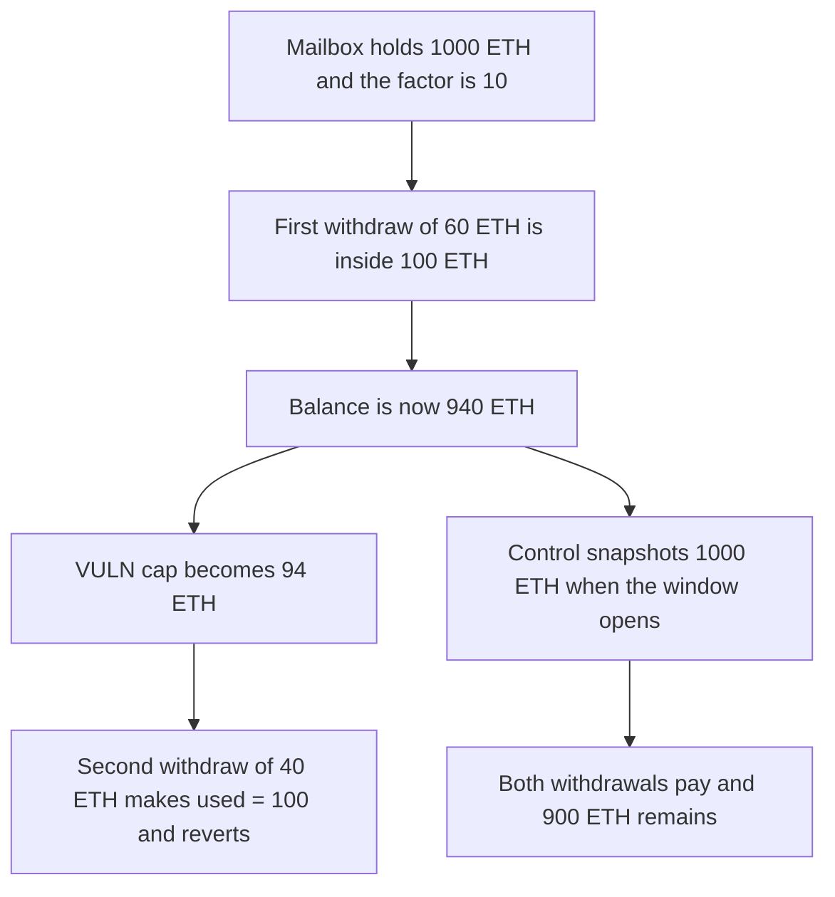

# zkSync Mailbox rejects an ETH withdrawal that is still inside the daily cap

> **Vulnerability classes:** vuln/logic/withdrawal-limit · vuln/dos/frozen-funds

<!-- non-defihacklabs -->
<!-- source-auditvault: https://github.com/Auditware/AuditVault/blob/main/findings/33111-eth-withdrawal-within-allowed-limit-could-fail-openzeppelin.md -->
<!-- date: 2023-02 -->

## Key info

| Field | Value |
|---|---|
| **Loss** | 40 ETH stays in the mailbox. The opening balance is 1000 ETH, so the 10 percent daily cap is 100 ETH. After a 60 ETH withdrawal the next 40 ETH reverts |
| **Vulnerable contract** | `Mailbox.withdraw` |
| **Attacker EOA** | `0x1111111111111111111111111111111111111111` |
| **Attack contract** | `Exploit` at `0x15452ec016c4dc8c549e7fe6ff4b26324ea8b7a4` |
| **Attack tx** | `Exploit.run()` |
| **Chain / block / date** | Ethereum model · block 0 · 2023-02 |
| **Compiler** | solc 0.8.27, cancun, via IR |
| **Bug class** | Daily cap multiplies the live balance instead of the balance at the start of the window |



## TL;DR

`withdraw` computes the daily cap as `withdrawalFactor * address(this).balance / 100`. The balance already excludes withdrawals from earlier in the same window.

A mailbox seeded with 1000 ETH has a 100 ETH cap. The first call sends 60 ETH. The balance is then 940 ETH, so the next cap is 94 ETH. A further 40 ETH makes `used` equal 100, and `100 <= 94` reverts. Those 40 ETH stay in the contract. Together the two calls are exactly 10 percent of the opening balance.

The fixed mailbox stores `address(this).balance` when the window id changes and divides that snapshot. Both calls succeed and the mailbox holds 900 ETH.

## The vulnerable code

```solidity
lastCap = (withdrawalFactor * address(this).balance) / 100; // @> VULN: cap uses the post-withdrawal balance
lastUsed = amount + withdrawnAmountInWindow;
emit CapChecked(lastCap, lastUsed);
require(lastUsed <= lastCap, "w4");
```

The quoted Mailbox check is `_amount + s.withdrawnAmountInWindow <= (limitData.withdrawalFactor * address(this).balance) / 100`.

## Impact

A withdrawal that is inside the published daily limit fails because an earlier withdrawal in the same window reduced `address(this).balance`. In this run, 40 ETH of the 100 ETH opening cap cannot leave.
