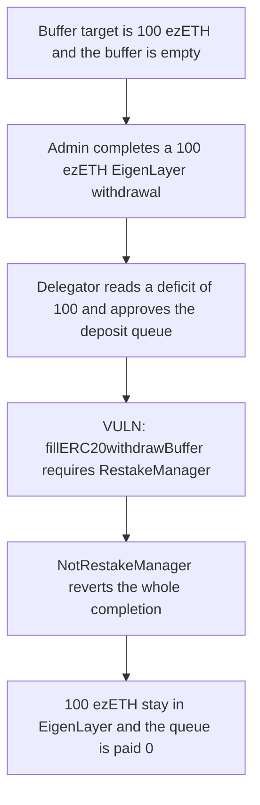

# Renzo: filling the ERC20 buffer reverts completeQueuedWithdrawal

> **Vulnerability classes:** vuln/access-control/missing-modifier · vuln/dos/frozen-funds · vuln/dos/lockup

> **Reproduction:** local synthetic. `OperatorDelegator.completeQueuedWithdrawal` and `DepositQueue.onlyRestakeManager` are the audited lines. No fork.

<!-- non-defihacklabs -->
<!-- source-auditvault: https://github.com/Auditware/AuditVault/blob/main/findings/33494-h-07-dos-of-completequeuedwithdrawal-when-erc20-buffer-is-fi.md -->
<!-- date: 2024-04 -->

## Key info

| | |
|---|---|
| **Protocol** | Renzo |
| **Finding** | Code4rena H-07, AuditVault 33494 |
| **Vulnerable code** | `DepositQueue.onlyRestakeManager` / `OperatorDelegator.completeQueuedWithdrawal` |
| **Harm** | 100 ezETH stay stuck in EigenLayer. The withdraw queue is paid 0. The control pays 100 ezETH. |
| **Chain** | local synthetic |

## TL;DR

The ERC20 withdrawal buffer target is 100 ezETH and the buffer is empty, so the deficit is 100. `completeQueuedWithdrawal` pulls that 100 out of EigenLayer, approves the deposit queue, and calls `fillERC20withdrawBuffer`. That function still has `onlyRestakeManager`. The caller is the OperatorDelegator, so the call reverts `NotRestakeManager` and the whole completion reverts. The 100 ezETH never leave EigenLayer. Removing the modifier lets the same call finish and pays 100 ezETH into the withdraw queue.

## The vulnerable code

```solidity
/// @dev Allows only the RestakeManager address to call functions
modifier onlyRestakeManager() {
    // @> VULN: OperatorDelegator is not the RestakeManager, so filling the buffer reverts the whole completion
    if (msg.sender != address(restakeManager)) revert NotRestakeManager();
    _;
}

function fillERC20withdrawBuffer(
    address _asset,
    uint256 _amount
) external nonReentrant onlyRestakeManager {
    ...
}
```

`completeQueuedWithdrawal` reaches that modifier whenever the buffer deficit is non-zero:

```solidity
tokens[i].safeApprove(address(restakeManager.depositQueue()), bufferToFill);
restakeManager.depositQueue().fillERC20withdrawBuffer(
    address(tokens[i]),
    bufferToFill
);
```

The recommended change is to drop `onlyRestakeManager`. Anyone who calls the fill is donating ERC20 to the withdraw queue.

## Root cause

The completion path and the buffer-fill path disagree about who is allowed to move tokens into the queue. The delegator is the contract that holds the tokens just withdrawn from EigenLayer. The queue only accepts the RestakeManager. The first time the buffer is short, every ERC20 completion reverts.

## Preconditions

The caller is the native-ETH restake admin. One ERC20 strategy is queued for 100 ezETH. The buffer target is that same 100 ezETH and nothing has been filled yet, so `getBufferDeficit` is 100. The buffer is deliberately small: one withdrawal, no extra tokens, no loop.

## Attack walkthrough

1. EigenLayer's delegation manager holds 100 ezETH for the queued withdrawal. The withdraw queue's buffer target is 100 and its filled amount is 0.
2. The admin records 100 queued shares and calls `completeQueuedWithdrawal`.
3. The delegator reads a deficit of 100, approves the deposit queue, and calls `fillERC20withdrawBuffer`.
4. `onlyRestakeManager` sees `msg.sender` is the OperatorDelegator and reverts.
5. The completion reverts with it. EigenLayer still holds 100 ezETH. The withdraw queue holds 0.

The control deploys a deposit queue without `onlyRestakeManager`. The same 100 ezETH withdrawal completes. The withdraw queue's balance is 100 ezETH and EigenLayer's balance is 0.

## Diagrams



## Impact

Users waiting on the ERC20 buffer cannot be paid from this withdrawal. 100 ezETH that EigenLayer already released back to the delegator are rolled back into the delegation manager and stay there. Repeating the call does not help: the deficit is still 100, so the same revert happens again. The control pays those 100 ezETH into the withdraw queue.

## Remediation

Remove `onlyRestakeManager` from `fillERC20withdrawBuffer`, or allow the OperatorDelegator. Filling the buffer only transfers the caller's ERC20 into the withdraw queue.

## How to reproduce

```bash
cd 33494-h-07-dos-of-completequeuedwithdrawal-when-erc20-buffer-is-fi_exp
forge test -vv
```

`run()` does not warp. The forge log shows `stuck ezETH: 100000000000000000000` and `queue paid: 0`. The control log shows `control paid: 100000000000000000000`.

## Sources

- AuditVault finding: https://github.com/Auditware/AuditVault/blob/main/findings/33494-h-07-dos-of-completequeuedwithdrawal-when-erc20-buffer-is-fi.md
- Code4rena report: https://code4rena.com/reports/2024-04-renzo
- Reviewed tree: https://github.com/code-423n4/2024-04-renzo/blob/main/contracts/Delegation/OperatorDelegator.sol
- Deposit queue: https://github.com/code-423n4/2024-04-renzo/blob/main/contracts/Deposits/DepositQueue.sol
