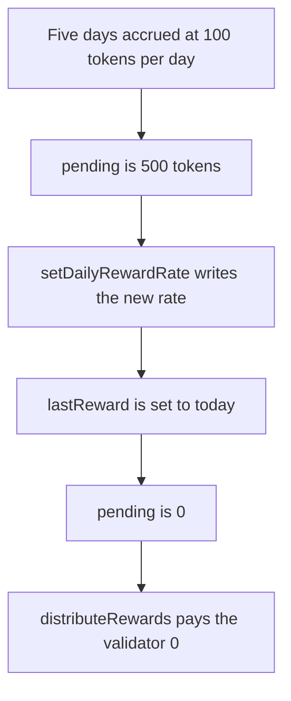

# veTenet — changing the reward rate makes 500 tokens unclaimable

> **Vulnerability classes:** vuln/logic/reward-calculation · vuln/logic/state-update

<!-- non-defihacklabs -->
<!-- source-auditvault: https://github.com/Auditware/AuditVault/blob/main/findings/34033-h-01-changing-the-reward-rate-results-in-non-claimable-yield.md -->
<!-- date: 2023-12 -->

## Key info

| | |
|---|---|
| **Protocol** | veTenet RewardVault |
| **Finding** | Pashov Audit Group veTenet H-01, AuditVault 34033 |
| **Vulnerable code** | `RewardVault.setDailyRewardRate` |
| **Harm** | 500 tokens that had accrued for the validator are no longer claimable |
| **Chain** | local synthetic |

## TL;DR

`pending()` is `(today - lastReward) * dailyRewardRate`. `setDailyRewardRate` stores the new rate and then sets `lastReward` to today. Five days at 100 tokens per day, 500 tokens, disappear from `pending()`. The following `distributeRewards` pays 0. The validator's balance stays 0 and the 500 tokens sit in the vault. The control calls `distributeRewards` before the rate change and the validator receives the 500.

`lastReward` is initialized five days behind the block timestamp. Nothing in `run()` warps the clock.

## The vulnerable code

```solidity
function setDailyRewardRate(uint256 newRate) external {
    dailyRewardRate = newRate;
    // @> VULN: lastReward is moved to the current day, so already-accrued days drop out of pending()
    lastReward = block.timestamp / 1 days;
}
```

## Root cause

The rate setter moves the accrual cursor forward without settling the interval that cursor still covered. Distribution only pays `pending()`, so the skipped interval is never paid.

## Preconditions

`lastReward` is five days before the current day and `dailyRewardRate` is 100 tokens. The vault holds at least 500 tokens. The caller is the admin who is allowed to change the rate. The loss happens on the intended setter, not on a separate malicious role.

## Attack walkthrough

1. `pending()` returns 500 tokens.
2. `setDailyRewardRate(200)` writes the rate, then sets `lastReward` to today.
3. `pending()` returns 0.
4. `distributeRewards` transfers 0. `paid` stays 0. The validator balance stays 0. The vault still holds 500 tokens.

The control distributes first. The validator receives 500 tokens, and the later rate change has an empty pending window.

## Diagrams



## Impact

Validators lose 500 tokens of yield that was already accrued. The tokens remain in the vault but no later call includes those five days. Distributing before the cursor moves pays the 500.

## Remediation

Call `distributeRewards` before updating `lastReward`, and only when `lastReward` has already been set.

## How to reproduce

```bash
cd 34033-h-01-changing-the-reward-rate-results-in-non-claimable-yield_exp
forge test -vv
```

## Sources

- AuditVault finding 34033
- https://github.com/solodit/solodit_content/blob/main/reports/Pashov%20Audit%20Group/2023-12-01-veTenet.md
