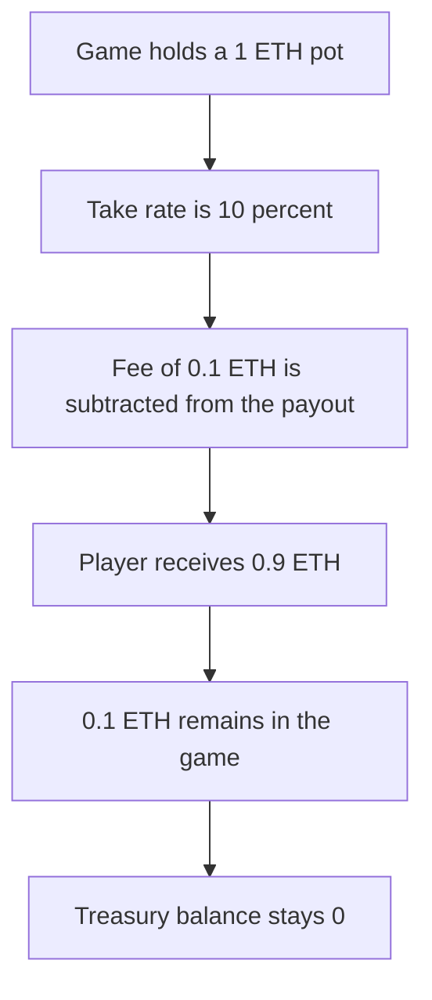

# Curio — earlyEndGame locks the 0.1 ETH game fee

> **Vulnerability classes:** vuln/logic/fee-calculation · vuln/dos/frozen-funds

<!-- non-defihacklabs -->
<!-- source-auditvault: https://github.com/Auditware/AuditVault/blob/main/findings/34118-h-01-game-fee-locked-in-earlyendgame-pashov-audit-group-none.md -->
<!-- date: 2024-01 -->

## Key info

| | |
|---|---|
| **Protocol** | Curio |
| **Finding** | Pashov Audit Group Curio H-01, AuditVault 34118 |
| **Vulnerable code** | `Game.earlyEndGame` |
| **Harm** | 0.1 ETH of a 1 ETH pot stays in the game. The treasury receives 0 |
| **Chain** | local synthetic |

## TL;DR

`earlyEndGame` computes a 10 percent fee on a 1 ETH payout, subtracts 0.1 ETH from the player, and sends the player 0.9 ETH. It never forwards the fee. The game balance is 0.1 ETH and the treasury balance is 0. There is no other withdrawal of that balance. The fixed function sends the 0.1 ETH to the treasury and the game balance ends at 0.

## The vulnerable code

```solidity
uint256 gameFee = (playerPayout.payout * takeRate) / 100;
playerPayout.payout -= gameFee; // @> VULN: gameFee is taken from the player and left in this contract
feeTaken = gameFee;
(bool sent,) = player.call{value: playerPayout.payout}("");
```

The recommended fix is `treasury.call{value: gameFee}` after the deduction. That call is absent here.

## Root cause

The fee is an accounting decrease of the player's payout, not a transfer. The ETH that used to back the full payout remains in the contract with no path to the treasury.

## Preconditions

The admin calls `earlyEndGame` the way the game ends a match. The pot is 1 ETH and `takeRate` is 10. The player can receive ETH. The treasury is a separate address.

## Attack walkthrough

1. The game is funded with 1 ETH.
2. `earlyEndGame` sets the fee to 0.1 ETH and the payout to 0.9 ETH.
3. The player receives 0.9 ETH.
4. The game still holds 0.1 ETH. The treasury holds 0.

The control uses the same numbers and then pays the treasury. The game balance is 0 and the treasury holds 0.1 ETH.

## Diagrams



## Impact

The treasury is owed 0.1 ETH and cannot collect it. The player was paid the net amount, so the missing fee is not the player's loss. It is locked in the game contract. A 10 percent fee on every early end accumulates the same way.

## Remediation

After the deduction, send `gameFee` to the treasury and revert if the call fails.

## How to reproduce

```bash
cd 34118-h-01-game-fee-locked-in-earlyendgame-pashov-audit-group-none_exp
forge test -vv
```

## Sources

- AuditVault finding 34118
- https://github.com/pashov/audits/blob/master/team/md/Curio-security-review.md
