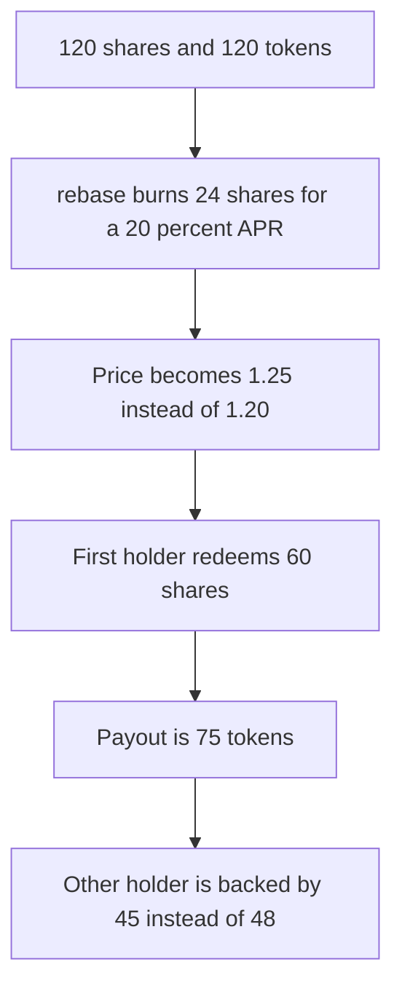

# RivusTAO — rebase turns a 20% APR into a 1.25 price

> **Vulnerability classes:** vuln/logic/reward-calculation · vuln/logic/wrong-condition

<!-- non-defihacklabs -->
<!-- source-auditvault: https://github.com/Auditware/AuditVault/blob/main/findings/34138-c-02-function-rebase-apply-wrong-apr-in-rivustao-pashov-audi.md -->
<!-- date: 2024-03 -->

## Key info

| | |
|---|---|
| **Protocol** | RivusTAO |
| **Finding** | Pashov Audit Group Rivus C-02, AuditVault 34138 |
| **Vulnerable code** | `RivusTAO.rebase` |
| **Harm** | The first holder receives 75 tokens instead of 72. The other holder's backing falls from 48 to 45 |
| **Chain** | local synthetic |

## TL;DR

`rebase` should raise the share price by `apr` by burning `totalShares * apr / (100 + apr)`. It burns `totalShares * apr / 100`. On 120 shares and 120 tokens, a 20% APR burns 24 shares instead of 20. The price becomes 1.25 instead of 1.20. The holder who withdraws 60 shares first receives 75 tokens. The fair amount is 72. The other holder is left with 45 tokens instead of 48.

The report walks the same formula on 100 shares: burn 20, price 1.25, instead of burn `100 * 20 / 120`. These amounts divide evenly, so both the wrong path and the fair path are exact.

## The vulnerable code

```solidity
function rebase(uint256 apr) external {
    // @> VULN: burnAmount = totalShares * apr / 100, not totalShares * apr / (100 + apr)
    uint256 burnAmount = totalShares * apr / 100;
    lastBurn = burnAmount;
    totalShares -= burnAmount;
}
```

## Root cause

Burning `apr / 100` of the shares multiplies the price by `1 / (1 - apr/100)`, which is 1.25 when apr is 20. The price multiplier that matches a 20% increase is `1.20`, and the burn that produces it is `apr / (100 + apr)`.

## Preconditions

There are 120 shares and 120 backing tokens. Two holders have 60 shares each. The admin calls `rebase(20)`. One holder withdraws immediately.

## Attack walkthrough

1. `rebase(20)` burns 24 shares. `totalShares` is 96. Price is 120/96 = 1.25.
2. The early holder withdraws 60 shares and receives 75 tokens.
3. 45 tokens remain. A 20% price would have paid 72 and left 48.
4. The excess is 3 tokens.

The control burns `120 * 20 / 120 = 20` shares, pays 72, and leaves 48.

## Diagrams



## Impact

The early withdrawer takes 3 tokens that a 20% APR does not entitle them to. Those 3 tokens are missing from the remaining holder's reserve. Every daily rebase overstates the APR the same way, and the first redeemer after each rebase is paid from the others.

## Remediation

Set `burnAmount = totalShares * apr / (100 + apr)`.

## How to reproduce

```bash
cd 34138-c-02-function-rebase-apply-wrong-apr-in-rivustao-pashov-audi_exp
forge test -vv
```

## Sources

- AuditVault finding 34138
- https://github.com/pashov/audits/blob/master/team/md/Rivus-security-review.md
