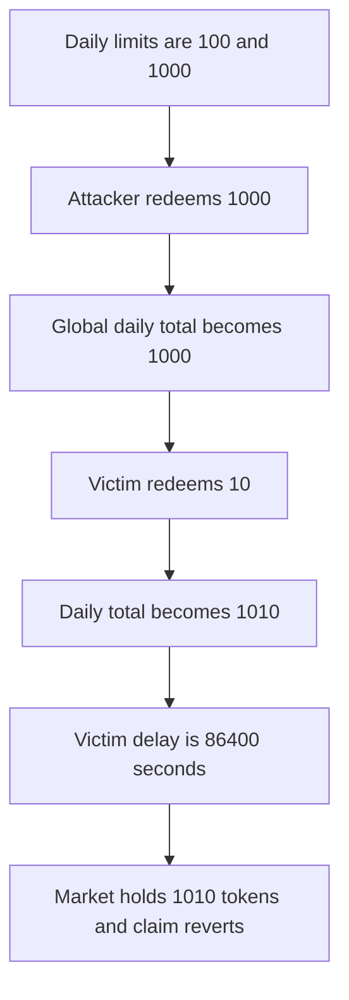

# dForce — one redeem fills the global daily limit and delays the next user 86400 seconds

> **Vulnerability classes:** vuln/logic/state-update · vuln/dos/lockup

<!-- non-defihacklabs -->
<!-- source-auditvault: https://github.com/Auditware/AuditVault/blob/main/findings/34259-manipulation-of-global-daily-limits-on-timelockstrategy-mixb.md -->
<!-- date: 2023-09 -->

## Key info

| | |
|---|---|
| **Protocol** | dForce TimeLockStrategy |
| **Finding** | MixBytes dForce Lending v2, AuditVault 34259 |
| **Vulnerable code** | `TimeLockStrategy.calculateTimeLockParams` |
| **Harm** | A victim redeeming 10 tokens waits 86400 seconds. Without the filled bucket the same redeem is instant |
| **Chain** | local synthetic |

## TL;DR

`currentDailyAmount` is stored once per asset. Every outgoing transfer adds to it. The attacker redeems 1000 tokens, which is the mid daily limit, and their own delay is 3600 seconds. The victim then redeems 10 tokens, under the 100 token single minimum. The bucket is 1010, above the mid daily limit, so the victim's delay is `maxDailyWaitSeconds`, 86400. `claim` reverts in this block. The market holds 1010 tokens. The control redeems the victim while the bucket is empty: the delay is 0 and the 10 tokens return immediately.

The audited repository is no longer public. The reduction follows the verified `TimeLockStrategy` ABI: `assetData(currentDailyAmount, dailyStartTime)`, the four limit fields, and `calculateTimeLockParams` as the function that both returns the delay and writes the daily total.

## The vulnerable code

```solidity
uint256 next = data.currentDailyAmount + amount;
// @> VULN: currentDailyAmount is global, so this caller raises the delay tier for everyone else
data.currentDailyAmount = next;
delay = _delay(asset, amount, next);
```

`_delay` returns 0 only when both the single amount and the daily total are within the minimums. It returns 86400 when the daily total is above the mid limit.

## Root cause

The daily statistic is not keyed by the account that transferred. One large outgoing transfer moves every later transfer, including a tiny one, into a longer timelock. The owner can reset the asset data. Until then the bucket stays high.

## Preconditions

Limits are 100 minimum and 1000 mid, for both a single transfer and the daily total. Waits are 0, 3600, and 86400 seconds. The attacker can redeem 1000 tokens. The victim redeems 10.

## Attack walkthrough

1. Attacker redeem of 1000. Daily total becomes 1000. Delay is 3600. The 1000 tokens are escrowed.
2. Victim redeem of 10. Daily total becomes 1010. Delay is 86400. The 10 tokens are escrowed.
3. `claim` for the victim reverts. The market holds 1010 tokens.

The control is the victim redeem with an empty bucket. Delay is 0. The victim's balance is unchanged and `pending` is 0.

## Diagrams



## Impact

The victim's 10 tokens, which the single-transfer minimum would have released immediately, are locked for 86400 seconds. The market holds those 10 plus the attacker's 1000 until each delay elapses or the owner resets the asset. Any later user in the same day is pushed up the same ladder.

## Remediation

Track the daily total per account, or stop letting one account's transfer select the delay tier for a different account. The client's note says they planned a different delay strategy. This build shows the global bucket as audited.

## How to reproduce

```bash
cd 34259-manipulation-of-global-daily-limits-on-timelockstrategy-mixb_exp
forge test -vv
```

## Sources

- AuditVault finding 34259
- https://github.com/mixbytes/audits_public/blob/master/dForce/Lending%20v2/README.md
- `TimeLockStrategy.sol` in dforce-network/LendingContracts at `6f3a7b6946d8226b38e7f0d67a50e68a28fe5165`, and the verified Base implementation `0xeae18e7d342d03a5fb0492060557f979b9e9a92f`
