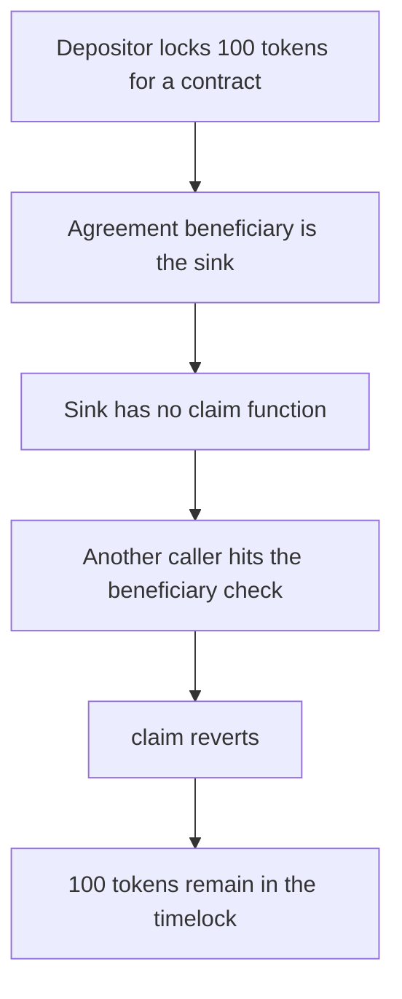

# dForce — 100 tokens freeze when the beneficiary cannot call claim

> **Vulnerability classes:** vuln/dos/frozen-funds · vuln/access-control/broken-logic

<!-- non-defihacklabs -->
<!-- source-auditvault: https://github.com/Auditware/AuditVault/blob/main/findings/34260-funds-may-freeze-on-the-timelock-if-the-beneficiary-does-not.md -->
<!-- date: 2023-09 -->

## Key info

| | |
|---|---|
| **Protocol** | dForce DefaultTimeLock |
| **Finding** | MixBytes dForce Lending v2, AuditVault 34260 |
| **Vulnerable code** | `DefaultTimeLock.claim` |
| **Harm** | 100 tokens locked for an immutable contract stay in the timelock |
| **Chain** | local synthetic |

## TL;DR

`claim` requires `msg.sender == beneficiary`. The beneficiary here is a contract with no functions. It cannot call `claim`. A depositor or anyone else who calls `claim` reverts. The timelock still holds the 100 tokens and the sink's balance is 0. `claimFixed` drops the caller check and the same agreement delivers the 100 tokens to the sink. That is the recommended fix: any account may invoke `claim`.

## The vulnerable code

```solidity
function claim(uint256 id) external {
    Agreement storage a = agreements[id];
    require(a.open, "closed");
    // @> VULN: a beneficiary contract with no way to call claim can never receive the tokens
    require(msg.sender == a.beneficiary, "beneficiary");
    a.open = false;
    token.transfer(a.beneficiary, a.amount);
}
```

The audited line is the beneficiary check in `DefaultTimeLock` agreement execution. The source repo is no longer public. The check is the one the report describes.

## Root cause

Claim is both the release path and an authentication check that the beneficiary itself must satisfy. A beneficiary that is immutable and has no call path can never satisfy it. The tokens have already left the depositor.

## Preconditions

An agreement is created for 100 tokens with the sink as beneficiary. The sink's runtime has no functions. The depositor approved the timelock.

## Attack walkthrough

1. `execute(sink, 100)` transfers 100 tokens into the timelock.
2. The exploit calls `claim`. It is not the beneficiary.
3. The require reverts.
4. The timelock balance is 100. The sink balance is 0.

The control calls `claimFixed` on a fresh agreement. The sink receives 100 and the timelock balance is 0.

## Diagrams



## Impact

The sink is owed 100 tokens and cannot receive them. They sit in `DefaultTimeLock` until the owner intervenes with a different release path. Any beneficiary that cannot send a transaction is in the same position.

## Remediation

Allow any account to call `claim`, and still send the tokens to the stored beneficiary.

## How to reproduce

```bash
cd 34260-funds-may-freeze-on-the-timelock-if-the-beneficiary-does-not_exp
forge test -vv
```

## Sources

- AuditVault finding 34260
- https://github.com/mixbytes/audits_public/blob/master/dForce/Lending%20v2/README.md
- `DefaultTimeLock.sol` at dforce-network/LendingContracts `6f3a7b69`, fixed in commit `8ad82e8ef3dc4568d6bd4d8f06e13cec651d28d0`
