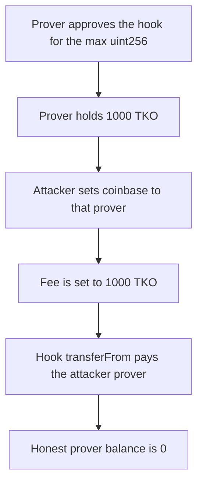

# Taiko — block proposal spends a prover's allowance and takes 1000 TKO

> **Vulnerability classes:** vuln/access-control/missing-auth · vuln/logic/missing-check

<!-- non-defihacklabs -->
<!-- source-auditvault: https://github.com/Auditware/AuditVault/blob/main/findings/34318-vulnerability-in-block-proposal-function-allows-token-theft.md -->
<!-- date: 2024-02 -->

## Key info

| | |
|---|---|
| **Protocol** | Taiko |
| **Finding** | OpenZeppelin Taiko protocol audit, AuditVault 34318 |
| **Vulnerable code** | `AssignmentHook.onBlockProposed` |
| **Harm** | An attacker prover receives an honest prover's entire 1000 TKO balance |
| **Chain** | local synthetic |

## TL;DR

`proposeBlock` stores the caller-supplied coinbase unless it is the zero address. `onBlockProposed` pays the assigned prover with `transferFrom(coinbase, prover, fee)`. An honest prover has approved the hook for `type(uint256).max` and holds 1000 TKO. A proposer sets coinbase to that prover, the fee to 1000 TKO, and the assigned prover to themselves. The hook moves all 1000 TKO. The honest prover's balance is 0. The control passes coinbase zero, the caller pays a 10 TKO fee, and the honest prover's balance does not change.

This is the same coinbase pull as the later Code4rena report, described here as theft of a prover's allowance rather than as one proposer forcing another proposer to pay a partial fee.

## The vulnerable code

```solidity
if (coinbase == address(0)) {
    coinbase = msg.sender;
}
metaCoinbase = coinbase;
hook.onBlockProposed(assignedProver, coinbase, proverFee);
```

```solidity
paidProver = assignedProver;
paidFee = proverFee;
// @> VULN: fee is transferFrom(meta.coinbase), so a proposer can spend another account's allowance
feeToken.transferFrom(coinbase, assignedProver, proverFee);
```

The audited call is `safeTransferFrom(_meta.coinbase, _blk.assignedProver, proverFee)` in `AssignmentHook`. The hook is the token spender, so the allowance that matters is the allowance to the hook.

## Root cause

Coinbase is treated as the fee payer, and the proposer chooses both that address and the fee. A prover who approved the hook so it could pay its own fees has authorized every later proposer to name them.

## Preconditions

The honest prover holds 1000 TKO and has approved the hook for the maximum uint256. The attacker can call `proposeBlock` and can choose the assigned prover.

## Attack walkthrough

1. Read the honest prover's 1000 TKO balance and the max allowance.
2. `proposeBlock(honestProver, attackerProver, 1000 TKO)`.
3. Coinbase is not replaced.
4. The hook transfers 1000 TKO from the honest prover to the attacker prover.
5. The honest prover's balance is 0.

The control uses coinbase zero and a 10 TKO fee paid by the caller. The honest prover still has 1000 TKO.

## Diagrams



## Impact

The honest prover loses 1000 TKO in one proposal. The attacker chooses the recipient. Any account that has approved the hook, up to its token balance, can be drained the same way.

## Remediation

Pay the fee from the `proposeBlock` caller. Do not use `meta.coinbase` as the `transferFrom` source. Taiko's later patch records the proposer separately and charges that address.

## How to reproduce

```bash
cd 34318-vulnerability-in-block-proposal-function-allows-token-theft_exp
forge test -vv
```

## Sources

- AuditVault finding 34318
- https://blog.openzeppelin.com/taiko-protocol-audit
- taikoxyz/taiko-mono `AssignmentHook.sol` at `b47fc34cb0e7fe9b7ebd9416b3051a067483b860`, fixed in commit `7423ffa`
