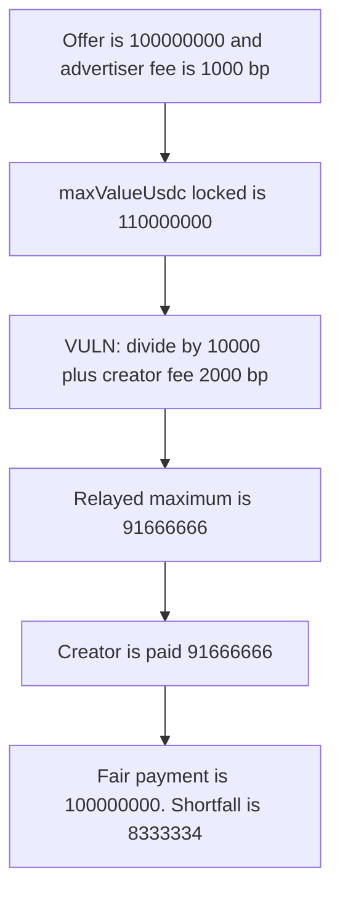

# Tunnl: creator payment divides by the creator fee

> **Vulnerability classes:** vuln/logic/fee-calculation · vuln/logic/missing-check

> **Reproduction:** local synthetic. `sendFunctionsRequest` uses the audited divisor. No fork and no warp.

<!-- non-defihacklabs -->
<!-- source-auditvault: https://github.com/Auditware/AuditVault/blob/main/findings/34361-math-error-in-creator-payment-calculation-cyfrin-none-cyfrin.md -->
<!-- date: 2024-07 -->

## Key info

| | |
|---|---|
| **Protocol** | Tunnl |
| **Finding** | Cyfrin, AuditVault 34361 |
| **Vulnerable code** | `TunnlTwitterOffers.sendFunctionsRequest` |
| **Harm** | Creator is paid 91,666,666 USDC. The fair offer is 100,000,000 USDC. |
| **Chain** | local synthetic |

## TL;DR

The advertiser's locked amount is `maxOffer * (1 + advertiserFee) + flatFee`. With a 100,000,000 offer, a 1000 bp advertiser fee, and no flat fee, that lock is 110,000,000. `sendFunctionsRequest` backs the fee out with `creatorFeePercentageBP` (2000) instead of `advertiserFeePercentageBP` (1000). The relayed maximum, which is paid in full, is 91,666,666. The fair payment is 100,000,000. The creator is short 8,333,334 USDC. The control divides by the advertiser fee and pays 100,000,000.

## The vulnerable code

```solidity
// @> VULN: divisor is creatorFeePercentageBP. It must be advertiserFeePercentageBP, so the creator is paid 91666666 instead of 100000000
maxCreatorPayment = uint256((s_offers[offerId].maxValueUsdc - s_offers[offerId].flatFeeUsdc) * 10000) / uint256(10000 + s_config.creatorFeePercentageBP);
// FIX: / uint256(10000 + s_offers[offerId].advertiserFeePercentageBP)
```

The audited expression is the one in the report: `(maxValueUsdc - flatFeeUsdc) * 10000 / (10000 + creatorFeePercentageBP)`. The fix the report gives is to divide by `10000 + advertiserFeePercentageBP` stored on the offer.

## Root cause

`maxValueUsdc` was inflated with the advertiser fee. Undoing that inflation with a different fee cannot recover the offer. 2000 bp is larger than 1000 bp, so the result is smaller than the offer and `fulfillRequest` does not hit `Exceeds max`. The nodes relay this maximum and the creator is paid that number, not a separate performance amount.

## Preconditions

An offer is open. `flatFeeUsdc` is 0. `maxValueUsdc` is 110,000,000. `advertiserFeePercentageBP` is 1000. `creatorFeePercentageBP` is 2000. The offer contract holds 110,000,000 USDC. No time lock is required for this payout; `run()` does not warp.

## Attack walkthrough

1. Config is creator fee 2000 bp, advertiser fee 1000 bp. The offer stores `maxValueUsdc = 110000000`.
2. `sendFunctionsRequest` computes `(110000000 - 0) * 10000 / (10000 + 2000) = 91666666`.
3. That 91,666,666 is packed into the request argument and paid to the creator.
4. The fair figure is `(110000000) * 10000 / (10000 + 1000) = 100000000`.
5. The creator's balance is 91,666,666. The offer contract keeps 18,333,334 instead of the 10,000,000 advertiser fee.

The control uses the advertiser fee as the divisor. The quoted payment and the creator's balance are both 100,000,000. 10,000,000 remains in the offer contract.

## Diagrams



## Impact

The creator is paid 91,666,666 USDC for an offer of 100,000,000 USDC. 8,333,334 USDC of the offer stays in the contract. Every payout that uses this formula is short by the same ratio whenever the creator fee is above the advertiser fee. The other direction, a creator fee below the advertiser fee, makes the relayed amount exceed the offer and `Exceeds max` reverts the payout.

## Remediation

Divide `(maxValueUsdc - flatFeeUsdc) * 10000` by `10000 + advertiserFeePercentageBP` from the offer, not by `10000 + creatorFeePercentageBP`.

## How to reproduce

```bash
cd 34361-math-error-in-creator-payment-calculation-cyfrin-none-cyfrin_exp
forge test -vv
```

The forge log shows `paid: 91666666` and `fair: 100000000`. The control log shows `control paid: 100000000`.

## Sources

- AuditVault finding: https://github.com/Auditware/AuditVault/blob/main/findings/34361-math-error-in-creator-payment-calculation-cyfrin-none-cyfrin.md
- Cyfrin report: https://github.com/solodit/solodit_content/blob/main/reports/Cyfrin/2024-07-01-cyfrin-tunnl-v2.0.md
- Fix: https://github.com/tunnl-io/Tunnl-Contracts/pull/37/files
