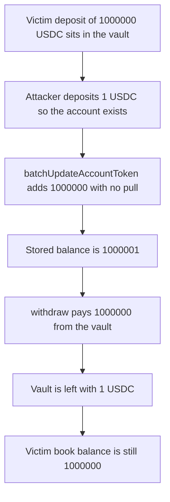

# Elfi — batchUpdateAccountToken credits a balance and the vault pays it

> **Vulnerability classes:** vuln/access-control/missing-modifier · vuln/access-control/missing-auth

> **Reproduction:** a self-contained Foundry PoC that compiles and runs offline
> with only `forge-std` — no fork and no RPC. Trace: [output.txt](output.txt).
> PoC: [test/34764-h-2-anyone-can-change-the-balance-of-an-account-to-drain-the_exp.sol](test/34764-h-2-anyone-can-change-the-balance-of-an-account-to-drain-the_exp.sol).

<!-- non-defihacklabs -->
<!-- source-auditvault: https://github.com/Auditware/AuditVault/blob/main/findings/34764-h-2-anyone-can-change-the-balance-of-an-account-to-drain-the.md -->
<!-- date: 2024-05 -->

---

## Key info

| | |
|---|---|
| **Impact** | **HIGH** — the attacker withdraws **1,000,000 USDC** from the portfolio vault after writing that amount into their account with no deposit |
| **Protocol** | Elfi `AccountFacet.batchUpdateAccountToken` |
| **Vulnerable code** | `AssetsProcess.updateAccountToken` adds the caller's delta and never pulls tokens |
| **Bug class** | Missing access control on an account-balance write |
| **Finding** | Sherlock — Elfi, May 2024 · id 34764, H-2 |
| **Report** | [sherlock-audit/2024-05-elfi-protocol-judging #28](https://github.com/sherlock-audit/2024-05-elfi-protocol-judging/issues/28) |
| **Source** | [AuditVault finding](https://github.com/Auditware/AuditVault/blob/main/findings/34764-h-2-anyone-can-change-the-balance-of-an-account-to-drain-the.md) |
| **Status** | Fixed by removing the call or gating it. Reproduced here as a local synthetic. |
| **Compiler** | solc 0.8.27, cancun, via IR |

---

## TL;DR

`batchUpdateAccountToken` is external and has no role check. It calls `updateAccountToken`, which adds `changedTokenAmounts` to an existing account and does not transfer tokens.

The victim's **1,000,000 USDC** sits in the portfolio vault. The attacker deposits **1 USDC** so the account exists, then credits **1,000,000 USDC** and withdraws it. The vault is left with **1 USDC**. The victim's book balance is still **1,000,000**.

`run()` does not warp.

## The vulnerable code

```solidity
function batchUpdateAccountToken(address account, int256 delta) external virtual {
    require(exists[account], "exists");
    // @> VULN: no role check and no token transfer; the caller writes the balance
    if (delta > 0) balanceOf[account] += uint256(delta);
}
```

Withdraw then pays `balanceOf[msg.sender]` out of the shared vault. The audited function is `AccountFacet.batchUpdateAccountToken` at `AccountFacet.sol` L68-L71, which forwards to `AssetsProcess.updateAccountToken` with the same missing pull.

## Root cause

The balance used by withdraw is a stored integer. The only permissionless writer was supposed to be `deposit`, which pulls tokens into the vault first. `batchUpdateAccountToken` writes the integer and skips the pull. The account must already exist (`checkExists` in the audited library); one real unit of deposit satisfies that.

## Preconditions

- The portfolio vault holds the victim deposit of **1,000,000 USDC** (6 decimals).
- The attacker has an existing account, opened here with a **1 USDC** deposit.
- No timestamp change happens inside `run()`.

## Attack walkthrough

1. Deposit **1,000,000 USDC** for the victim. The vault holds it and the book balance is **1,000,000**.
2. Deposit **1 USDC** for the attacker so `exists[attacker]` is true.
3. `batchUpdateAccountToken(attacker, +1_000_000e6)` raises the stored balance to **1,000,001** without a transfer.
4. `withdraw(1_000_000e6)` pays that amount from the vault. The attacker holds **1,000,000 USDC**. The vault holds **1 USDC**.

Control: the same credit on a book that requires a guardian reverts, and the attacker's withdraw of **1,000,000** cannot run. The vault still holds the victim's **1,000,000 USDC**.

## Diagrams



## Impact

The attacker receives **1,000,000 USDC** that was the victim's deposit. The victim's stored balance is unchanged, so the vault is short by that amount for every later honest withdrawal.

## Remediation

Remove `batchUpdateAccountToken`, or restrict it to the keeper role and pull or burn the tokens that the delta claims to add.

## Sources

- [AuditVault finding 34764](https://github.com/Auditware/AuditVault/blob/main/findings/34764-h-2-anyone-can-change-the-balance-of-an-account-to-drain-the.md)
- [Sherlock judging issue 28](https://github.com/sherlock-audit/2024-05-elfi-protocol-judging/issues/28)
- Audited tree: [elfi-perp-contracts AccountFacet.sol](https://github.com/sherlock-audit/2024-05-elfi-protocol/blob/8a1a01804a7de7f73a04d794bf6b8104528681ad/elfi-perp-contracts/contracts/facets/AccountFacet.sol#L68-L71)

### Taxonomy

- `severity/high`
- `vuln/access-control/missing-modifier`
- `vuln/access-control/missing-auth`
